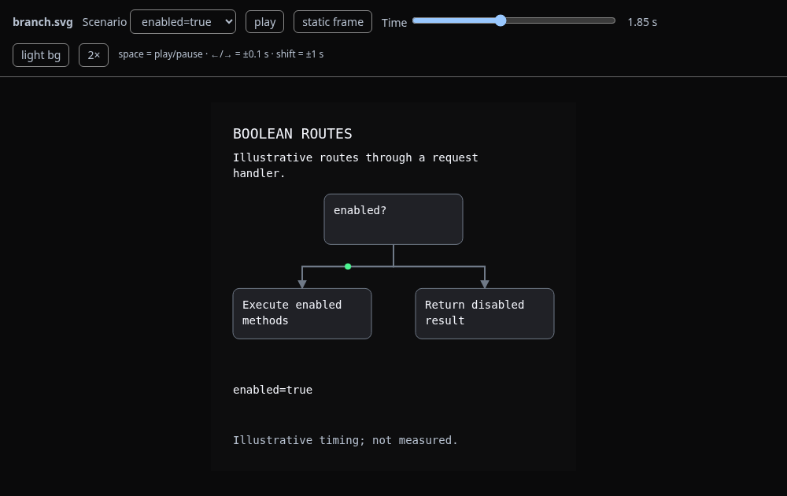
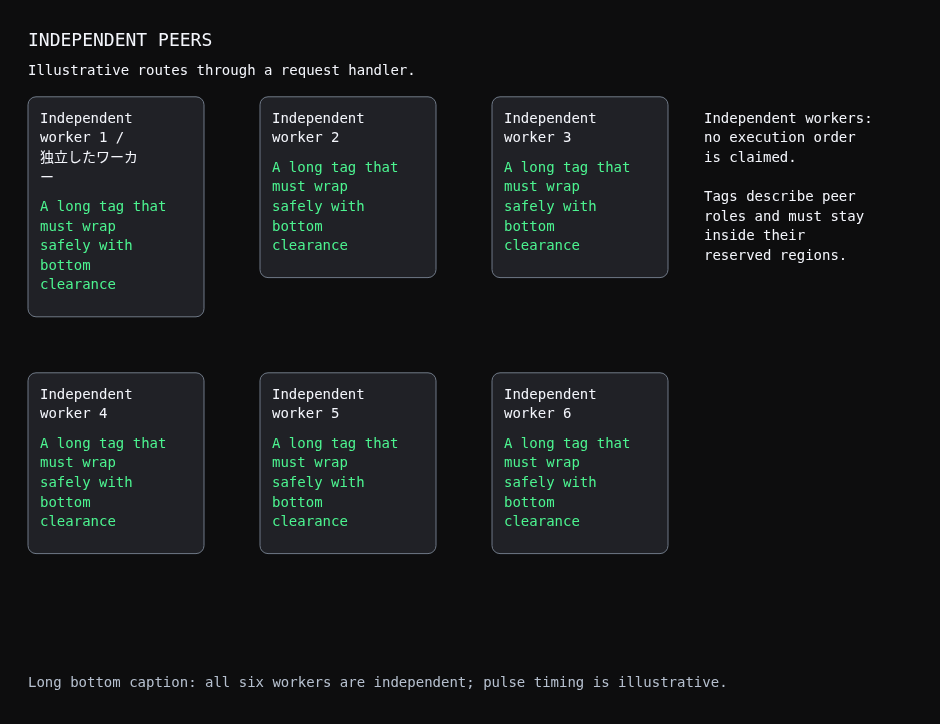

# Phase 3 validation and remaining acceptance

Scenario-selecting HTML is implemented through the verified wrapper. Standalone animated SVG, compact semantic spec and companion remain the primary assets. The audited commit and SHA-256 manifest are unchanged. New preview/layout code is project-owned and independently reviewed.

## Representative frames



The selected boolean preview is paused at 1.85 seconds; the other route stays visible while only the enabled route animates. [Boolean SVG](../../../skills/sl-svg-diagram/tests/fixtures/branch.svg), [spec](../../../skills/sl-svg-diagram/tests/fixtures/branch.spec.json), and [companion](../../../skills/sl-svg-diagram/tests/fixtures/branch.agent.md).



The grid frame uses reduced motion to inspect labels and outer regions. It includes the wide Unicode regression label, long tags, a right explanation and bottom caption. These are non-sensitive hypothetical fixtures. [Grid SVG](../../../skills/sl-svg-diagram/tests/fixtures/grid.svg), [spec](../../../skills/sl-svg-diagram/tests/fixtures/grid.spec.json), and [companion](../../../skills/sl-svg-diagram/tests/fixtures/grid.agent.md). More examples and exact review commands are in the [user review guide](user-review-guide.md).

## Commands and results

Environment: Python 3.12.14, Playwright 1.62.0, Chromium 156.0.8078.79 (`/usr/bin/chromium`). Browser processes and subprocesses ran in `unshare --user --map-root-user --net`, with no default route and a failed external socket probe. Managed Chromium blocks file URLs, so identical local HTML/SVG bytes were supplied inline. Rendering used no external diagram service; fixtures and review frames are published in this PR.

The final runnable commands are:

```sh
python3 -I skills/sl-svg-diagram/tests/run.py /workspace/animdiagram-audited
python3 -I skills/sl-svg-diagram/scripts/run-animdiagram.py setup --skill-dir /workspace/svg-review-artifacts/final-root-installed --dependency-dir /workspace/animdiagram-audited
python3 -I skills/sl-svg-diagram/tests/smoke.py --skill-dir /workspace/svg-review-artifacts/final-root-installed --output-dir /workspace/svg-review-artifacts/final-root-smoke
unshare --user --map-root-user --net python3 skills/sl-svg-diagram/tests/browser_layout.py --examples-dir /workspace/svg-review-artifacts/final-root-smoke --output-dir /workspace/svg-review-artifacts/final-root-layout
unshare --user --map-root-user --net python3 skills/sl-svg-diagram/tests/browser_preview.py --examples-dir /workspace/svg-review-artifacts/final-root-smoke --output-dir /workspace/svg-review-artifacts/final-root-playback
```

Install/smoke destinations must be fresh when reproducing these commands. Use your own disposable paths; never replace a personal installation/profile. Setup's upstream tests passed 8/8. The complete deterministic entry point passed **43 tests**: 15 wrapper, 12 generation and 16 preview checks. The root independently installed and ran this final smoke suite. The reviewer separately passed its full 41-test snapshot before the two additional generator precision regressions; those two also passed, and the root's final suite includes them.

Eight real Chromium layout checks cover four semantic fixtures at intended 1000px and narrow 360px widths. Node/tag containment and outer/bottom clearance passed at both widths. Readability passed at intended width; narrow branch/grid/enum labels are **unreadable** and need alternate layouts. The flow stays readable. The HTML preview reports narrow unreadability; these are not claims that all widths pass readability. Auxiliary legacy SVGs are explicitly skipped by the semantic layout runner and exercised by playback tests.

Independent full browser playback passed after the final harness fixes. The root also reran and passed both final browser suites against its fresh smoke outputs (`final-root-layout/layout.json` and `final-root-playback/playback.json`). The report records boolean order `[0,1,0]` and enum order `[0,1,2,3,0]`, all authored outcomes/resets, and exclusive named-scenario repeats. Assertions inspect actual computed opacity/transforms, including other-scenario captions immediately before boundaries and at the next start. Full cycles use virtual browser time; a separate approximately 0.24-second real-time sample verifies speed and pause/resume. Controls, keyboard focus, scrubbing/static-frame ranges, ambient stream/tick continuity and freeze, metadata-free preview, standalone image animation and reduced motion passed.

For standalone SVG images this Chromium does not propagate page-level reduced-motion emulation into the image document. The final test uses both an explicit reduced-motion page context and a separate browser process with `--force-prefers-reduced-motion=reduce`. The host media query is true and embedded-image screenshots are stable. The normal browser demonstrates changing image frames. This is actual rendering evidence, not a replacement with XML assertions.

## Reviewed fixes and supported limits

Independent SOL review identified caption pre-fades leaking into adjacent scenarios. Positive caption fades and guards now live inside setup/reset; windows use the compiler's centisecond loop clock. An `edge=0` attempt was rejected by real-browser evidence because duplicate keyframe offsets interpolate unexpectedly. Final browser probes confirm other-scenario caption opacity is zero through selected boundaries.

Legacy selection now resolves schedules through the real compiler in a verified snapshot, checks exact SVG/spec motion pairing and complete pre/post effect tails, and rejects conflicting opacity values at collapsed emitted percentage offsets. Regressions include tiny packets/pulses, ring tails, pre-fades and rounding that moves a start before its boundary. Generated builds also inspect emitted visibility offsets before publishing. The versioned precision budget limits loops to 250 seconds; unrepresentable effects/long loops fail with shorter-loop/longer-effect guidance. Legacy bar/moving-group selection is unsupported; ordinary `--plain` preview remains available. Supported topology is still chain/tree/independent grid, with manual authoring for other shapes.

Additional regressions cover stale SVG/spec metadata, safe `</script>` labels and placeholder text, direct/symlink/hardlink output aliases, light/dark conversion with valid scenario pairing, repeated build/preview cycles, preserved personal preferences and legacy commands. Tests use explicit disposable paths and a subprocess-only `Path.home` mock; they do not repurpose `HOME` or touch the real profile. The full upstream MIT notice accompanies the adapted preview controls in the installed bundle.

## Evidence and pending live trials

Independent reports and screenshots are retained outside the repository in `/workspace/svg-review-artifacts/phase3/`, including `tests-final-candidate.log`, `final-review-smoke/integration.log`, `layout-final-review/layout.json` and `browser-final-accepted/playback.json`. Root artifacts are under `final-root-*`; focused generation regression output is `phase3-generation-tests-final.txt`. The two compact frames above are committed for human review. Raw/private transcripts are not included.

**Live installed Claude acceptance is unrun.** Claude Code and an approved authenticated connection are unavailable in this environment. The [user review guide](user-review-guide.md#prepare-real-claude-acceptance-safely) gives disposable project-scoped candidate installation, normal authentication, explicit temporary personal-preference paths, known-fixture prompts and transcript/artifact checks for boolean/grid/enum creation, one-time versus remembered refinement, and a fresh reading session. Script tests and browser renders do not establish model skill selection or preference persistence behavior during a real session.

Actual creation/refinement model usage remains unavailable. [Phase 2's report](phase2-validation.md#creationrefinement-measurements) records explicitly labeled authoring-character/tool-output proxies; no percentage token saving is claimed. Keep the PR draft while required live evidence is pending unless the user explicitly accepts that limitation. The user's review and later explicit approval remain required before merging.
