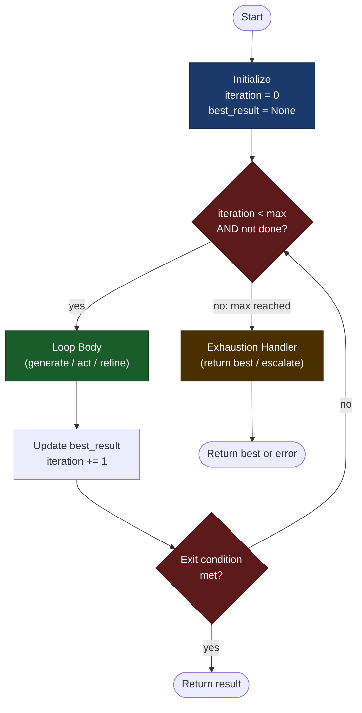

# Bounded Loop

## 1. Problem

Many agent and workflow patterns require a loop: refine until quality is sufficient, act until the task is complete, retry until success. An unbounded loop is a latency bomb and a cost sink: a misconfigured prompt, a moving target, or a persistent external failure can cause the loop to run indefinitely. The problem is not the loop itself — loops are necessary — but the absence of an explicit, enforced termination contract. Every loop must have a maximum iteration bound, a clear exit condition, and a defined behavior when the bound is reached.

## 2. Solution Structure

Every loop is designed with three explicit components: (1) an **exit condition** that terminates the loop on success, (2) a **maximum iteration cap** that terminates the loop when the budget is exhausted, and (3) an **exhaustion handler** that defines what to return or do when the cap is reached (return best result, escalate, raise an error). The cap and exit condition are both checked at the top of each iteration, not just at the end. The cap is not a magic number — it is derived from the task's expected difficulty and the cost of an iteration.

<details>
<summary><b>Bounded Loop — Wiring Diagram</b></summary>



</details>

## 3. When to Use

- Any iterative pattern: refinement, retry, ReAct, generator-critic, evaluator-optimizer.
- The number of iterations required is not known upfront and depends on runtime state.
- The loop cost (tokens, time, money) is non-negligible and must be capped.
- The loop may encounter persistent failures (external tool errors, evaluator that never passes) that would otherwise run forever.
- You need a defined, predictable behavior when the task cannot be completed within budget.

## 4. When Not to Use

- The iteration count is exactly known at design time — use a fixed-length [Prompt Chain](prompt-chaining.md) instead.
- The loop is a one-time call (not actually iterative) — Bounded Loop is a structural constraint, not applicable to single calls.
- The task genuinely requires an unbounded number of iterations (e.g., a long-running daemon) — but in this case, you still need external timeout and budget controls, just not an in-loop cap.

## 5. Trade-offs

| Benefit | Cost / Risk |
|---|---|
| Guarantees loop termination regardless of exit condition behavior | Cap choice is heuristic; too low causes premature exit and quality loss |
| Defines system behavior at exhaustion — no silent infinite spend | Exhaustion returns best-effort result; callers must handle non-passing outputs |
| Tracking best result across iterations recovers quality even if final iteration is worse | Overhead of tracking best result and iteration count is minor but must be designed in |
| Makes loop cost predictable: bounded by max_iterations × per-iteration cost | A cap that is too high still permits significant cost accumulation before termination |
| Forces explicit reasoning about expected iteration count during design | None — this is a pure governance pattern with no functional downsides |

## 6. Implementation Sketch

```
function bounded_loop(task, loop_body, exit_condition, max_iterations, on_exhausted):
    """
    Generic bounded loop scaffolding.

    loop_body(state) -> new_state
    exit_condition(state) -> bool
    on_exhausted(state) -> result
    """
    state = initialize(task)
    best_state = None
    best_score = -inf

    for iteration in range(max_iterations):
        state = loop_body(state, iteration=iteration)

        # Track best result across iterations
        score = score_state(state)
        if score > best_score:
            best_score = score
            best_state = state

        if exit_condition(state):
            return LoopResult(
                output=state.output,
                iterations=iteration + 1,
                exhausted=False
            )

    # Cap reached — invoke exhaustion handler
    return on_exhausted(best_state)


# Example: bounded refinement loop
result = bounded_loop(
    task=my_task,
    loop_body=lambda state, iteration: refine(state, iteration),
    exit_condition=lambda state: evaluator.passes(state.output),
    max_iterations=5,
    on_exhausted=lambda best: LoopResult(output=best.output, exhausted=True)
)

if result.exhausted:
    log_warning("Loop exhausted without passing exit condition")
    # Caller decides: escalate, use best-effort, or fail hard
```

Key wiring decisions:
- `best_state` is tracked throughout the loop so exhaustion returns the best result achieved, not just the last.
- The exhaustion handler is a first-class parameter, not an afterthought — it must be defined before the loop runs.
- `iteration` is passed to `loop_body` so the body can adapt its strategy as the budget runs low (e.g., switch to a more conservative approach on the last iteration).
- Cap is set based on task analysis: expected difficulty, per-iteration cost, acceptable total budget.

## 7. Related Patterns

- [Iterative Refinement](iterative-refinement.md) — the canonical use case for Bounded Loop.
- [Generator-Critic](generator-critic.md) — the revision cycle must be bounded.
- [Evaluator-Optimizer](evaluator-optimizer.md) — the optimization loop requires a max-iteration cap.
- [ReAct](react.md) — the Thought-Action-Observation cycle must have a `max_steps` bound.
- [Family I — Reliability & Recovery](../I-reliability-recovery/README.md) — loop termination is a reliability property; see timeout, retry budget, and circuit breaker patterns there.

## 8. Anti-Patterns Addressed

**Infinite/Weakly Bounded Agent Loop** — Bounded Loop is the direct structural response to this anti-pattern. Every loop must have an explicit cap enforced in code, not just "it should converge eventually."

**Retry Without New Information** — by tracking best result and requiring the loop body to produce new state on each iteration, Bounded Loop forces the design question: what new information drives each iteration?
---

## Sources

- Anthropic — [Building Effective Agents](https://www.anthropic.com/engineering/building-effective-agents)
- OpenAI — [A Practical Guide to Building AI Agents](https://openai.com/business/guides-and-resources/a-practical-guide-to-building-ai-agents/)
- Google — [Choose a Design Pattern for Agentic AI](https://docs.cloud.google.com/architecture/choose-design-pattern-agentic-ai-system)
- AWS — [Agentic AI Patterns](https://docs.aws.amazon.com/prescriptive-guidance/latest/agentic-ai-patterns/agent-patterns.html)
- Microsoft Azure — [AI Agent Design Patterns](https://learn.microsoft.com/en-us/azure/architecture/ai-ml/guide/ai-agent-design-patterns)
