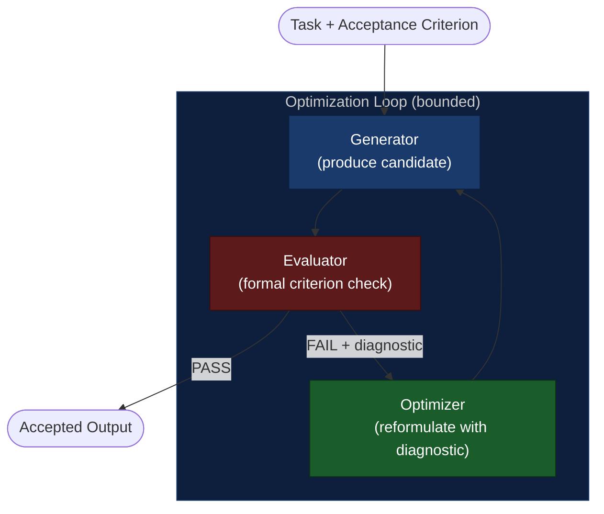

# Evaluator-Optimizer

## 1. Problem

Many generation tasks have a measurable acceptance criterion — a test suite that must pass, a schema that must validate, a score that must exceed a threshold, a constraint that must hold. A generator that produces output without checking against this criterion may deliver work that looks correct but fails in practice. Running an evaluator after generation and discarding failures wastes the evaluator's signal: the system knows *what* failed but does nothing with that knowledge. The task needs a tight loop where the evaluator's verdict and diagnostic information actively drive the generator's next attempt.

## 2. Solution Structure

A Generator produces a candidate. An Evaluator applies a formal, deterministic (or near-deterministic) criterion to the candidate and returns a structured verdict: pass/fail plus a diagnostic. If the candidate passes, it is returned. If it fails, the diagnostic is fed back to the Generator as part of a revised generation request. The loop repeats until the candidate passes or a maximum iteration count is reached.

<details>
<summary><b>Evaluator-Optimizer — Wiring Diagram</b></summary>



</details>

## 3. When to Use

- The acceptance criterion is formal and checkable without human judgment (e.g., unit tests, JSON schema validation, constraint satisfaction, benchmark score).
- The generator is capable of producing a passing output given sufficient diagnostic feedback — the criterion is not trivially unsatisfiable.
- Evaluation is cheaper than generation, making the loop cost-effective.
- The diagnostic from a failed evaluation is informative enough to guide a meaningful revision.
- You cannot pre-specify all constraints as generator instructions — some are only checkable after the fact.

## 4. When Not to Use

- The acceptance criterion is subjective or requires human judgment — use [Generator-Critic](generator-critic.md) with an LLM critic instead.
- The evaluator is unreliable or noisy — a flaky criterion causes the optimizer to chase phantom failures.
- The generator consistently fails after N attempts — the criterion may be too strict or the generator fundamentally under-specified.
- A single well-prompted generation reliably passes the criterion — the loop adds cost without benefit.

## 5. Trade-offs

| Benefit | Cost / Risk |
|---|---|
| Acceptance criterion is explicit, auditable, and consistent | Evaluator must be precise; vague or noisy criteria cause the loop to chase false failures |
| Failed evaluations generate informative diagnostics that improve next attempt | Generator may overfit to the evaluator's specific checks while missing the actual goal |
| Eliminates manual verification for criterion-satisfying outputs | Loop cost grows if the generator requires many iterations to pass |
| Formal criterion is independent of LLM output style | Max-iteration exit may return an output that never passed — callers must handle this |
| Can compose multiple evaluators (e.g., test suite AND schema check) | Composing evaluators increases rejection rate; all criteria must pass simultaneously |

## 6. Implementation Sketch

```
function evaluator_optimizer(task, evaluator, max_iterations=5):
    candidate = call_llm(
        system=GENERATOR_SYSTEM_PROMPT,
        user=render(GENERATION_TEMPLATE, task=task)
    )

    for iteration in range(max_iterations):
        verdict = evaluator.evaluate(candidate)

        if verdict.passed:
            return OptimizationResult(
                output=candidate,
                iterations=iteration + 1,
                passed=True
            )

        # Build optimizer prompt from diagnostic
        optimizer_prompt = render(OPTIMIZER_TEMPLATE,
            original_task=task,
            failed_candidate=candidate,
            failure_reason=verdict.diagnostic,
            iteration=iteration + 1,
            max_iterations=max_iterations
        )
        candidate = call_llm(
            system=GENERATOR_SYSTEM_PROMPT,
            user=optimizer_prompt
        )

    return OptimizationResult(
        output=candidate,
        iterations=max_iterations,
        passed=False,
        last_diagnostic=verdict.diagnostic
    )


# Example evaluator: unit test runner
class UnitTestEvaluator:
    def evaluate(self, candidate_code):
        results = run_tests(candidate_code, self.test_suite)
        if results.all_passed:
            return Verdict(passed=True)
        failed = [t.name + ": " + t.error for t in results.failures]
        return Verdict(passed=False, diagnostic="\n".join(failed))
```

Key wiring decisions:
- The Evaluator is a pure function: same input always produces the same verdict (deterministic criterion).
- `OPTIMIZER_TEMPLATE` includes the original task, failed candidate, and specific failure reason — the three pieces of information the generator needs to improve.
- Iteration count and max are passed to the generator so it can adjust strategy as attempts run out.

## 7. Related Patterns

- [Generator-Critic](generator-critic.md) — replaces the formal evaluator with an LLM critic; use when criteria are subjective or hard to formalize.
- [Iterative Refinement](iterative-refinement.md) — similar loop structure without a formal evaluator; quality is assessed by heuristics or LLM judgment.
- [Bounded Loop](bounded-loop.md) — provides the loop termination guarantee; every Evaluator-Optimizer must implement a max-iteration cap.
- [Family B — Task Decomposition](../B-task-decomposition/README.md) — decomposing a failing candidate into sub-criteria can help the optimizer target specific failures.
- [Family C — Orchestration](../C-orchestration/README.md) — when the evaluator is an external service or tool that the orchestrator manages.

## 8. Anti-Patterns Addressed

**Self-Certified Completion** — the evaluator is structurally independent of the generator; the generator cannot influence the pass/fail verdict.

**Retry Without New Information** — the optimization step transforms the evaluator's diagnostic into a targeted revision request; each generation attempt is informed by specific failure evidence, not a blind retry.

**Infinite/Weakly Bounded Agent Loop** — the max-iteration cap is a first-class parameter; the loop always terminates, and the caller receives a clear signal when the cap is reached.
---

## Sources

- Anthropic — [Building Effective Agents](https://www.anthropic.com/engineering/building-effective-agents)
- OpenAI — [A Practical Guide to Building AI Agents](https://openai.com/business/guides-and-resources/a-practical-guide-to-building-ai-agents/)
- Google — [Choose a Design Pattern for Agentic AI](https://docs.cloud.google.com/architecture/choose-design-pattern-agentic-ai-system)
- AWS — [Agentic AI Patterns](https://docs.aws.amazon.com/prescriptive-guidance/latest/agentic-ai-patterns/agent-patterns.html)
- Microsoft Azure — [AI Agent Design Patterns](https://learn.microsoft.com/en-us/azure/architecture/ai-ml/guide/ai-agent-design-patterns)
