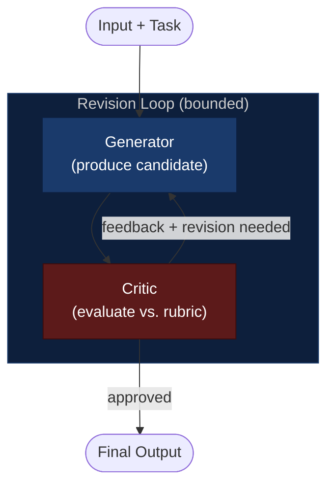

# Generator-Critic

## 1. Problem

A generative LLM is optimized to produce fluent, plausible-sounding outputs — but this same fluency makes it a poor critic of its own work. Self-review in a single prompt suffers from confirmation bias: the model evaluates its output against the reasoning it used to produce it, not against an independent standard. The result is that errors, logical gaps, and hallucinations survive self-review at high rates. The task requires a mechanism that separates the act of generating from the act of evaluating, with the critic operating from a clean perspective.

## 2. Solution Structure

Two distinct roles operate in sequence: a Generator produces a candidate output, and a Critic evaluates that output against an explicit rubric or set of criteria, producing structured feedback. The orchestrator decides whether to pass the output (if the critic approves) or feed the critic's feedback back to the Generator for a revised attempt. The Critic never sees the Generator's reasoning — only the Generator's output and the evaluation criteria.

<details>
<summary><b>Generator-Critic — Wiring Diagram</b></summary>



</details>

## 3. When to Use

- Generated outputs are creative, complex, or open-ended in ways that make rule-based validation insufficient.
- The evaluation criteria are expressible in a prompt (e.g., "check for factual claims without citations", "verify all edge cases are handled").
- A first draft is likely good enough to critique but not to ship directly.
- The critic's feedback is specific enough to guide targeted revision — not just "this is wrong."
- You want a separation between creative latitude (generator) and standards enforcement (critic).

## 4. When Not to Use

- The acceptance criterion is formal and mechanically checkable — use [Evaluator-Optimizer](evaluator-optimizer.md) with an automated evaluator instead.
- The task is simple and a single prompt with explicit instructions handles it reliably.
- The critic itself is unreliable (e.g., it tends to approve everything) — a bad critic is worse than no critic.
- Use [Parallel Voting](parallel-voting.md) when you need consensus across multiple independent samples rather than adversarial critique.

## 5. Trade-offs

| Benefit | Cost / Risk |
|---|---|
| Critic is free from generator's anchoring bias | Critic prompt engineering is non-trivial; vague rubrics produce vague feedback |
| Structured feedback enables targeted revision, not blind retry | Adds at least one extra LLM call per revision cycle |
| Clear separation of responsibilities: creativity vs. standards | Generator may converge to outputs that satisfy the critic rather than the actual goal (Goodhart's Law) |
| Critic rubric is explicit and auditable | If critic and generator use the same base model, correlated blind spots remain |
| Can gate on critic approval before committing output | Loop must be bounded; a persistent disagreement between generator and critic can spin indefinitely |

## 6. Implementation Sketch

```
CRITIC_RUBRIC = """
Evaluate the candidate output against these criteria:
1. Factual accuracy: no unsupported claims
2. Completeness: all requirements addressed
3. Clarity: no ambiguous statements

Return JSON: {"approved": bool, "issues": [{"criterion": str, "detail": str}]}
"""

function generator_critic(task_input, max_rounds=3):
    candidate = call_llm(
        system=GENERATOR_SYSTEM_PROMPT,
        user=task_input
    )

    for round in range(max_rounds):
        critique = call_llm(
            system=CRITIC_SYSTEM_PROMPT,
            user=render(CRITIC_RUBRIC, candidate=candidate)
        )
        result = parse_json(critique)

        if result["approved"]:
            return ApprovedOutput(output=candidate, rounds=round + 1)

        # Build revision request from structured issues
        revision_request = format_revision_request(task_input, candidate, result["issues"])
        candidate = call_llm(
            system=GENERATOR_SYSTEM_PROMPT,
            user=revision_request
        )

    return ExhaustedOutput(output=candidate, issues=result["issues"])


function format_revision_request(original_task, current_draft, issues):
    issue_list = "\n".join(f"- [{i['criterion']}] {i['detail']}" for i in issues)
    return f"{original_task}\n\nCurrent draft:\n{current_draft}\n\nIssues to fix:\n{issue_list}"
```

Key wiring decisions:
- The Critic receives only the candidate and the rubric — not the Generator's system prompt or reasoning.
- Critique output is structured JSON, not free-form text, so revision requests are precise.
- The revision request includes the original task to prevent the Generator from losing the goal while fixing issues.

## 7. Related Patterns

- [Iterative Refinement](iterative-refinement.md) — a simpler loop without a distinct critic role; use Generator-Critic when critique logic is non-trivial.
- [Evaluator-Optimizer](evaluator-optimizer.md) — replaces the LLM critic with a formal, measurable acceptance criterion.
- [Sequential Workflow](sequential-workflow.md) — if the critic is a one-time review (no loop), this is a two-stage sequential workflow.
- [Bounded Loop](bounded-loop.md) — provides the loop safety mechanism; Generator-Critic must always be bounded.
- [Family C — Orchestration](../../C-orchestration/README.md) — when Generator and Critic are deployed as separate agents with independent state.

## 8. Anti-Patterns Addressed

**Self-Certified Completion** — the Critic is a structurally separate call that cannot access the Generator's reasoning, eliminating the anchoring effect that makes self-review unreliable.

**Retry Without New Information** — the Critic provides specific, structured issues that become the Generator's revision instructions; each retry is guided by new diagnostic information, not a blind re-run.
---

## Sources

- Anthropic — [Building Effective Agents](https://www.anthropic.com/engineering/building-effective-agents)
- OpenAI — [A Practical Guide to Building AI Agents](https://openai.com/business/guides-and-resources/a-practical-guide-to-building-ai-agents/)
- Google — [Choose a Design Pattern for Agentic AI](https://docs.cloud.google.com/architecture/choose-design-pattern-agentic-ai-system)
- AWS — [Agentic AI Patterns](https://docs.aws.amazon.com/prescriptive-guidance/latest/agentic-ai-patterns/agent-patterns.html)
- Microsoft Azure — [AI Agent Design Patterns](https://learn.microsoft.com/en-us/azure/architecture/ai-ml/guide/ai-agent-design-patterns)
