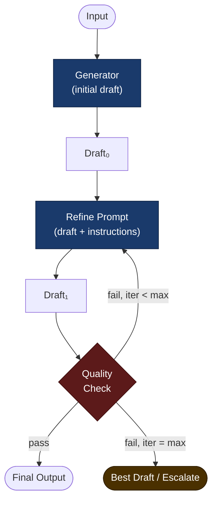

# Iterative Refinement

## 1. Problem

A first-generation output is directionally correct but not yet production-quality. The gap between draft and final is real but the refinement needed is not precisely specifiable upfront — it depends on what the draft actually contains. A single pass cannot close this gap reliably, but designing a fixed multi-step chain is impractical when the improvement needed varies by draft. The task needs a feedback loop that improves the output incrementally until a quality threshold is met, without knowing in advance how many passes are required.

## 2. Solution Structure

Generate an initial draft. Apply a refinement prompt that takes the current draft plus a refinement instruction (or critique) and produces an improved version. Repeat until a stopping condition is met: a quality evaluator approves the output, a maximum iteration count is reached, or the delta between iterations falls below a threshold. Each iteration operates on the previous iteration's output, not on the original input.

<details>
<summary><b>Iterative Refinement — Wiring Diagram</b></summary>



</details>

## 3. When to Use

- The initial draft is structurally sound but needs polishing (tone, clarity, accuracy, completeness).
- The refinement criteria can be expressed as a prompt instruction (e.g., "make this more concise", "fix factual claims", "improve code readability").
- Quality improvement per iteration is observable and measurable, even if not formally scored.
- The number of iterations needed varies across inputs and cannot be hardcoded.
- You have a convergence signal: a rubric, an evaluator call, or a structural check.

## 4. When Not to Use

- The initial draft is fundamentally wrong — iterative refinement polishes, it does not reconstruct. Start with a better generator prompt.
- The improvement criteria are vague (e.g., "make it better") — refinement will spin on surface changes without converging.
- A single well-designed prompt reliably produces quality output — adding a refinement loop wastes tokens.
- Use [Generator-Critic](generator-critic.md) when the critique logic is more complex than a simple refinement instruction.
- Use [Evaluator-Optimizer](evaluator-optimizer.md) when the acceptance criterion is formal and measurable (e.g., passes tests, score > threshold).

## 5. Trade-offs

| Benefit | Cost / Risk |
|---|---|
| Accommodates variable quality gaps without fixed chain length | Convergence is not guaranteed; the loop may cycle or plateau |
| Each iteration can target a specific improvement dimension | Each iteration adds latency; poor convergence multiplies cost |
| Later iterations can specialize (e.g., first for content, then for style) | Refinement prompts can introduce new errors while fixing old ones (regression) |
| Max-iteration cap prevents infinite loops | Early exit at max iterations may produce a draft that passed no quality check |
| Works with any output type (text, code, structured data) | Quality check must be more reliable than the generator to be useful |

## 6. Implementation Sketch

```
function iterative_refinement(input, max_iterations=5):
    draft = call_llm(
        system=GENERATOR_SYSTEM_PROMPT,
        user=input
    )

    for iteration in range(max_iterations):
        quality = evaluate_quality(draft)

        if quality.passes:
            return RefinementResult(output=draft, iterations=iteration, quality=quality)

        refinement_instruction = quality.improvement_notes  # from evaluator
        draft = call_llm(
            system=REFINER_SYSTEM_PROMPT,
            user=render(REFINE_TEMPLATE,
                        current_draft=draft,
                        instruction=refinement_instruction,
                        iteration=iteration + 1)
        )

    # Exhausted iterations
    return RefinementResult(output=draft, iterations=max_iterations, quality=None, exhausted=True)


function evaluate_quality(draft):
    # Options: rule-based check, LLM evaluator, unit tests, schema validation
    # Returns: {passes: bool, improvement_notes: str, score: float}
    ...
```

Key wiring decisions:
- The evaluator (`evaluate_quality`) is separate from the refiner; it must be more reliable than the generator.
- `improvement_notes` from the evaluator become the refinement instruction — making each iteration targeted rather than generic.
- Storing the best-scoring draft during iteration allows returning the best result even if the final iteration is worse.

## 7. Related Patterns

- [Prompt Chaining](prompt-chaining.md) — iterative refinement is a dynamic chain where loop count is determined at runtime.
- [Bounded Loop](bounded-loop.md) — provides the loop safety mechanism (max iterations cap) that every iterative refinement must implement.
- [Generator-Critic](generator-critic.md) — separates the critic into a distinct role with structured feedback; use when critique logic is non-trivial.
- [Evaluator-Optimizer](evaluator-optimizer.md) — adds a formal acceptance criterion as the convergence gate; use when "passes" means meeting a measurable spec.
- [Family I — Reliability & Recovery](../../I-reliability-recovery/README.md) — convergence failures are a reliability concern; see retry and fallback patterns there.

## 8. Anti-Patterns Addressed

**Infinite/Weakly Bounded Agent Loop** — the max-iteration cap is a first-class design element, not an afterthought; every refinement loop must have an explicit exit condition.

**Retry Without New Information** — each iteration provides the current draft plus specific evaluator-generated improvement notes, ensuring the refiner has new, targeted information rather than repeating the same call.
---

## Sources

- Anthropic — [Building Effective Agents](https://www.anthropic.com/engineering/building-effective-agents)
- OpenAI — [A Practical Guide to Building AI Agents](https://openai.com/business/guides-and-resources/a-practical-guide-to-building-ai-agents/)
- Google — [Choose a Design Pattern for Agentic AI](https://docs.cloud.google.com/architecture/choose-design-pattern-agentic-ai-system)
- AWS — [Agentic AI Patterns](https://docs.aws.amazon.com/prescriptive-guidance/latest/agentic-ai-patterns/agent-patterns.html)
- Microsoft Azure — [AI Agent Design Patterns](https://learn.microsoft.com/en-us/azure/architecture/ai-ml/guide/ai-agent-design-patterns)
