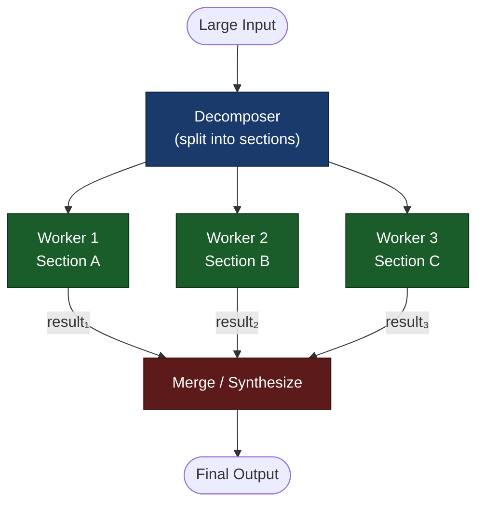

# Parallel Sectioning

## 1. Problem

A large input — a long document, a multi-part specification, a batch of items — exceeds what a single LLM call can process with consistent quality. Processing the full input sequentially through one chain creates unnecessary latency and causes quality degradation in the middle sections due to attention dilution. The sub-tasks are structurally independent: section A's output does not depend on section B's output. The task needs a strategy that exploits this independence to reduce latency and maintain per-section quality.

## 2. Solution Structure

Decompose the input into N independent sections. Dispatch each section to its own LLM call (the worker) in parallel. Collect all worker outputs and pass them to a merge step that assembles a coherent final output. The merge step may be a simple concatenation, a re-ranking, or a dedicated synthesis prompt depending on whether the outputs must be globally consistent.

<details>
<summary><b>Parallel Sectioning — Wiring Diagram</b></summary>



</details>

## 3. When to Use

- The input is larger than what fits comfortably in one context window at high quality.
- Sub-tasks are provably independent: no worker needs another worker's output to proceed.
- Total wall-clock time matters and parallelism is feasible in the deployment environment.
- Each section benefits from the same processing logic (same prompt, same model).
- The merge step can produce a globally coherent result from independently generated parts.

## 4. When Not to Use

- Sections have cross-dependencies (e.g., section B refers to entities introduced in section A) — process sequentially to maintain context.
- The merge step is so complex or lossy that the cost of reassembly exceeds the benefit of parallelism.
- N is very large (>50 sections) and the orchestration and merge overhead dominates — consider batching workers.
- The task requires global reasoning across the entire input (e.g., finding the single most important theme across all sections).

## 5. Trade-offs

| Benefit | Cost / Risk |
|---|---|
| Latency scales with the slowest worker, not total sections | Workers produce independently coherent sections that may be stylistically inconsistent |
| Each worker operates within a manageable context window | A merge/synthesis step is always required and adds cost and latency |
| Per-section quality is higher due to focused context | Section boundary artifacts: ideas that span sections may be incomplete in both |
| Parallelism is horizontally scalable | Decomposition must produce clean, non-overlapping sections — this is non-trivial for unstructured inputs |
| Failed sections can be retried individually | Total token cost is N × per-section cost plus merge cost |

## 6. Implementation Sketch

```
function parallel_sectioning(input, process_prompt, merge_prompt):
    # Step 1: decompose
    sections = split_input(input)  # deterministic: by paragraph, token count, or structural marker

    # Step 2: dispatch workers in parallel
    futures = [
        async_call_llm(
            system=WORKER_SYSTEM_PROMPT,
            user=render(process_prompt, section=s, index=i, total=len(sections))
        )
        for i, s in enumerate(sections)
    ]
    results = await_all(futures)

    # Step 3: handle failures
    for i, result in enumerate(results):
        if result.error:
            results[i] = retry_section(sections[i], process_prompt)

    # Step 4: merge
    assembled = "\n\n".join(
        f"[Section {i+1}]\n{r.content}" for i, r in enumerate(results)
    )
    final = call_llm(
        system=MERGE_SYSTEM_PROMPT,
        user=render(merge_prompt, assembled_results=assembled)
    )
    return final
```

Key wiring decisions:
- Workers receive `index` and `total` so they can write with awareness of their position (e.g., "this is section 2 of 5").
- Merge prompt receives labeled section outputs, not raw concatenation, so the synthesizer knows provenance.
- Individual section failures trigger targeted retry rather than full restart.

## 7. Related Patterns

- [Prompt Chaining](prompt-chaining.md) — the decompose and merge steps are themselves chained calls around the parallel fan-out.
- [Parallel Voting](parallel-voting.md) — runs the same prompt N times on the same input for consensus; Parallel Sectioning runs the same prompt on N different inputs.
- [Family B — Task Decomposition](../B-task-decomposition/README.md) — provides the decomposition strategies used in the split step.
- [Family N — Efficiency](../N-efficiency/README.md) — parallelism is a core efficiency lever; see token batching and cost strategies there.

## 8. Anti-Patterns Addressed

**Retry Without New Information** — by processing sections independently and merging, the pattern avoids re-submitting an oversized input that consistently degrades in the middle — a common cause of blind retries.
---

## Sources

- Anthropic — [Building Effective Agents](https://www.anthropic.com/engineering/building-effective-agents)
- OpenAI — [A Practical Guide to Building AI Agents](https://openai.com/business/guides-and-resources/a-practical-guide-to-building-ai-agents/)
- Google — [Choose a Design Pattern for Agentic AI](https://docs.cloud.google.com/architecture/choose-design-pattern-agentic-ai-system)
- AWS — [Agentic AI Patterns](https://docs.aws.amazon.com/prescriptive-guidance/latest/agentic-ai-patterns/agent-patterns.html)
- Microsoft Azure — [AI Agent Design Patterns](https://learn.microsoft.com/en-us/azure/architecture/ai-ml/guide/ai-agent-design-patterns)
