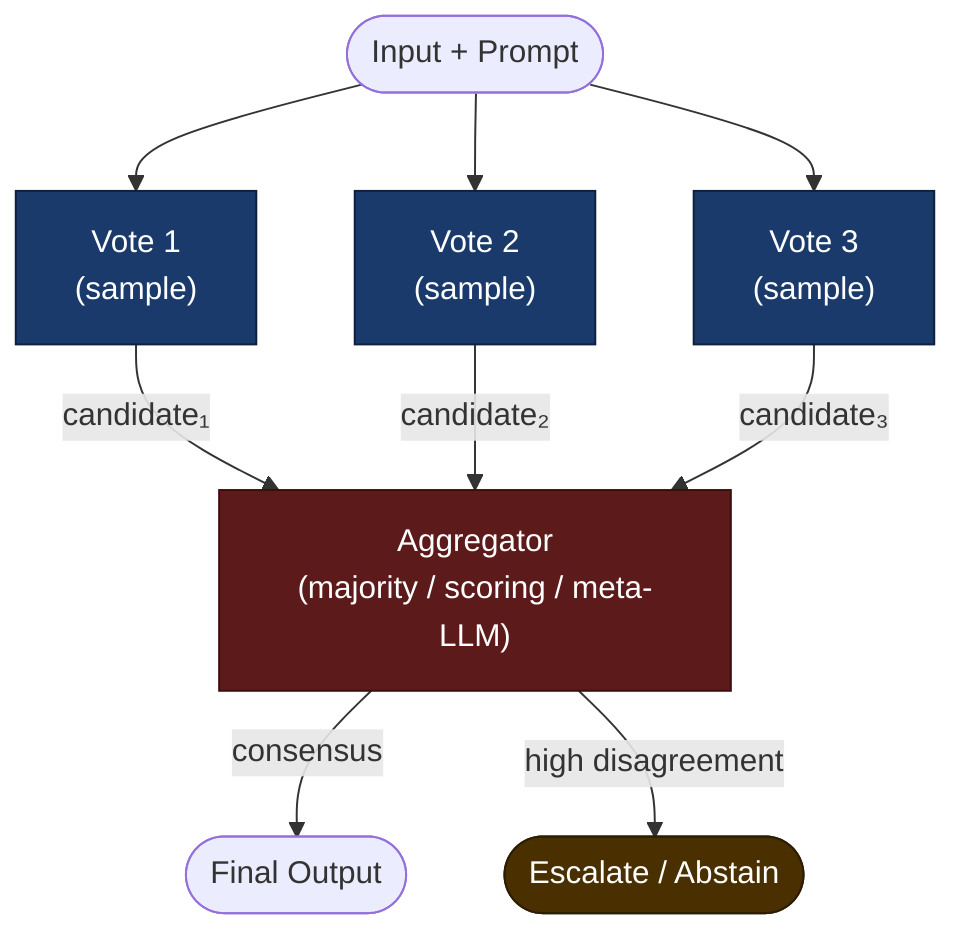

# Parallel Voting

## 1. Problem

A single LLM call for a high-stakes decision is unreliable: the model may hallucinate, take a locally optimal but globally wrong path, or produce outputs that vary significantly across runs due to sampling randomness. Running the same prompt once and trusting the result — especially for classification, code generation, or factual extraction — introduces unacceptable variance. The task needs a mechanism to reduce output variance and detect when the model is uncertain, without requiring a human in the loop.

## 2. Solution Structure

Run the same prompt N times in parallel (with temperature > 0 to induce variation). Collect all N outputs. Apply an aggregation strategy — majority vote, weighted scoring, or a meta-prompt that selects the best candidate — to produce a single consensus output. Disagreement across votes is itself a signal: high disagreement indicates low model confidence and should trigger escalation or abstention.

<details>
<summary><b>Parallel Voting — Wiring Diagram</b></summary>



</details>

## 3. When to Use

- The task has a correct or best answer (not purely subjective) and single-run reliability is insufficient.
- The output space is discrete or enumerable (classification labels, boolean decisions, structured outputs) — making majority vote tractable.
- You can tolerate N× cost in exchange for higher precision on high-value decisions.
- You need a confidence signal: disagreement rate across votes is a proxy for model uncertainty.
- Generating diverse candidate solutions and selecting the best is more reliable than generating one.

## 4. When Not to Use

- The output is continuous or highly open-ended (e.g., long-form prose) where "majority vote" is not meaningful — use [Generator-Critic](generator-critic.md) to select among diverse candidates instead.
- N× cost is not acceptable for the task's value profile.
- The model is deterministic at temperature=0 and you want consistency, not diversity — run once.
- Disagreement is expected and desirable (e.g., brainstorming) — parallel voting's aggregation would suppress legitimate diversity.

## 5. Trade-offs

| Benefit | Cost / Risk |
|---|---|
| Reduces variance and hallucination rate on discrete outputs | N× token cost and N× latency (though parallelism caps wall-clock time) |
| Disagreement rate is a free confidence signal | Tie-breaking logic is required and can be non-trivial |
| Majority vote is robust to individual model failures or hallucinations | All N votes can be wrong in the same way (correlated errors from shared training) |
| Diverse candidates from multiple samples improve best-of-N quality | Meta-LLM aggregator adds cost and reintroduces single-call risk |
| No labeled training data required for confidence estimation | Optimal N is task-specific and must be tuned empirically |

## 6. Implementation Sketch

```
function parallel_voting(prompt, n=5, temperature=0.7):
    # Step 1: fan out N parallel calls
    futures = [
        async_call_llm(prompt=prompt, temperature=temperature)
        for _ in range(n)
    ]
    candidates = await_all(futures)

    # Step 2: extract structured outputs
    parsed = [parse_output(c) for c in candidates]

    # Step 3: aggregate
    vote_counts = count_votes(parsed)  # {label: count}
    winner, count = max(vote_counts.items(), key=lambda x: x[1])
    confidence = count / n

    if confidence < CONFIDENCE_THRESHOLD:
        return EscalationSignal(candidates=parsed, vote_counts=vote_counts)

    return ConsensusResult(answer=winner, confidence=confidence, votes=parsed)


function count_votes(parsed_outputs):
    # For structured outputs: exact match
    # For free text: semantic clustering or hash-based dedup
    counts = defaultdict(int)
    for p in parsed_outputs:
        counts[normalize(p)] += 1
    return counts
```

Key wiring decisions:
- Temperature > 0 is essential; identical calls at temperature=0 produce identical outputs (no diversity, no benefit).
- `CONFIDENCE_THRESHOLD` (e.g., 0.6 for majority of 5) determines when to escalate vs. commit.
- For complex outputs, use a meta-LLM call as the aggregator: "given these N candidate answers, select the most correct one and explain why."

## 7. Related Patterns

- [Parallel Sectioning](parallel-sectioning.md) — runs N workers on N different inputs; Parallel Voting runs N workers on the same input.
- [Generator-Critic](generator-critic.md) — generates multiple candidates then applies a critic; use when the output is not easily voted on.
- [Evaluator-Optimizer](evaluator-optimizer.md) — selects among candidates using a formal acceptance criterion rather than majority vote.
- [Family N — Efficiency](../N-efficiency/README.md) — cost/latency optimization strategies for N× call patterns.

## 8. Anti-Patterns Addressed

**Self-Certified Completion** — no single call certifies its own output; the aggregation step provides an independent signal across N independent samples.

**Retry Without New Information** — each vote is a fresh sample with independent randomness; the aggregation is genuinely informed by N distinct outputs rather than identical retries.
---

## Sources

- Anthropic — [Building Effective Agents](https://www.anthropic.com/engineering/building-effective-agents)
- OpenAI — [A Practical Guide to Building AI Agents](https://openai.com/business/guides-and-resources/a-practical-guide-to-building-ai-agents/)
- Google — [Choose a Design Pattern for Agentic AI](https://docs.cloud.google.com/architecture/choose-design-pattern-agentic-ai-system)
- AWS — [Agentic AI Patterns](https://docs.aws.amazon.com/prescriptive-guidance/latest/agentic-ai-patterns/agent-patterns.html)
- Microsoft Azure — [AI Agent Design Patterns](https://learn.microsoft.com/en-us/azure/architecture/ai-ml/guide/ai-agent-design-patterns)
