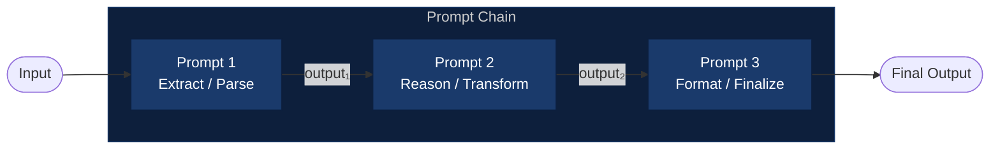

# Prompt Chaining

## 1. Problem

A single prompt cannot reliably complete a task that has natural sub-steps with distinct concerns, intermediate representations, or outputs that serve as inputs to subsequent reasoning. Attempting to collapse everything into one call degrades output quality, makes debugging opaque, and prevents targeted re-execution when a step fails. The task has a clear sequential dependency structure: step N cannot begin until step N-1 is complete and its output is known.

## 2. Solution Structure

Break the task into a fixed sequence of prompts where each call's output is passed as (part of) the next call's input. A thin orchestrator assembles the chain, handles output extraction, and injects results into downstream prompts. No step runs in parallel; the dependency graph is strictly linear.

<details>
<summary><b>Prompt Chaining — Wiring Diagram</b></summary>



</details>

## 3. When to Use

- The task decomposes naturally into ordered sub-tasks with distinct concerns (e.g., extract → analyze → format).
- Intermediate outputs need validation or transformation before being forwarded.
- Different steps benefit from different system prompts, personas, or model parameters.
- A failed step should allow re-execution from that point without rerunning earlier steps.
- The combined context of all steps would exceed a single prompt's effective reasoning window.

## 4. When Not to Use

- Steps are independent and could run concurrently — use [Parallel Sectioning](parallel-sectioning.md) instead.
- The task is simple enough for a single well-crafted prompt.
- Latency is critical and the sequential overhead is unacceptable.
- The chain length is unknown at design time and depends on runtime state — use [Bounded Loop](bounded-loop.md) instead.

## 5. Trade-offs

| Benefit | Cost / Risk |
|---|---|
| Each step can use a focused, smaller prompt | Latency accumulates linearly with chain length |
| Failures are isolatable and re-executable | Errors in early steps propagate and compound downstream |
| Intermediate outputs are inspectable and loggable | Orchestration code must handle output extraction reliably |
| Each step can use a different model or temperature | More total tokens consumed across all calls |
| Easier to test each step in isolation | Designing clean hand-off schemas between steps takes upfront effort |

## 6. Implementation Sketch

```
function run_chain(initial_input):
    state = initial_input

    steps = [
        {prompt_template: EXTRACT_PROMPT, output_key: "extracted"},
        {prompt_template: ANALYZE_PROMPT, output_key: "analysis"},
        {prompt_template: FORMAT_PROMPT,  output_key: "final"},
    ]

    for step in steps:
        prompt = render(step.prompt_template, context=state)
        raw_output = call_llm(prompt)
        parsed = extract_structured(raw_output, schema=step.output_schema)

        if not parsed.valid:
            raise StepError(step=step, output=raw_output)

        state[step.output_key] = parsed.value

    return state["final"]
```

Key wiring decisions:
- `state` is a dict passed forward, not a growing transcript.
- `extract_structured` enforces the contract between steps (JSON schema, regex, or XML tags).
- Each `call_llm` uses the step's own system prompt; the model never sees prior raw outputs unless explicitly injected.

## 7. Related Patterns

- [Sequential Workflow](sequential-workflow.md) — adds role specialization and review stages on top of a chain structure.
- [Iterative Refinement](iterative-refinement.md) — chains where the same prompt is applied repeatedly until quality is sufficient.
- [Evaluator-Optimizer](evaluator-optimizer.md) — adds a measurable acceptance criterion between chain steps.
- [Bounded Loop](bounded-loop.md) — dynamic chain length controlled by a loop condition.
- [Family B — Task Decomposition](../../B-task-decomposition/README.md) — determines how to split tasks before a chain is designed.

## 8. Anti-Patterns Addressed

**Self-Certified Completion** — by separating generation from downstream evaluation steps, no single call judges its own output as "done."

**Retry Without New Information** — each step in the chain provides genuinely new context (extracted data, transformed representation) before the next call, rather than repeating the same prompt.
---

## Sources

- Anthropic — [Building Effective Agents](https://www.anthropic.com/engineering/building-effective-agents)
- OpenAI — [A Practical Guide to Building AI Agents](https://openai.com/business/guides-and-resources/a-practical-guide-to-building-ai-agents/)
- Google — [Choose a Design Pattern for Agentic AI](https://docs.cloud.google.com/architecture/choose-design-pattern-agentic-ai-system)
- AWS — [Agentic AI Patterns](https://docs.aws.amazon.com/prescriptive-guidance/latest/agentic-ai-patterns/agent-patterns.html)
- Microsoft Azure — [AI Agent Design Patterns](https://learn.microsoft.com/en-us/azure/architecture/ai-ml/guide/ai-agent-design-patterns)
