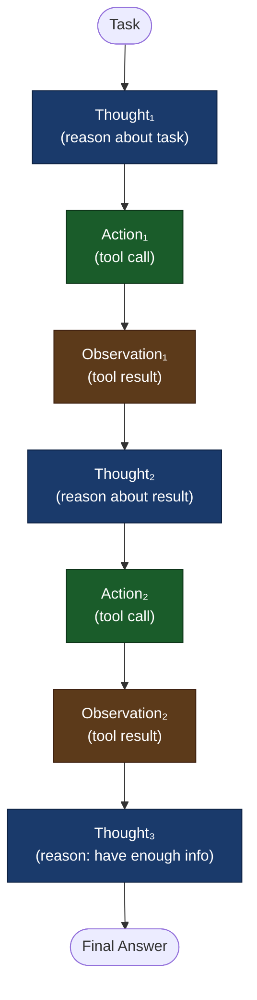

# ReAct (Reason + Act)

## 1. Problem

Many tasks cannot be completed from a model's static parametric knowledge alone: they require fetching live data, executing code, querying databases, calling APIs, or interacting with external systems. A model that only generates text has no mechanism to incorporate the results of these actions into its reasoning. Conversely, a model that acts without explicit reasoning steps produces actions that are hard to inspect, debug, or correct. The task needs a pattern where reasoning and acting are tightly interleaved: each action is motivated by explicit reasoning, and each action's result is incorporated into subsequent reasoning before the next action is chosen.

## 2. Solution Structure

The model operates in a loop of three alternating steps: **Thought** (explicit reasoning about the current state and what action to take next), **Action** (a structured call to an external tool or system), and **Observation** (the result of the action, injected back into the model's context). This Thought-Action-Observation cycle repeats until the model produces a final answer rather than an action. The orchestrator executes actions on behalf of the model and injects observations as new messages in the conversation.

<details>
<summary><b>ReAct — Wiring Diagram</b></summary>



</details>

## 3. When to Use

- The task requires information that must be retrieved or computed at runtime (not available in parametric knowledge).
- The sequence and selection of actions depends on prior action results — the action plan cannot be fully specified upfront.
- Explicit reasoning traces are required for auditability, debugging, or user trust.
- The model must adapt its strategy mid-task based on unexpected tool results (e.g., a search returns no results).
- The set of available tools is well-defined and the model reliably selects and calls them correctly.

## 4. When Not to Use

- The action sequence is fully known upfront — use [Prompt Chaining](prompt-chaining.md) or [Sequential Workflow](sequential-workflow.md) instead for deterministic pipelines.
- No external tools are needed — pure generation tasks don't need the Thought-Action-Observation loop.
- Observation quality is unreliable (e.g., external APIs frequently return errors or empty results) — build robust error handling and fallback actions before adopting ReAct.
- The task requires very long action sequences; context window accumulation from observations can become unwieldy.

## 5. Trade-offs

| Benefit | Cost / Risk |
|---|---|
| Reasoning is explicit and inspectable at each step | Observation quality entirely determines answer quality; bad tool results silently corrupt reasoning |
| The model can adapt its plan dynamically based on observed results | Context window grows with each Thought-Action-Observation triple; long chains require truncation strategies |
| Thought traces enable post-hoc debugging and user explanation | Harder to test deterministically; output varies based on live tool results |
| Tool selection errors are visible in the Thought before the Action is executed | Model may over-use tools for sub-tasks it could answer from parametric knowledge |
| Clean separation between reasoning (model) and execution (orchestrator) | Orchestrator must handle tool failures, timeouts, and malformed action payloads |

## 6. Implementation Sketch

```
TOOLS = {
    "search": web_search,
    "calculator": evaluate_expression,
    "lookup": database_query,
}

REACT_SYSTEM_PROMPT = """
You solve tasks by reasoning and acting. Use this format:

Thought: <your reasoning about what to do next>
Action: <tool_name>(<arguments>)

OR when you have the final answer:

Thought: <reasoning that you now have sufficient information>
Final Answer: <your answer>

Available tools: search(query), calculator(expression), lookup(key)
"""

function react(task, max_steps=10):
    messages = [{role: "user", content: task}]

    for step in range(max_steps):
        response = call_llm(system=REACT_SYSTEM_PROMPT, messages=messages)
        messages.append({role: "assistant", content: response})

        if "Final Answer:" in response:
            return extract_final_answer(response)

        action = parse_action(response)  # {tool: str, args: dict}
        if action is None:
            raise MalformedResponseError(response)

        observation = execute_tool(TOOLS[action.tool], action.args)
        messages.append({
            role: "user",
            content: f"Observation: {observation}"
        })

    return ExhaustedResult(messages=messages)  # max steps reached


function execute_tool(tool_fn, args):
    try:
        return str(tool_fn(**args))
    except Exception as e:
        return f"Tool error: {str(e)}"  # inject error as observation, not exception
```

Key wiring decisions:
- Tool errors are injected as observations (not raised as exceptions) so the model can reason about failures and try alternatives.
- `max_steps` is a hard loop guard; the loop never runs indefinitely.
- The full message history (with all Thoughts, Actions, and Observations) is sent on each turn so the model has complete context.
- Malformed action responses (model fails to follow the format) are detected early and handled explicitly.

## 7. Related Patterns

- [Bounded Loop](bounded-loop.md) — the `max_steps` cap is the loop safety mechanism every ReAct implementation requires.
- [Prompt Chaining](prompt-chaining.md) — when the action sequence is known upfront, a chain is simpler and more predictable than ReAct.
- [Family C — Orchestration](../../C-orchestration/README.md) — the orchestrator manages tool dispatch and observation injection; ReAct is one of the primary patterns orchestrators implement.

## 8. Anti-Patterns Addressed

**Infinite/Weakly Bounded Agent Loop** — `max_steps` is a hard termination condition; every ReAct loop must have one.

**Retry Without New Information** — each iteration produces a new Action and a new Observation; the model never repeats a reasoning step without incorporating fresh external information.

---

## Sources

- Anthropic — [Building Effective Agents](https://www.anthropic.com/engineering/building-effective-agents)
- OpenAI — [A Practical Guide to Building AI Agents](https://openai.com/business/guides-and-resources/a-practical-guide-to-building-ai-agents/)
- Google — [Choose a Design Pattern for Agentic AI](https://docs.cloud.google.com/architecture/choose-design-pattern-agentic-ai-system)
- AWS — [Agentic AI Patterns](https://docs.aws.amazon.com/prescriptive-guidance/latest/agentic-ai-patterns/agent-patterns.html)
- Microsoft Azure — [AI Agent Design Patterns](https://learn.microsoft.com/en-us/azure/architecture/ai-ml/guide/ai-agent-design-patterns)
- Stanford CS224G — [Agentic Design Patterns (lecture slides)](https://web.stanford.edu/class/cs224g/2025/lectures/Agentic_Design_Patterns.pdf)
