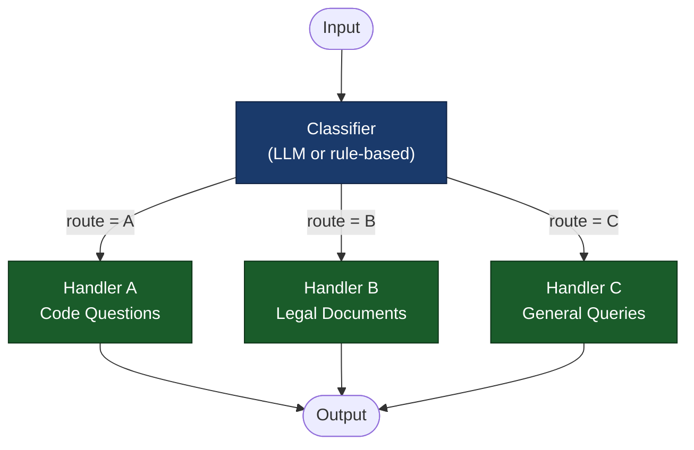

# Routing

## 1. Problem

A single generalist prompt performs poorly across heterogeneous input types. Different inputs require different instructions, personas, tools, or models — but running all inputs through the same specialist prompt wastes tokens and degrades quality for inputs that don't match. The system needs a way to classify incoming inputs and dispatch each to the most appropriate handler, without the caller needing to know which handler is correct.

## 2. Solution Structure

A lightweight classifier prompt (or rule-based classifier) inspects each input and assigns it a route label. A dispatcher maps route labels to handler prompts and invokes only the matched handler. The caller interacts only with the router interface; handlers are invisible to it. The classifier can be a separate LLM call, a fine-tuned model, an embedding-based similarity lookup, or a deterministic rule set — chosen based on classification complexity.

<details>
<summary><b>Routing — Wiring Diagram</b></summary>



</details>

## 3. When to Use

- Inputs fall into 2–10 meaningfully distinct categories that each benefit from tailored handling.
- A generalist prompt yields noticeably lower quality than a specialist prompt for at least one input type.
- The classification decision is reliable enough (high precision on the boundary cases) to be trusted.
- Different routes may require different models, tools, context windows, or cost profiles.
- You want to add new handlers without modifying existing ones (open/closed principle).

## 4. When Not to Use

- All inputs can be handled adequately by a single well-crafted prompt — routing adds latency and cost for no gain.
- The classification boundary is ambiguous and classifier errors would be costly — consider a fallback handler with manual review.
- The number of routes is very large (>20) — consider a retrieval-based approach (RAG) instead.
- Inputs are structurally identical and differ only in content — parameterize the prompt rather than routing.

## 5. Trade-offs

| Benefit | Cost / Risk |
|---|---|
| Each handler is optimized for its input type | Classifier errors silently misroute inputs, degrading quality without obvious failure |
| Handlers are independently deployable and testable | Adds one extra LLM call (the classifier) to every request |
| New routes can be added without touching existing ones | Classifier prompt must be maintained as route space evolves |
| Cost optimization: cheap model for simple routes, expensive for complex | Edge-case inputs near category boundaries receive inconsistent treatment |
| Reduces prompt complexity: no generalist hedging | Classification latency adds to overall P99 response time |

## 6. Implementation Sketch

```
ROUTES = {
    "code":    CodeHandler(system=CODE_SYSTEM_PROMPT),
    "legal":   LegalHandler(system=LEGAL_SYSTEM_PROMPT),
    "general": GeneralHandler(system=GENERAL_SYSTEM_PROMPT),
}

CLASSIFIER_PROMPT = """
Classify the following input into exactly one of: code, legal, general.
Respond with only the label.

Input: {input}
"""

function route(input):
    # Step 1: classify
    label = call_llm(
        prompt=render(CLASSIFIER_PROMPT, input=input),
        max_tokens=10,
        temperature=0
    ).strip().lower()

    if label not in ROUTES:
        label = "general"  # fallback

    # Step 2: dispatch
    handler = ROUTES[label]
    return handler.run(input)
```

Key wiring decisions:
- Classifier uses `temperature=0` and `max_tokens=10` to minimize cost and variance.
- Unknown labels fall back to the general handler rather than raising an error.
- The classifier and handlers are separate calls; the classifier never sees the handler's system prompt and vice versa.
- For high-stakes misrouting scenarios, add a confidence threshold: if the classifier is uncertain, escalate to a human or run the top-2 handlers and compare.

## 7. Related Patterns

- [Sequential Workflow](sequential-workflow.md) — routing selects which sequential workflow to run for a given input type.
- [Parallel Sectioning](parallel-sectioning.md) — when a single input must be handled by multiple handlers concurrently.
- [Family B — Task Decomposition](../B-task-decomposition/README.md) — decomposition determines the dispatch targets that routing selects between.

## 8. Anti-Patterns Addressed

**Multi-Agent by Default** — routing achieves specialization via prompt selection rather than spinning up separate agents for each input type; use multi-agent only when handlers require independent state or tools.

**Self-Certified Completion** — indirectly: routing prevents a single generalist model from deciding it handled all input types adequately, by forcing explicit classification before handling.
---

## Sources

- Anthropic — [Building Effective Agents](https://www.anthropic.com/engineering/building-effective-agents)
- OpenAI — [A Practical Guide to Building AI Agents](https://openai.com/business/guides-and-resources/a-practical-guide-to-building-ai-agents/)
- Google — [Choose a Design Pattern for Agentic AI](https://docs.cloud.google.com/architecture/choose-design-pattern-agentic-ai-system)
- AWS — [Agentic AI Patterns](https://docs.aws.amazon.com/prescriptive-guidance/latest/agentic-ai-patterns/agent-patterns.html)
- Microsoft Azure — [AI Agent Design Patterns](https://learn.microsoft.com/en-us/azure/architecture/ai-ml/guide/ai-agent-design-patterns)
