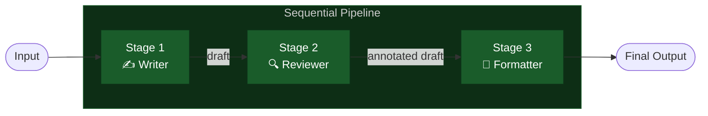

# Sequential Workflow

## 1. Problem

Many tasks require multiple distinct roles — such as drafting, reviewing, and formatting — where each role must complete before the next begins, and where allowing roles to overlap or merge into one prompt produces lower-quality output. When a single prompt wears too many hats, the model cannot maintain the discipline of each role: a writer that simultaneously critiques its own work tends to under-critique; a formatter that also reasons about content misses formatting consistency. The task needs a pipeline of specialists, each operating on the previous stage's committed output.

## 2. Solution Structure

Define a fixed ordered sequence of stages, each with its own system prompt and role persona. Each stage receives the prior stage's output as its primary input. An orchestrator drives stage transitions and ensures no stage begins until the previous one has produced a committed result. Unlike raw prompt chaining, each stage is a named role with explicit entry and exit contracts.

<details>
<summary><b>Sequential Workflow — Wiring Diagram</b></summary>



</details>

## 3. When to Use

- The task has well-understood, non-overlapping roles (e.g., generate, critique, polish, verify).
- Role separation produces measurably better output than a single combined prompt.
- Each stage's output is a meaningful artifact that can be reviewed or logged independently.
- Different stages may benefit from different models, temperatures, or token budgets.
- Downstream stages should be insulated from the reasoning noise of upstream stages.

## 4. When Not to Use

- Roles must collaborate dynamically or iterate back-and-forth — use [Generator-Critic](generator-critic.md) for a two-role loop.
- The workflow branches based on input type — use [Routing](routing.md) to select which pipeline applies.
- Stages can run concurrently — use [Parallel Sectioning](parallel-sectioning.md) or [Parallel Voting](parallel-voting.md).
- The number of stages is unknown at design time — use [Bounded Loop](bounded-loop.md).

## 5. Trade-offs

| Benefit | Cost / Risk |
|---|---|
| Role discipline: each stage focuses on one concern | Rigid ordering; no back-channel from later stages to earlier ones |
| Stages are independently testable and replaceable | Total latency is the sum of all stage latencies |
| Clear audit trail: each stage output is a checkpoint | An error or hallucination in stage N contaminates all downstream stages |
| Role-specific prompts are smaller and more precise | More total tokens consumed; orchestration overhead |
| Encourages explicit output contracts between stages | Designing clean stage interfaces requires upfront schema work |

## 6. Implementation Sketch

```
STAGES = [
    Stage(name="writer",    system=WRITER_SYSTEM_PROMPT,    input_key="task",  output_key="draft"),
    Stage(name="reviewer",  system=REVIEWER_SYSTEM_PROMPT,  input_key="draft", output_key="reviewed"),
    Stage(name="formatter", system=FORMATTER_SYSTEM_PROMPT, input_key="reviewed", output_key="final"),
]

function run_sequential_workflow(task_input):
    context = {"task": task_input}

    for stage in STAGES:
        user_message = build_user_message(stage, context)
        response = call_llm(
            system=stage.system,
            messages=[{role: "user", content: user_message}]
        )
        context[stage.output_key] = parse_stage_output(response, stage)

        log_checkpoint(stage.name, context[stage.output_key])

    return context["final"]
```

Key wiring decisions:
- Each stage receives only its declared `input_key` from context, not the full accumulated context, enforcing role isolation.
- `parse_stage_output` validates structure (e.g., the reviewer must return structured annotations, not free prose).
- `log_checkpoint` enables replay from any stage during debugging without re-running the full pipeline.

## 7. Related Patterns

- [Prompt Chaining](prompt-chaining.md) — the underlying linear execution model; Sequential Workflow adds role specialization on top.
- [Generator-Critic](generator-critic.md) — a two-stage loop between writer and reviewer roles; use when revision cycles are needed.
- [Routing](routing.md) — selects which sequential workflow to run based on input classification.
- [Evaluator-Optimizer](evaluator-optimizer.md) — adds a measurable gate between stages that can halt or retry.
- [Family C — Orchestration](../../C-orchestration/README.md) — the orchestrator pattern that manages stage transitions at scale.

## 8. Anti-Patterns Addressed

**Self-Certified Completion** — the reviewer stage is a separate LLM call that cannot see the writer's reasoning, preventing the writer from certifying its own output as review-passing.

**Multi-Agent by Default** — a sequential workflow keeps the system single-agent with role specialization via prompt engineering, avoiding unnecessary multi-agent infrastructure for tasks that do not require parallelism or independent state.
---

## Sources

- Anthropic — [Building Effective Agents](https://www.anthropic.com/engineering/building-effective-agents)
- OpenAI — [A Practical Guide to Building AI Agents](https://openai.com/business/guides-and-resources/a-practical-guide-to-building-ai-agents/)
- Google — [Choose a Design Pattern for Agentic AI](https://docs.cloud.google.com/architecture/choose-design-pattern-agentic-ai-system)
- AWS — [Agentic AI Patterns](https://docs.aws.amazon.com/prescriptive-guidance/latest/agentic-ai-patterns/agent-patterns.html)
- Microsoft Azure — [AI Agent Design Patterns](https://learn.microsoft.com/en-us/azure/architecture/ai-ml/guide/ai-agent-design-patterns)
