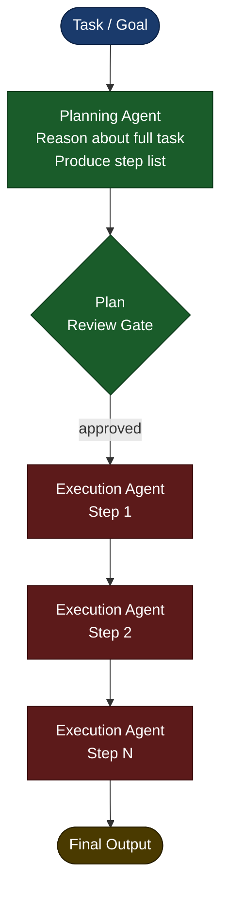

# B1: Plan → Execute

## Intent

Produce a complete, explicit plan before taking any action, then execute each step of that plan in sequence.

## Problem

When an agent attempts to reason and act simultaneously on a complex task, it loses coherence: it forgets earlier constraints, skips steps, or makes local decisions that conflict with the overall goal. The model cannot hold both the full plan and the detailed execution context in its effective attention window at once.

## Solution

Split the task into two distinct phases. In the planning phase, the agent reasons about the full task and produces a structured plan — a numbered list of steps, each with a clear scope and success criterion. No actions are taken during planning. In the execution phase, the agent works through each step, treating the plan as a fixed specification. The plan acts as an exoskeleton: it offloads the global structure from the execution context so each step can focus on its own details.

The two phases may run in the same agent or in separate agents. When they run separately, the planning agent's output becomes the execution agent's input. This separation also makes the plan auditable and reviewable before any irreversible action is taken.

## Structure

<details>
<summary><b>Plan → Execute Flow</b></summary>



</details>

**Steps:**

1. Receive task and any context.
2. Produce plan: enumerate steps with scope, inputs, outputs, and success criteria.
3. (Optional) Gate: human or validator reviews the plan.
4. Execute step 1; record result.
5. Execute step 2 using result from step 1 as context; record result.
6. Continue through all steps.
7. Aggregate results into final output.

## When to Use

- The task is complex enough that simultaneous planning and execution produces shallow or inconsistent results.
- The plan is stable — the shape of the work is knowable before execution begins.
- Auditability matters: a reviewer should be able to inspect the plan before actions are taken.
- The task has natural sequential dependencies between steps.
- Irreversible actions are involved and a planning gate reduces risk.

## When NOT to Use

- The task is simple enough to execute in one step — adding a planning phase just adds latency and cost.
- Step N's structure genuinely depends on the output of step N−1 in a way that cannot be anticipated; use Dynamic Decomposition (B3) instead.
- The domain is unfamiliar and a wrong plan would be expensive to execute; add a Reconnaissance phase first (B6).
- Real-time responsiveness is required; planning latency is unacceptable.

## Implementation Notes

**Plan granularity.** Steps should be scoped so that each fits comfortably in a single execution context. Too coarse and the executor still has to decompose; too fine and the plan becomes noisy. A useful heuristic: each step should produce a testable artifact or a clear state change.

**Plan format.** Structured formats (numbered lists, JSON with fields per step) work better than prose. Include for each step: what to do, what input it needs, what output it produces, and how to verify success.

**Handling plan drift.** If execution of a step reveals the plan is wrong, the agent must decide: patch the current step, revise the remaining plan, or escalate to a human gate. Build an explicit branch for this — silent plan mutation is a reliability failure mode.

**Separation of planning and execution agents.** Running them as separate LLM calls (or separate agents) keeps contexts clean and makes token budgets predictable. The planner should not have access to execution tools; the executor should not have access to plan-modification tools.

**Implementation sketch:**

```
function planAndExecute(task, context):
    plan = planningAgent.call(
        prompt = buildPlanningPrompt(task, context),
        tools  = []   // no action tools during planning
    )
    // optional: humanReview(plan)

    results = []
    for step in plan.steps:
        stepResult = executionAgent.call(
            prompt = buildStepPrompt(step, results, context),
            tools  = EXECUTION_TOOLS
        )
        if stepResult.status == FAILED:
            return handlePlanDrift(step, stepResult, plan)
        results.append(stepResult)

    return aggregateResults(results)
```

## Related Patterns

- [B3: Dynamic Decomposition](B3-dynamic-decomposition.md) — use when the plan cannot be fully known upfront.
- [B4: Fixed Decomposition](B4-fixed-decomposition.md) — B1 is a special case of B4 where the plan structure is implicit in the planning step.
- [B5: Milestone / Checkpoint Planning](B5-milestone-checkpoint.md) — adds validation gates between phases; often combined with B1 for long plans.
- [B6: Reconnaissance-First](B6-reconnaissance-first.md) — precedes B1 when the domain is unfamiliar.
- [Family A — Topology](../A-topology/README.md) — the plan's step sequence maps to chain or DAG topologies.
- [Family C — Orchestration](../C-orchestration/README.md) — an orchestrator assigns each plan step to a worker.
- [Family K — Human Control](../K-human-control/README.md) — the plan review gate is a human-in-the-loop checkpoint.

## Example

A software agent is asked to "add a pagination feature to the user list endpoint." Instead of immediately writing code, it first produces a plan: (1) read the existing endpoint handler, (2) read the ORM query layer, (3) design the pagination interface (page/limit params, response envelope), (4) implement query changes, (5) implement handler changes, (6) write tests, (7) update the API schema. A human reviews the plan and approves it. The agent then executes each step in order, with each step's output feeding context to the next. The final output is a coherent diff rather than the fragmented, inconsistent code that would result from trying to do all seven things at once.

## Sources

- **Anthropic Engineering** — AI safety company; authors of Claude. [Building Effective Agents](https://www.anthropic.com/engineering/building-effective-agents)
- **Google Cloud Architecture Center** — Google's cloud architecture team. [Choose a Design Pattern for Agentic AI](https://docs.cloud.google.com/architecture/choose-design-pattern-agentic-ai-system)
- **AWS Prescriptive Guidance** — Amazon Web Services architecture team. [Agentic AI Patterns](https://docs.aws.amazon.com/prescriptive-guidance/latest/agentic-ai-patterns/agent-patterns.html)
- **Microsoft Azure Architecture Center** — Microsoft's cloud architecture team. [AI Agent Design Patterns](https://learn.microsoft.com/en-us/azure/architecture/ai-ml/guide/ai-agent-design-patterns)
