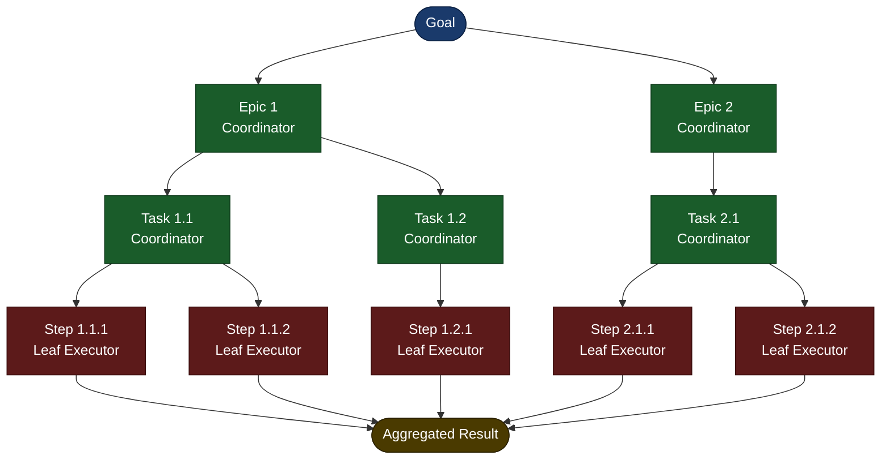

# B2: Hierarchical Task Decomposition

## Intent

Recursively break a complex task into a tree of increasingly granular subtasks, executing only at the leaf level while higher levels coordinate.

## Problem

Some tasks have natural levels of abstraction — a project contains features, features contain steps, steps contain actions — but a flat plan fails to capture these levels. Treating everything at one granularity either produces steps too large to execute reliably or steps so small they lose the structural context that gives them meaning. Coordination logic gets tangled with execution logic, and parallelism opportunities are missed because dependencies between branches are unclear.

## Solution

Decompose the task as a tree. The root node is the original goal. Each internal node is a coordinator that decomposes its assigned scope into children; it does not execute directly. Leaf nodes are execution units with a scope small enough to complete in a single agent call. The decomposition can proceed top-down (the root planner breaks the goal into epics, each epic planner breaks into tasks, each task planner breaks into steps) or bottom-up (rare; typically used when leaf capabilities are fixed). The tree structure makes dependencies explicit, enables parallel execution of independent branches, and allows partial re-planning: if one subtree fails, only that branch needs to be replanned — sibling branches are unaffected.

## Structure

<details>
<summary><b>Hierarchical Decomposition Tree</b></summary>



</details>

**Steps:**

1. Root coordinator receives the goal; decomposes into top-level epics (level 1).
2. Each epic coordinator decomposes into tasks (level 2).
3. Each task coordinator decomposes into leaf steps (level 3, or deeper if needed).
4. Leaf executors run their steps (in parallel across independent branches where possible).
5. Results bubble up: tasks aggregate leaf results; epics aggregate task results; root aggregates epic results.

## When to Use

- The task has natural hierarchical structure (project → feature → step).
- Independent branches can run in parallel, making depth worthwhile.
- Different levels of the hierarchy require different expertise or tools (strategy at the top, domain execution at the leaves).
- Partial failure isolation matters: a failed subtree should not invalidate sibling subtrees.
- The task is large enough that a flat plan would be unwieldy.

## When NOT to Use

- The task is naturally linear with no branching — hierarchy adds overhead without enabling parallelism.
- The decomposition depth is not justified by the task size; a flat plan (B1 or B4) is simpler.
- The subtree structure is not knowable upfront and depends on intermediate results; use Dynamic Decomposition (B3).
- Coordination overhead (multiple planning LLM calls) exceeds the benefit for small tasks.

## Implementation Notes

**Maximum depth.** In practice, 2–3 levels covers most tasks. Deeper hierarchies increase coordination overhead and make debugging difficult. If a leaf is still too large, it signals the decomposition criteria are wrong, not that you need more levels.

**Coordinator vs executor roles.** Coordinators should have no execution tools; executors should have no decomposition authority. Mixing roles produces agents that silently change the plan during execution.

**Aggregation strategy.** Each coordinator must define how it merges children's outputs. Aggregation logic is often domain-specific (concatenate, merge diffs, resolve conflicts, summarize). Build it explicitly — don't assume the LLM will figure it out at merge time.

**Parallel execution.** Independent sibling subtasks can run concurrently. Track dependency edges explicitly so the scheduler knows which siblings are truly independent. Implicit ordering assumptions are a common source of correctness bugs.

**Re-planning on failure.** When a leaf fails, the failure should propagate up only as far as needed. The immediate parent coordinator decides: retry the leaf, replace it with an alternative, or escalate to its parent. Avoid global re-plans triggered by single leaf failures.

**Implementation sketch:**

```
function hierarchicalDecompose(goal, depth, context):
    if depth == MAX_DEPTH or isLeafTask(goal):
        return executeLeaf(goal, context)

    subgoals = coordinatorAgent.call(
        prompt = buildDecomposePrompt(goal, context),
        tools  = []   // no execution tools at coordinator level
    )

    results = parallelMap(subgoals, fn(subgoal):
        return hierarchicalDecompose(subgoal, depth + 1, context)
    )

    return coordinatorAgent.call(
        prompt = buildAggregatePrompt(goal, results),
        tools  = []
    )
```

## Related Patterns

- [B1: Plan → Execute](B1-plan-execute.md) — B2 is a generalization; B1 is a two-level hierarchy (plan = level 1, execute = level 2).
- [B3: Dynamic Decomposition](B3-dynamic-decomposition.md) — use when the subtree structure depends on runtime results.
- [B4: Fixed Decomposition](B4-fixed-decomposition.md) — B2 with fixed decomposition locks the full tree before execution.
- [Family A — Topology](../A-topology/README.md) — the decomposition tree maps to a fan-out or DAG topology.
- [Family C — Orchestration](../C-orchestration/README.md) — orchestrators manage assignment of subtasks to workers at each level.

## Example

An agent is asked to "produce a competitive analysis report covering four product areas." The root coordinator breaks this into four epic-level subtasks, one per product area, which can run in parallel. Each epic coordinator decomposes its area into three tasks: gather data, analyze strengths/weaknesses, and draft the section. Leaf executors run individual web searches, summarizations, and drafting steps. Results propagate upward: leaf drafts merge into section drafts, section drafts merge into the final report. When the data-gathering leaf for one product area fails due to a blocked source, only that task's coordinator replans — the other three product areas continue unaffected.

## Sources

- **Anthropic Engineering** — AI safety company; authors of Claude. [Building Effective Agents](https://www.anthropic.com/engineering/building-effective-agents)
- **Google Cloud Architecture Center** — Google's cloud architecture team. [Choose a Design Pattern for Agentic AI](https://docs.cloud.google.com/architecture/choose-design-pattern-agentic-ai-system)
- **Microsoft Azure Architecture Center** — Microsoft's cloud architecture team. [AI Agent Design Patterns](https://learn.microsoft.com/en-us/azure/architecture/ai-ml/guide/ai-agent-design-patterns)
- **Stanford CS224G** — Stanford University course on LLM agents. [Agentic Design Patterns (lecture slides)](https://web.stanford.edu/class/cs224g/lectures/Agentic_Design_Patterns.pdf)
