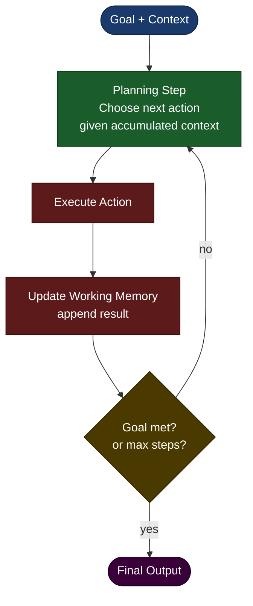

# B3: Dynamic Decomposition

## Intent

Decompose a task incrementally at runtime, generating each next step based on the results of prior steps, so the plan adapts as new information emerges.

## Problem

Many real-world tasks cannot be fully planned upfront because the right next step depends on what earlier steps found. A fixed plan built on assumptions about intermediate outputs fails when those assumptions are wrong — and in exploratory, research, or diagnostic tasks, the assumptions are almost always wrong in some detail. Forcing a complete plan upfront leads to wasted work, replanning, or brittle agents that fail silently when reality diverges from the plan.

## Solution

Replace a single planning call with a planning loop. After each executed step, the agent reassesses: given what it now knows, what is the best next step? The plan is a living structure — a queue or DAG that is extended and revised as results arrive. The agent maintains a working memory of accumulated context and uses it to determine when the goal is satisfied, when a new branch is needed, and when the task is complete. A termination condition is essential: without one, the loop never converges.

## Structure

<details>
<summary><b>Dynamic Decomposition Loop</b></summary>



</details>

**Steps:**

1. Receive goal and any initial context; initialize working memory.
2. Planning call: given current working memory, determine the next action to take.
3. Execute the action; record result in working memory.
4. Check termination: is the goal satisfied? Has a step limit been reached? Has the agent declared completion?
5. If not terminated, return to step 2 with updated context.
6. On termination, aggregate working memory into final output.

## When to Use

- The task is exploratory: the right direction depends on what is discovered.
- Step N's structure cannot be determined without the output of step N−1.
- The task involves diagnosis, debugging, or research where the problem definition itself evolves.
- The domain is partially unknown and rigid upfront planning would waste significant compute on wrong assumptions.
- The agent needs to decide whether to pursue a lead, abandon it, or pivot based on intermediate results.

## When NOT to Use

- The task is well-understood and a fixed plan would work; dynamic decomposition adds unnecessary LLM calls and unpredictability.
- Auditability is critical and the full plan must be visible before execution starts; use Fixed Decomposition (B4) instead.
- The task has hard token or latency budgets; dynamic loops are inherently variable in cost and duration.
- The termination condition cannot be clearly specified — a missing or weak termination condition is the primary failure mode of this pattern.

## Implementation Notes

**Termination conditions.** This is the most critical design decision. Options: explicit goal-satisfaction check (agent or validator signals done), step limit (hard cap on iterations), tool-call audit (if the agent makes the same call twice with the same args, it is looping), confidence threshold (agent self-reports confidence in its answer). Use at least two independent termination checks.

**Working memory design.** The context passed to each planning call must be rich enough to reason about progress but compact enough to fit in the context window. Summarize or compress earlier steps as the loop grows; don't concatenate raw outputs indefinitely.

**Action space.** Constrain what actions the agent can propose in each planning step. An unrestricted action space (the agent can do anything) makes convergence analysis impossible and increases the chance of irreversible side effects. Prefer a named set of allowed actions with defined inputs and outputs.

**Loop vs. DAG.** When some future steps can be anticipated (partial static structure), model the plan as a partially-filled DAG rather than a pure loop. Static edges represent known dependencies; dynamic edges are added at runtime. This hybrid reduces total planning LLM calls while preserving adaptability.

**Detecting stalling.** Track which parts of the goal remain unaddressed after each step. If the same gap persists across multiple iterations without progress, the agent is stuck and should escalate or change strategy rather than continuing to loop.

**Implementation sketch:**

```
function dynamicDecompose(goal, maxSteps):
    memory = WorkingMemory(goal)

    for step in range(maxSteps):
        nextAction = planningAgent.call(
            prompt = buildNextActionPrompt(goal, memory),
            tools  = PLANNING_TOOLS_ONLY
        )

        if nextAction.type == DONE:
            break

        result = executionAgent.call(
            action = nextAction,
            tools  = EXECUTION_TOOLS
        )

        memory.append(action=nextAction, result=result)

        if terminationCheck(goal, memory):
            break
    else:
        escalate("Step limit reached without completion", memory)

    return synthesizeAgent.call(
        prompt = buildSynthesisPrompt(goal, memory)
    )
```

## Related Patterns

- [B1: Plan → Execute](B1-plan-execute.md) — B1 produces a complete plan upfront; B3 produces it incrementally.
- [B4: Fixed Decomposition](B4-fixed-decomposition.md) — the deterministic alternative; prefer B4 when the task is well-understood.
- [B6: Reconnaissance-First](B6-reconnaissance-first.md) — a bounded recon pass before decomposition can reduce the need for dynamic adaptation.
- [Family A — Topology](../../A-workflow-topology/README.md) — dynamic decomposition often produces loop or evolving-DAG topologies.
- [Family C — Orchestration](../../C-orchestration/README.md) — an orchestrator may use dynamic decomposition to assign work to agents adaptively.
- [Family I — Reliability](../../I-reliability-recovery/README.md) — step limits, working memory snapshots, and loop-detection belong to reliability patterns.

## Example

A debugging agent is given a failing test and asked to find the root cause. It cannot know upfront which files to read or which logs to inspect. It starts by reading the test output, then decides to inspect the failing function, then notices an unexpected null being passed and traces back to the caller, then inspects the data source feeding that caller, and finally identifies a schema mismatch introduced by a recent migration. At each step, the decision of what to look at next depended entirely on what the previous step revealed. A fixed plan drawn before any code was read would have either been wrong or so general as to be useless.

## Sources

- **Anthropic Engineering** — AI safety company; authors of Claude. [Building Effective Agents](https://www.anthropic.com/engineering/building-effective-agents)
- **Google Cloud Architecture Center** — Google's cloud architecture team. [Choose a Design Pattern for Agentic AI](https://docs.cloud.google.com/architecture/choose-design-pattern-agentic-ai-system)
- **AWS Prescriptive Guidance** — Amazon Web Services architecture team. [Agentic AI Patterns](https://docs.aws.amazon.com/prescriptive-guidance/latest/agentic-ai-patterns/agent-patterns.html)
- **OpenAI Engineering** — AI research company; authors of GPT and Codex. [A Practical Guide to Building AI Agents](https://openai.com/business/guides-and-resources/a-practical-guide-to-building-ai-agents/)
