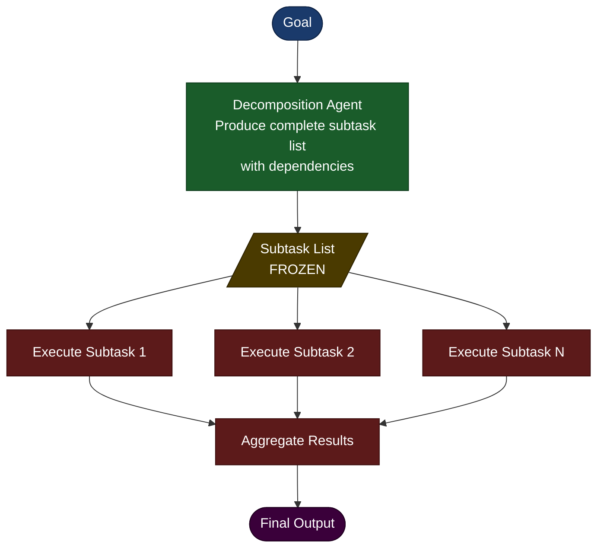

# B4: Fixed Decomposition

## Intent

Decompose a task into a complete, locked set of subtasks before any execution begins, treating the decomposition as immutable during execution.

## Problem

Adaptive decomposition (B3) carries a hidden cost: every planning decision made mid-execution adds latency, consumes tokens, and introduces a new opportunity for the agent to make a wrong turn. For well-understood tasks, this flexibility is waste — not a feature. When teams need to audit what an agent will do, predict costs, or reproduce a run identically, a plan that mutates during execution is an obstacle.

## Solution

Perform all decomposition work in a single upfront planning phase. The output is a complete, ordered (or dependency-annotated) list of subtasks. Once the planning phase ends, the subtask list is frozen: no additions, no removals, no reordering during execution. Execution agents receive their subtask specification as a fixed input. If a subtask fails, the failure is handled by the execution layer (retry, fallback, escalate) — not by modifying the plan. This constraint transforms the execution phase into a deterministic process: given the same plan and the same tools, the same run can be reproduced.

## Structure

<details>
<summary><b>Fixed Decomposition: Plan Once, Execute All</b></summary>



</details>

**Steps:**

1. Receive goal and context; run decomposition agent.
2. Decomposition agent produces the complete subtask list with dependency edges.
3. Freeze the plan — no modifications permitted after this point.
4. Execute subtasks respecting dependency order (independent subtasks may run in parallel).
5. Handle failures within the execution layer only (retry, skip, use fallback) — do not modify the plan.
6. Aggregate all subtask results into final output.

## When to Use

- The task structure is well-understood before execution; the domain is familiar.
- Reproducibility and auditability are requirements — the same input must produce the same plan.
- Cost predictability matters; the number of LLM calls must be bounded before execution begins.
- A human or automated reviewer needs to inspect and approve the full plan before any action is taken.
- Parallel execution is desired; all subtasks are known upfront so scheduling is straightforward.
- The task is a repeatable workflow run regularly (e.g., nightly data pipeline, weekly report generation).

## When NOT to Use

- Subtask structure depends on intermediate results; a wrong upfront plan will waste all execution work.
- The domain is unfamiliar; use Reconnaissance-First (B6) before committing to a fixed plan.
- The task is exploratory or diagnostic; use Dynamic Decomposition (B3).
- Subtasks have complex conditional logic ("if A fails, do B instead of C") — this is plan mutation in disguise.

## Implementation Notes

**Completeness check.** Before freezing, validate that the plan covers the full goal. Common checks: does every output required by the goal appear as a subtask output? Are there any goal requirements that no subtask addresses? Run this programmatically if the plan format is structured.

**Dependency annotation.** Even with a fixed plan, subtasks have ordering constraints. Represent these as a DAG: each subtask lists which subtasks must complete before it can start. This enables the execution scheduler to maximize parallelism while respecting correctness.

**Failure handling within the execution layer.** Because the plan is immutable, failure handling must be defined at the subtask level, not in the plan structure. Each subtask specification should include: retry policy, fallback behavior (skip, use default value, escalate), and whether failure is fatal to the overall task.

**Reproducibility.** To make runs reproducible, capture: the exact plan (subtask list with all fields), the tool versions, and any random seeds. Log the plan before execution begins. Comparing plans across runs is a useful debugging tool.

**When a plan turns out to be wrong.** The plan being immutable during execution does not mean it cannot be updated between runs. If a run fails because the plan was wrong, the fix is to improve the decomposition agent's prompts or context — not to add plan-mutation to the execution phase.

**Implementation sketch:**

```
function fixedDecompose(goal, context):
    plan = decompositionAgent.call(
        prompt = buildDecomposePrompt(goal, context),
        tools  = []   // no execution tools
    )

    validatePlanCompleteness(plan, goal)  // raises if plan has gaps
    frozenPlan = freeze(plan)

    scheduler = DependencyScheduler(frozenPlan)

    results = {}
    while not scheduler.done():
        readyTasks = scheduler.getReadyTasks(results)
        batchResults = parallelMap(readyTasks, fn(task):
            return executeWithPolicy(task, results, task.failurePolicy)
        )
        results.update(batchResults)
        scheduler.markComplete(batchResults.keys())

    return aggregateResults(frozenPlan, results)
```

## Related Patterns

- [B1: Plan → Execute](B1-plan-execute.md) — B1 is an informal version of B4 without explicit freezing or dependency annotation.
- [B3: Dynamic Decomposition](B3-dynamic-decomposition.md) — the adaptive alternative; use B3 when the task structure cannot be known upfront.
- [B5: Milestone / Checkpoint Planning](B5-milestone-checkpoint.md) — adds validation gates between groups of fixed subtasks.
- [B6: Reconnaissance-First](B6-reconnaissance-first.md) — a recon pass before B4 improves decomposition quality for unfamiliar domains.
- [Family A — Topology](../A-topology/README.md) — a frozen dependency DAG maps directly to a static DAG topology.
- [Family C — Orchestration](../C-orchestration/README.md) — fixed plans are easiest to schedule; orchestrators can assign all work upfront.

## Example

A data engineering team runs a nightly agent that generates a business intelligence report from six data sources. The task is well-understood: always the same sources, always the same transformations, always the same output format. The decomposition agent produces the same 18-subtask plan every night: six fetch subtasks (independent, run in parallel), six transform subtasks (each depends on its fetch), five join subtasks (depend on transforms), and one render subtask (depends on all joins). The plan is logged, reviewed weekly, and the execution is predictable enough that cost and latency can be committed to contractually. No dynamic replanning is needed or desired.

## Sources

- **Anthropic Engineering** — AI safety company; authors of Claude. [Building Effective Agents](https://www.anthropic.com/engineering/building-effective-agents)
- **Google Cloud Architecture Center** — Google's cloud architecture team. [Choose a Design Pattern for Agentic AI](https://docs.cloud.google.com/architecture/choose-design-pattern-agentic-ai-system)
- **AWS Prescriptive Guidance** — Amazon Web Services architecture team. [Agentic AI Patterns](https://docs.aws.amazon.com/prescriptive-guidance/latest/agentic-ai-patterns/agent-patterns.html)
- **OpenAI Engineering** — AI research company; authors of GPT and Codex. [A Practical Guide to Building AI Agents](https://openai.com/business/guides-and-resources/a-practical-guide-to-building-ai-agents/)
