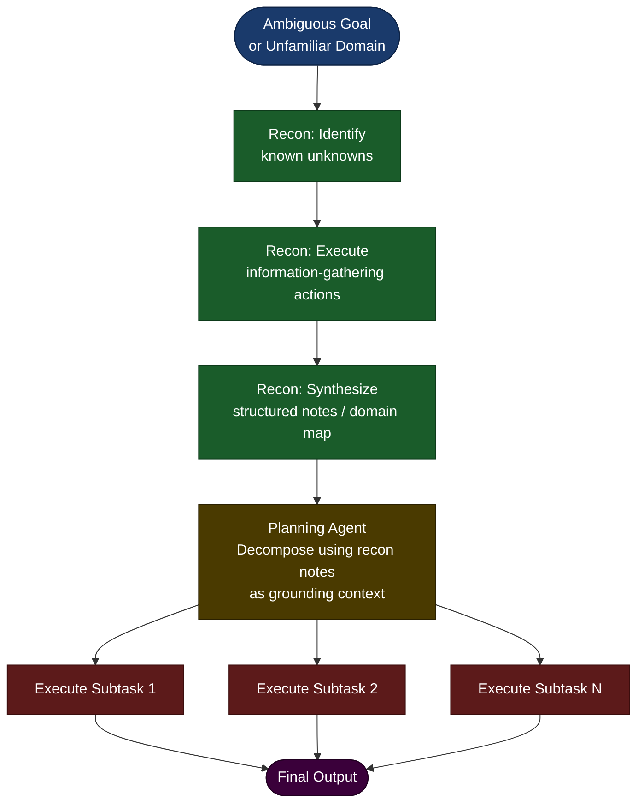

# B6: Reconnaissance-First

## Intent

Conduct a bounded information-gathering pass before committing to any decomposition, so that the plan is built on observed reality rather than assumptions.

## Problem

When an agent decomposes a task it does not yet understand, the plan reflects the agent's prior assumptions rather than the actual domain. The wrong files get read. The wrong APIs get called. The wrong subtasks are generated. Executing against a wrong plan wastes compute, produces incorrect output, and — in the worst case — takes irreversible actions in the wrong direction. The cost of a wrong decomposition is proportional to how far into execution the error is detected.

## Solution

Insert a reconnaissance phase before any planning or execution. The recon phase is a read-only (or minimally scoped, reversible) pass over the domain: read directory structures, sample representative files, query schema definitions, call a discovery API, or inspect logs. The goal is not to solve the problem but to build a faithful mental model of the environment that the subsequent planning phase will use. Recon output is compact structured notes — a map, not a solution — that the planner consumes as grounding context. Only after recon completes does the planner produce the decomposition.

## Structure

<details>
<summary><b>Reconnaissance-First Flow</b></summary>



</details>

**Steps:**

1. Receive the goal; identify what is unknown or assumed that could invalidate a plan.
2. Define the recon scope: what to read, query, or sample — and what to leave alone.
3. Execute recon actions (read-only or bounded reversible operations).
4. Synthesize findings into structured notes: key entities, relevant files/APIs, surprises, constraints.
5. Pass notes to the planning agent as grounding context.
6. Planning agent produces the decomposition; proceed with normal execution.

## When to Use

- The task involves an unfamiliar codebase, dataset, schema, or API surface.
- The task prompt is ambiguous and a wrong decomposition would waste significant compute or take irreversible actions.
- The task involves locating something whose existence and location are uncertain (files, endpoints, table names).
- A prior decomposition attempt failed due to incorrect structural assumptions.
- The domain changes frequently and cached structural knowledge is stale.
- The scope of the task is unclear: recon helps bound what is in and out.

## When NOT to Use

- The domain is fully known and the planner already has accurate structural context.
- The task is simple or time-critical; a recon pass adds latency without reducing risk.
- Recon actions themselves are expensive or risky (e.g., querying a production database with slow scans) — recon must be cheaper than the planning errors it prevents.
- The task is purely generative with no external grounding needed.

## Implementation Notes

**Scoping recon.** Unbounded recon becomes a second task. Define a recon budget before starting: maximum number of file reads, maximum depth of directory traversal, maximum number of API calls. If recon is taking longer than the task itself would, something is wrong with the scoping.

**Recon vs. execution tools.** Recon agents should have access only to read/query/search tools — never to write, create, delete, or deploy. This is not just a safety measure; it forces the recon phase to stay observational.

**Structured output.** Recon output should be a structured document, not raw logs. Useful sections: (1) key files and their roles, (2) relevant APIs and their signatures, (3) constraints and gotchas discovered, (4) what was not found that was expected (these absences are as informative as the findings). The planner should be able to consume this document without re-reading any of the source material.

**Iterative recon.** Sometimes a single recon pass is insufficient — the first pass reveals that there is more to explore. Allow at most one additional recon pass before planning. Two levels of recon cover almost all cases; more than two suggests the task itself is not well-specified.

**Recon for dynamic decomposition.** B6 pairs naturally with B3: the initial recon anchors the first iteration of the dynamic loop, reducing how much adaptation is needed mid-execution. This is preferable to a pure dynamic loop that starts with zero context.

**Implementation sketch:**

```
function reconFirst(goal, context):
    // Phase 1: Reconnaissance
    reconScope = defineReconScope(goal, context)

    reconNotes = reconAgent.call(
        prompt = buildReconPrompt(goal, reconScope),
        tools  = READ_ONLY_TOOLS,
        maxCalls = reconScope.budget
    )

    // Phase 2: Planning (grounded)
    plan = planningAgent.call(
        prompt = buildPlanningPrompt(goal, context, reconNotes),
        tools  = []
    )

    // Phase 3: Execution
    results = []
    for step in plan.steps:
        result = executionAgent.call(
            prompt = buildStepPrompt(step, results, reconNotes),
            tools  = EXECUTION_TOOLS
        )
        results.append(result)

    return aggregateResults(results)
```

## Related Patterns

- [B1: Plan → Execute](B1-plan-execute.md) — B6 precedes B1; recon feeds the planning phase.
- [B3: Dynamic Decomposition](B3-dynamic-decomposition.md) — B6 can anchor the first iteration of a dynamic loop, reducing mid-execution drift.
- [B4: Fixed Decomposition](B4-fixed-decomposition.md) — recon before B4 produces a more accurate upfront plan, reducing the cost of fixing a wrong fixed plan.
- [B5: Milestone / Checkpoint Planning](B5-milestone-checkpoint.md) — a recon milestone can be the first milestone of a checkpoint plan.
- [Family A — Topology](../A-topology/README.md) — recon is a pre-topology phase; its output determines the shape of the execution topology.
- [Family C — Orchestration](../C-orchestration/README.md) — an orchestrator may assign recon work to a specialist agent before dispatching execution workers.

## Example

A developer asks an agent to "add caching to the product search endpoint." The agent does not know this codebase. Before writing any code, it runs a recon pass: it reads the project's directory tree to locate the service layer, finds the search endpoint handler, identifies the ORM query it uses, reads the existing cache utility to understand its interface, and checks whether any other endpoints already use caching as a reference implementation. The recon notes identify the three files to modify, the cache key strategy used elsewhere, and the TTL convention the team follows. Armed with this map, the planner produces an accurate three-step plan on the first try. Without recon, the agent would likely have proposed a caching approach inconsistent with the existing utility, requiring a replan after the first implementation attempt failed review.

## Sources

- **Anthropic Engineering** — AI safety company; authors of Claude. [Building Effective Agents](https://www.anthropic.com/engineering/building-effective-agents)
- **OpenAI Engineering** — AI research company; authors of GPT and Codex. [A Practical Guide to Building AI Agents](https://openai.com/business/guides-and-resources/a-practical-guide-to-building-ai-agents/)
- **Google Cloud Architecture Center** — Google's cloud architecture team. [Choose a Design Pattern for Agentic AI](https://docs.cloud.google.com/architecture/choose-design-pattern-agentic-ai-system)
- **Stanford CS224G** — Stanford University course on LLM agents. [Agentic Design Patterns (lecture slides)](https://web.stanford.edu/class/cs224g/lectures/Agentic_Design_Patterns.pdf)
