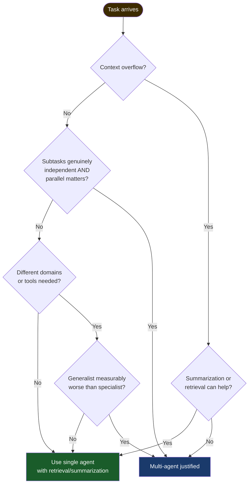

# Do You Actually Need Multi-Agent?

## Purpose

Before choosing any pattern in Family C, answer the questions in this guide. Multi-agent architectures are not a default upgrade — they are a tool for specific problems. Applying them unnecessarily adds coordination overhead, latency, cost, and failure modes without meaningful benefit.

---

## The Baseline Question

**Can one agent with a longer context window do this task sequentially?**

If yes, stop. A single agent with sufficient context is almost always simpler, cheaper, faster, and easier to debug than a multi-agent system. Multi-agent is justified only when a single agent genuinely cannot do the job.

---

## Qualifying Questions

Work through these before committing to multi-agent. A YES to any of the first four is a flag to reconsider.

### 1. Is the "parallelism" actually needed?

- Are the subtasks genuinely independent? (Each can run without the output of the others.)
- Or does it only *feel* faster because you are imagining concurrent execution?
- **If subtasks are sequential**, parallelism is illusory. A single agent processing them in order is equivalent and simpler.

### 2. Is specialization actually needed?

- Does a generalist agent with a well-crafted prompt perform measurably worse than a specialist?
- Or are you adding a specialist because it *sounds* better?
- **If the generalist is good enough**, specialization adds cost and maintenance without quality gain.

### 3. Does coordination overhead exceed the work itself?

- Count the inter-agent calls, context translations, error-routing decisions, and retry logic your design requires.
- Compare that to the actual computation each agent does.
- **If coordination is the majority of the work**, the architecture is inverted. Simplify.

### 4. Is the prompt complexity driving the agent count?

- Would splitting into multiple agents fix a problem that is actually just a poorly structured single-agent prompt?
- **If yes**, simplify the prompt first. Multi-agent systems built to compensate for bad prompts are expensive and fragile.

### 5. Does the context window genuinely overflow?

- Measure the actual token count required for the task.
- Account for outputs being fed back into the context.
- **If context overflow is the real constraint** and cannot be solved by summarization or retrieval, multi-agent is justified.

### 6. Are the subtasks genuinely parallel and independent?

- List the subtasks. For each pair, can subtask B start before subtask A finishes?
- **If dependencies exist**, parallelism is constrained. A sequential single-agent approach may be equivalent.

---

## When Multi-Agent IS Justified

Multi-agent is the right tool when at least one of these conditions holds:

1. **True parallelism**: Subtasks are independent and running them concurrently meaningfully reduces wall-clock time.
2. **Genuine specialization**: Different subtasks require different system prompts, tools, retrieval corpora, or models — and a generalist performs measurably worse.
3. **Real context overflow**: The full task cannot fit in any available context window and summarization/retrieval cannot recover the lost information.
4. **Independent verification**: You need a structurally independent agent to verify or critique outputs — the same agent cannot provide unbiased self-evaluation.
5. **Isolation for safety**: Certain subtasks (e.g., code execution, external API calls) should run in isolated agents to contain failures or side effects.

---

## The Cost of Getting It Wrong

| What you add | What you pay |
|---|---|
| Each additional agent | Extra LLM calls, extra latency, extra tokens |
| Each inter-agent handoff | Context translation, serialization, error routing |
| Each coordination layer | Additional failure modes, harder debugging, longer traces |
| Each parallel fan-out | Synthesis step required; synthesis can introduce errors |

A two-agent system with coordination overhead can be slower and more expensive than a single-agent system, even when both produce equivalent outputs.

---

## Decision Flowchart

<b>Decision Flow</b>

---

## If You Proceed: Choose the Right Pattern

If multi-agent is justified, consult the [Family C README](../README.md) quick-reference table to select the right pattern.

The anti-pattern to read before building: [Multi-Agent by Default](../anti-patterns/multi-agent-by-default.md).

---

## Sources

- **Anthropic Engineering** — AI safety company; authors of Claude. [Building Effective Agents](https://www.anthropic.com/engineering/building-effective-agents)
- **OpenAI Engineering** — AI research company; authors of GPT and Codex. [A Practical Guide to Building AI Agents](https://openai.com/business/guides-and-resources/a-practical-guide-to-building-ai-agents/)
- **Google Cloud Architecture Center** — Google's cloud architecture team. [Choose a Design Pattern for Agentic AI](https://docs.cloud.google.com/architecture/choose-design-pattern-agentic-ai-system)
- **AWS Prescriptive Guidance** — Amazon Web Services architecture team. [Agentic AI Patterns](https://docs.aws.amazon.com/prescriptive-guidance/latest/agentic-ai-patterns/agent-patterns.html)
