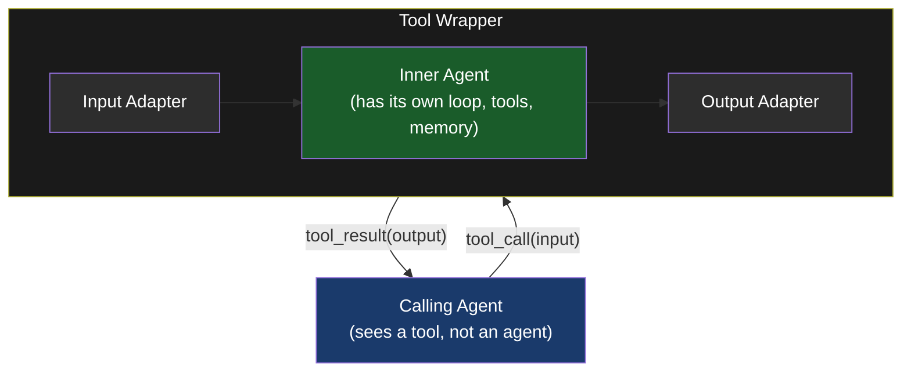

# Agent-as-Tool

## Intent

Wrap an agent behind a tool interface so that a calling agent can invoke it like any other tool — without knowing it is an agent.

## Motivation

As agent systems grow, callers accumulate knowledge of which workers are agents vs. simple functions. This coupling makes the system brittle: changing a worker from a function to an agent (or back) requires updating callers. By wrapping an agent as a tool, the caller sees a clean interface (`tool_name(input) → output`), the worker's internal agentic loop is encapsulated, and the two can evolve independently.

## Structure

<details>
<summary><b>Solution Structure</b></summary>



</details>

## Participants

| Role | Responsibility |
|------|---------------|
| Calling Agent | Invokes the tool by name with a structured input; receives a structured output; unaware of the worker's internal implementation |
| Tool Wrapper | Adapts the tool-call interface to the inner agent's input format; invokes the agent; adapts the agent's output to the tool-result format |
| Inner Agent | Runs its own agentic loop, uses its own tools and memory, and produces a result; unaware it is being called via a tool interface |

## How It Works

1. The calling agent selects the agent-as-tool from its tool registry (just like any other tool).
2. The calling agent emits a structured tool call with the required input fields.
3. The tool wrapper receives the call, adapts the input, and invokes the inner agent.
4. The inner agent runs its agentic loop — potentially using its own tools, memory, and multi-step reasoning.
5. The inner agent produces a result.
6. The tool wrapper adapts the result to the expected tool-result schema and returns it to the calling agent.
7. The calling agent receives the result and continues its own loop.

## When to Use

- You want to expose a complex, multi-step sub-process as a simple tool call.
- The worker may evolve from a simple function to an agent (or vice versa) and you want to insulate the caller from that change.
- The inner agent requires its own tools, context, or memory that should not pollute the calling agent's context.
- You are building a library of reusable agents that callers should access through a stable interface.
- The calling agent already has a tool-use loop and you want to add agent-level capability without restructuring it.

## When NOT to Use

- The worker is a simple, deterministic function — wrapping it as an agent-as-tool adds complexity without benefit.
- The calling agent needs to inspect or control the inner agent's intermediate steps.
- Latency from the inner agent's loop is unacceptable in the calling agent's flow.
- The inner agent needs to call back into the calling agent — this creates coupling that the pattern is designed to avoid.

## Variants

**Opaque Tool**: The calling agent has no knowledge of the inner agent's capabilities beyond the tool's description. Fully encapsulated.

**Transparent Tool**: The tool description includes information about the inner agent's capabilities, allowing the caller to pass richer inputs. Partial encapsulation.

**Recursive Agent-as-Tool**: The inner agent itself uses agent-as-tool wrappers for its own sub-agents. Enables deep nesting without caller-level complexity.

**Streaming Tool**: The wrapper streams partial results back to the caller as the inner agent makes progress. Useful for long-running inner agents.

## Implementation Notes

- **Tool schema design**: Define the tool's input/output schema from the calling agent's perspective first — not from the inner agent's implementation. The wrapper is responsible for translation.
- **Error handling**: Inner agent failures must be caught at the wrapper layer and returned as structured tool errors. Never let an inner agent exception propagate unhandled to the calling agent.
- **Context isolation**: The inner agent should not inherit the calling agent's context unless explicitly passed. This prevents context leakage and keeps the inner agent's behavior predictable.
- **Timeout**: Set an explicit timeout on the tool wrapper. The calling agent's loop must not block indefinitely on a slow inner agent.
- **Cost tracking**: The inner agent's token usage is not visible to the calling agent. Track it at the wrapper level for observability.
- **Idempotency**: If the calling agent might retry a failed tool call, the inner agent must be idempotent.

## Trade-offs

| Pro | Con |
|-----|-----|
| Caller is decoupled from worker implementation | Inner agent's intermediate steps are invisible to the caller |
| Worker can be upgraded from function to agent transparently | Debugging is harder — failures may originate deep in the inner agent |
| Reusable agents with stable interfaces | Latency of the inner agent's loop is fully absorbed by the caller's tool call |
| Inner agent has isolated context and tools | Error messages from the inner agent may be opaque without extra instrumentation |
| Enables recursive agent composition | Wrapping adds a translation layer that can silently mismatch schemas |

## Related Patterns

- [Orchestrator → Workers](orchestrator-workers.md) — workers in an orchestrator can each be agent-as-tool instances
- [Coordinator → Specialists](coordinator-specialists.md) — specialists are natural candidates to wrap as tools
- [Manager → Workers](manager-workers.md) — manager's tool registry can include agent-as-tool entries
- [Hierarchical Coordinator](hierarchical-coordinator.md) — sub-coordinators can be wrapped as tools at the parent level
- [Family A — Topology](../A-topology/README.md) — agent-as-tool creates a nested node in the topology

## Example Sketch

```
// Tool wrapper definition (called by the calling agent's tool loop)
tool "research_agent":
    description: "Researches a topic and returns a structured summary."
    input_schema: { topic: string, depth: "shallow" | "deep" }
    output_schema: { summary: string, sources: list[string] }

    handler(input):
        agent = ResearchAgent(
            system_prompt = RESEARCH_SYSTEM_PROMPT,
            tools = [web_search, read_page, extract_facts]
        )
        result = agent.run(
            prompt = format_research_prompt(input.topic, input.depth)
        )
        return { summary: result.answer, sources: result.citations }
        // Inner agent's full loop is hidden; caller sees only this return


// Calling agent uses the tool like any other
function calling_agent(task):
    if needs_research(task):
        research = call_tool("research_agent", { topic: task.topic, depth: "deep" })
        // Calling agent does not know research_agent is itself an agent
    continue_with(research.summary)
```

## Sources

- **Anthropic Engineering** — AI safety company; authors of Claude. [Building Effective Agents](https://www.anthropic.com/engineering/building-effective-agents)
- **OpenAI Engineering** — AI research company; authors of GPT and Codex. [A Practical Guide to Building AI Agents](https://openai.com/business/guides-and-resources/a-practical-guide-to-building-ai-agents/)
- **AWS Prescriptive Guidance** — Amazon Web Services architecture team. [Agentic AI Patterns](https://docs.aws.amazon.com/prescriptive-guidance/latest/agentic-ai-patterns/agent-patterns.html)
