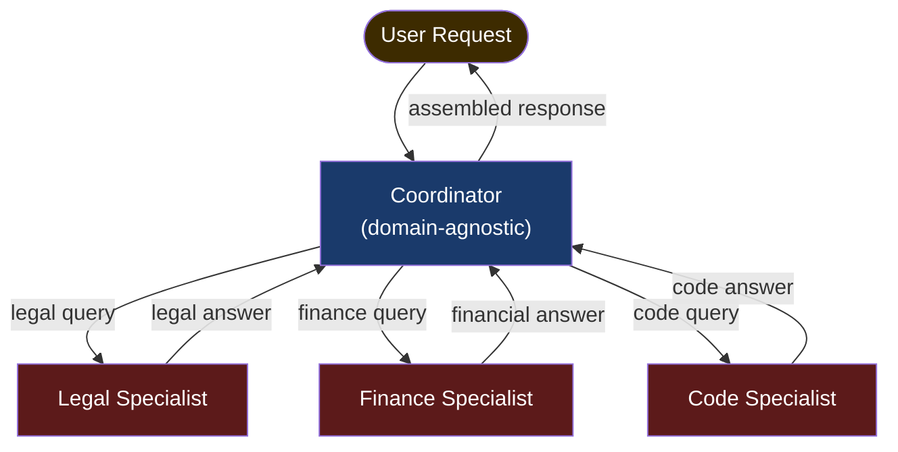

# Coordinator → Specialists

## Intent

A neutral coordinator routes tasks to domain-expert agents, relying entirely on each specialist's expertise to handle its domain — the coordinator itself has no domain knowledge.

## Motivation

When a generalist agent tries to handle multiple domains (legal, financial, medical, code, data), it either performs mediocrely across all of them or requires an impractically large prompt. A coordinator with no domain knowledge offloads each domain to an agent that was built specifically for it, getting best-of-class results per domain while keeping the coordination layer simple and replaceable.

## Structure

<details>
<summary><b>Solution Structure</b></summary>



</details>

## Participants

| Role | Responsibility |
|------|---------------|
| Coordinator | Classifies the incoming request; identifies which specialist(s) are needed; routes inputs; assembles responses; has no domain knowledge |
| Specialist | Deep expert in one domain; receives a well-scoped query; returns a domain-specific answer; knows nothing about other specialists |
| User / Caller | Submits a potentially cross-domain request; receives an assembled response |

## How It Works

1. User submits a request that may span multiple domains.
2. Coordinator classifies the request into one or more domain queries.
3. Coordinator routes each domain query to the appropriate specialist.
4. Specialists process their queries independently, drawing on domain-specific prompts, tools, or fine-tuning.
5. Coordinator collects specialist responses.
6. Coordinator assembles a coherent final response (stitching, summarizing, or simply returning the relevant specialist output).
7. Final response is returned to the user.

## When to Use

- The problem spans multiple distinct domains where a generalist cannot match specialist quality.
- Domain boundaries are clear enough that a request can be cleanly routed.
- Specialists can be built, maintained, or updated independently of one another.
- You want to swap out or add specialists without changing the coordinator.
- Quality in each domain is more important than coordination simplicity.

## When NOT to Use

- The domains are not truly distinct — a good generalist prompt handles all of them adequately.
- Routing itself requires domain knowledge (the coordinator would need to be a specialist to classify correctly).
- The task requires tight integration between domains mid-execution (not just at assembly).
- Coordination overhead exceeds the quality gain from specialization.

## Variants

**Static Registry**: Specialists are registered at build time; coordinator selects from a fixed list. Simple and predictable.

**Dynamic Discovery**: Specialists register their capabilities at runtime; coordinator queries the registry to find the right agent. Flexible for large catalogs.

**Multi-Specialist Query**: A single request activates multiple specialists in parallel; coordinator assembles all outputs. Used for cross-domain questions.

**Gated Specialist**: Coordinator evaluates whether a specialist is needed before calling it (e.g., "does this request involve legal risk?"). Reduces unnecessary calls.

## Implementation Notes

- **Coordinator prompt discipline**: The coordinator's system prompt must explicitly state that it has no domain knowledge and must not attempt to answer domain questions itself. This prevents the coordinator from hallucinating domain answers when a specialist is unavailable.
- **Specialist scoping**: Each specialist should receive only the relevant sub-query — not the full original request. Strip irrelevant context before dispatch.
- **Assembly strategy**: Define upfront how specialist outputs are assembled. Options: direct concatenation, coordinator summarization, or returning only the highest-confidence specialist output.
- **Fallback**: If no specialist matches a domain, the coordinator should return "I cannot answer this domain" rather than attempting a generalist response.
- **Specialist isolation**: Specialists must not call each other directly. All cross-specialist data flows through the coordinator to maintain auditability.
- **Token budget**: Specialist prompts can be deep (long system prompts, retrieval context). Monitor total tokens across all specialist calls.

## Trade-offs

| Pro | Con |
|-----|-----|
| Best-of-class quality per domain | Coordinator must classify correctly — misrouting degrades quality |
| Specialists are independently maintainable | Assembly of multi-domain responses can be incoherent |
| Coordinator is simple and domain-agnostic | More agents to maintain, monitor, and version |
| Adding a new domain means adding a specialist, not changing the coordinator | Tightly coupled cross-domain tasks may not decompose cleanly |
| Clear separation of concerns | Latency increases with number of specialists called per request |

## Related Patterns

- [Manager → Workers](manager-workers.md) — manager owns goal state; coordinator does not
- [Orchestrator → Workers](orchestrator-workers.md) — orchestrator routes by task type; coordinator routes by domain expertise
- [Specialist Reviewer](specialist-reviewer.md) — a specialist whose only job is critique, not production
- [Agent-as-Tool](agent-as-tool.md) — each specialist can be wrapped as a callable tool in the coordinator's loop
- [Family B — Task Decomposition](../B-task-decomposition/README.md) — how to decompose a cross-domain request before routing

## Example Sketch

```
// Coordinator — no domain knowledge
function coordinator(user_request):
    domains = classify_domains(user_request)
    // classify_domains returns e.g. ["legal", "finance"]

    results = {}
    for domain in domains:
        specialist = registry.get(domain)
        scoped_query = extract_domain_query(user_request, domain)
        results[domain] = specialist.answer(scoped_query)

    return assemble(results)
    // Coordinator stitches responses; does not reinterpret domain answers


// Specialist — deep domain focus
function legal_specialist(query):
    // Has legal-specific system prompt, tools, retrieval
    return answer_legal_question(query)
```

## Sources

- **Anthropic Engineering** — AI safety company; authors of Claude. [Building Effective Agents](https://www.anthropic.com/engineering/building-effective-agents)
- **Microsoft Azure Architecture Center** — Microsoft's cloud architecture team. [AI Agent Design Patterns](https://learn.microsoft.com/en-us/azure/architecture/ai-ml/guide/ai-agent-design-patterns)
- **Google Cloud Architecture Center** — Google's cloud architecture team. [Choose a Design Pattern for Agentic AI](https://docs.cloud.google.com/architecture/choose-design-pattern-agentic-ai-system)
- **OpenAI Engineering** — AI research company; authors of GPT and Codex. [A Practical Guide to Building AI Agents](https://openai.com/business/guides-and-resources/a-practical-guide-to-building-ai-agents/)
