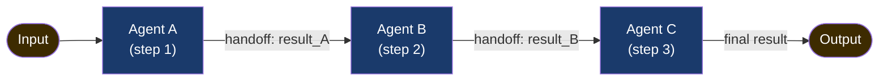

# Decentralized Handoff

## Intent

Agents pass work directly to the next peer agent without routing through a central controller, forming a peer-to-peer chain or graph of handoffs.

## Motivation

Centralized orchestrators become bottlenecks when the workflow is a long sequential chain — every message passes through the orchestrator even when it adds no value. Decentralized handoff removes the middleman: each agent knows what comes next and passes directly to it. This reduces latency, eliminates the orchestrator as a single point of failure, and allows the chain to be modified locally (add a step between A and B) without changing a central routing table.

## Structure

<details>
<summary><b>Solution Structure</b></summary>



</details>

## Participants

| Role | Responsibility |
|------|---------------|
| Peer Agent | Executes its step; packages its output as a handoff message; routes directly to the next peer; no awareness of the global workflow beyond its immediate successor |
| Handoff Message | Carries the accumulated result and any routing metadata needed by the next agent |
| Entry Point | Receives the initial input and starts the chain |
| Terminal Agent | Produces the final output; does not hand off further |

## How It Works

1. Entry point sends the initial input to the first agent in the chain.
2. Agent A processes its step and packages its output as a handoff message.
3. Agent A routes the handoff directly to Agent B — no central controller involved.
4. Agent B processes its step using the handoff payload and produces its own output.
5. Each subsequent agent repeats this until the terminal agent produces the final output.
6. The terminal agent returns the result to the original caller or writes it to a shared store.

## When to Use

- The workflow is a well-defined sequential pipeline where each step knows its successor.
- Reducing latency is important and the orchestrator adds no processing value on each hop.
- The chain needs to be dynamically extensible — inserting a step between two agents should not require changing a central router.
- Agents are specialized and each knows what the next step in the process is.
- Resilience to central controller failure is a concern.

## When NOT to Use

- The routing decision at each step requires global knowledge of the workflow — a central orchestrator has better visibility.
- The workflow is a fan-out (one input to many workers) rather than a sequential chain.
- Auditability is critical — decentralized handoff is harder to trace end-to-end than centralized routing.
- Agents need to be reordered or the pipeline reconfigured frequently — a central routing table is easier to update.
- Error recovery requires coordination across multiple agents — decentralized handoff makes cross-agent rollback harder.

## Variants

**Linear Chain**: Each agent has exactly one successor. The simplest form.

**Branching Handoff**: An agent evaluates its output and routes to one of several possible successors based on a condition. Creates a directed acyclic graph rather than a linear chain.

**Ring**: Agents are arranged in a loop; work circulates until a termination condition is met. Uncommon; use with caution to avoid infinite loops.

**Gossip / Broadcast**: An agent sends its output to multiple peers simultaneously. Closer to fan-out; most useful in distributed state synchronization scenarios.

## Implementation Notes

- **Handoff message schema**: Define a shared handoff schema used by all agents in the chain. At minimum: `{ source_agent, step_result, accumulated_context, next_agent }`. Never let agents pass raw, unstructured text between themselves.
- **Routing metadata**: Each agent should encode `next_agent` in the handoff message rather than hard-coding it. This allows the chain to be reconfigured by changing the message, not the agent.
- **Observability**: Without a central controller, tracing the full chain requires correlation IDs. Assign a `trace_id` at the entry point and propagate it in every handoff message.
- **Loop prevention**: In branching or ring variants, include a `hop_count` in the handoff message and set a maximum. Terminate and raise an error if exceeded.
- **Failure handling**: Each agent must handle the case where its predecessor produced an error. Define whether to propagate, recover, or terminate the chain on error.
- **Idempotency**: If a handoff message is redelivered (e.g., due to a retry), agents must handle duplicate inputs gracefully.

## Trade-offs

| Pro | Con |
|-----|-----|
| No central bottleneck or single point of failure | End-to-end tracing requires explicit correlation IDs |
| Lower latency for sequential chains | Harder to reconfigure the pipeline globally |
| Each agent is independently deployable and testable | Error recovery across multiple agents is complex |
| Easy to insert new steps between two agents | No global view of workflow progress without aggregation |
| Scales horizontally — each agent is an independent process | Agents must know their successors, introducing implicit coupling |

## Related Patterns

- [Orchestrator → Workers](orchestrator-workers.md) — centralized alternative to decentralized handoff
- [Manager → Workers](manager-workers.md) — manager maintains global state and can recover from chain failures
- [Hierarchical Coordinator](hierarchical-coordinator.md) — nested coordinators can use decentralized handoff internally within each subtree
- [Synthesizer / Aggregator](synthesizer-aggregator.md) — terminal node that collects results from a branching handoff
- [Family A — Topology](../A-topology/README.md) — decentralized handoff implements a pipeline or DAG topology

## Example Sketch

```
// Shared handoff message schema
type Handoff = {
    trace_id: string,
    hop_count: int,
    step_result: any,
    accumulated: any,
    next_agent: string | null
}

// Each agent in the chain
function agent_B(handoff: Handoff):
    if handoff.hop_count > MAX_HOPS:
        raise Error("hop limit exceeded")

    result = process_step_B(handoff.step_result)

    next = {
        trace_id: handoff.trace_id,
        hop_count: handoff.hop_count + 1,
        step_result: result,
        accumulated: merge(handoff.accumulated, result),
        next_agent: "agent_C"   // B knows its successor
    }

    if next.next_agent:
        dispatch(next.next_agent, next)
    else:
        return next.accumulated   // Terminal agent


// Entry point
function start(input):
    initial = {
        trace_id: new_trace_id(),
        hop_count: 0,
        step_result: input,
        accumulated: {},
        next_agent: "agent_A"
    }
    dispatch("agent_A", initial)
```

## Sources

- **Anthropic Engineering** — AI safety company; authors of Claude. [Building Effective Agents](https://www.anthropic.com/engineering/building-effective-agents)
- **Google Cloud Architecture Center** — Google's cloud architecture team. [Choose a Design Pattern for Agentic AI](https://docs.cloud.google.com/architecture/choose-design-pattern-agentic-ai-system)
- **AWS Prescriptive Guidance** — Amazon Web Services architecture team. [Agentic AI Patterns](https://docs.aws.amazon.com/prescriptive-guidance/latest/agentic-ai-patterns/agent-patterns.html)
- **Microsoft Azure Architecture Center** — Microsoft's cloud architecture team. [AI Agent Design Patterns](https://learn.microsoft.com/en-us/azure/architecture/ai-ml/guide/ai-agent-design-patterns)
