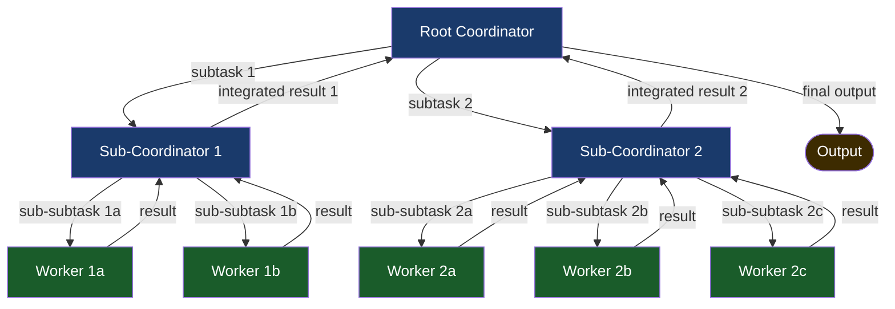

# Hierarchical Coordinator

## Intent

Nest coordinators recursively so that a root coordinator delegates to sub-coordinators, each of which manages its own subtree of workers — enabling deep decomposition of complex goals without overwhelming any single coordinator.

## Motivation

When a task is too large for a flat manager/orchestrator structure, a single coordinator must hold too much context: all subtasks, all workers, all intermediate results. At scale this causes context overflow, degraded planning quality, and an unmaintainable coordinator prompt. Hierarchical coordinators solve this by applying the divide-and-conquer principle to the coordination layer itself: each coordinator manages only the subtasks within its scope, and sub-coordinators are opaque to their parent.

## Structure

<details>
<summary><b>Solution Structure</b></summary>



</details>

## Participants

| Role | Responsibility |
|------|---------------|
| Root Coordinator | Owns the top-level goal; decomposes into major subtasks; delegates each to a sub-coordinator; integrates sub-coordinator results |
| Sub-Coordinator | Owns a scoped subtask; decomposes it further; manages its own workers; returns a single integrated result to the root |
| Leaf Worker | Executes a single atomic task; returns a result to its direct coordinator |

## How It Works

1. Root coordinator receives the top-level goal.
2. Root decomposes the goal into major sub-goals (each scoped enough to fit within a sub-coordinator's context).
3. Root dispatches each sub-goal to a sub-coordinator.
4. Each sub-coordinator independently decomposes its sub-goal into leaf tasks and dispatches them to workers.
5. Workers execute leaf tasks and return results to their sub-coordinator.
6. Each sub-coordinator integrates its workers' results into a single output and returns it to the root.
7. Root integrates all sub-coordinator outputs into the final result.

## When to Use

- The top-level goal cannot be decomposed into leaf tasks without exceeding a single coordinator's context capacity.
- The problem has a natural hierarchical structure (e.g., a large document with chapters, a software system with modules, a multi-phase project).
- Different subtrees require different expertise or tool sets at the coordinator level.
- You want to parallelize at multiple levels of the hierarchy.

## When NOT to Use

- A flat [Manager → Workers](manager-workers.md) structure fits within context limits — hierarchy adds coordination overhead without benefit.
- The decomposition is shallow (two levels) and the flat structure is readable.
- Sub-coordinators would be trivial wrappers with no meaningful decomposition work.
- The task requires cross-subtree communication at the leaf level — hierarchies make this costly.

## Variants

**Fixed Depth**: The hierarchy has a pre-defined number of levels (e.g., root → department coordinators → worker agents). Structure is determined at design time.

**Dynamic Depth**: Each coordinator decides at runtime whether to spawn a sub-coordinator or a leaf worker, based on task size. More flexible but harder to bound.

**Homogeneous Tree**: All coordinators use the same coordinator template; only their scoped goals differ. Simpler to implement and maintain.

**Heterogeneous Tree**: Different coordinator levels have different prompts, tools, or models. Used when different levels of the hierarchy require different capabilities.

## Implementation Notes

- **Scope discipline**: Each coordinator's context must be bounded to its subtree. Never pass the full global goal to a sub-coordinator — pass only the scoped sub-goal.
- **Result contracts**: Define a result schema for each level of the hierarchy. Sub-coordinators return structured results, not free-form text.
- **Depth limit**: Set a maximum depth (e.g., 3 levels). Unbounded recursion is a bug; hierarchies deeper than 3 levels are usually a sign of over-decomposition.
- **Error propagation**: A sub-coordinator failure should return a structured error to the root. The root decides whether to retry, reroute, or abort.
- **Parallelism**: Sub-coordinators at the same level can run in parallel. Workers within a sub-coordinator can also run in parallel. Both levels of parallelism are independent.
- **Context propagation**: Pass only the context each sub-coordinator needs. A common mistake is passing the root's full context to every sub-coordinator, defeating the purpose of hierarchy.

## Trade-offs

| Pro | Con |
|-----|-----|
| Scales to very large, deeply structured tasks | Coordination overhead compounds at each level |
| Each coordinator's context is bounded and manageable | End-to-end latency increases with depth |
| Subtrees can be parallelized independently | Debugging requires tracing across multiple coordinator levels |
| Subtrees can use different models or tools | Misaligned scope definitions between levels cause gaps or duplication |
| Natural fit for hierarchically structured domains | Over-decomposition is easy — many teams add levels they don't need |

## Related Patterns

- [Manager → Workers](manager-workers.md) — the single-level base case of this pattern
- [Orchestrator → Workers](orchestrator-workers.md) — stateless variant; can be used at any level of the hierarchy
- [Coordinator → Specialists](coordinator-specialists.md) — sub-coordinators can be domain specialists
- [Agent-as-Tool](agent-as-tool.md) — sub-coordinators can be wrapped as tools for the root
- [Synthesizer / Aggregator](synthesizer-aggregator.md) — each coordinator-level integration is a synthesizer
- [Family B — Task Decomposition](../B-task-decomposition/README.md) — the decomposition strategy used at each level

## Example Sketch

```
// Root coordinator
function root_coordinator(goal):
    sub_goals = decompose_top_level(goal)
    // e.g. ["research phase", "analysis phase", "writing phase"]

    sub_results = parallel_map(sub_goals, sub_coordinator)
    return integrate_top_level(sub_results)


// Sub-coordinator — same pattern, narrower scope
function sub_coordinator(sub_goal):
    leaf_tasks = decompose_sub_goal(sub_goal)
    // Each task is now small enough for a single worker

    worker_results = parallel_map(leaf_tasks, leaf_worker)
    return integrate_sub_level(worker_results)
    // Returns ONE result to the root; root does not see leaf details


// Leaf worker
function leaf_worker(task):
    return execute(task.instructions)
```

## Sources

- **Anthropic Engineering** — AI safety company; authors of Claude. [Building Effective Agents](https://www.anthropic.com/engineering/building-effective-agents)
- **Google Cloud Architecture Center** — Google's cloud architecture team. [Choose a Design Pattern for Agentic AI](https://docs.cloud.google.com/architecture/choose-design-pattern-agentic-ai-system)
- **AWS Prescriptive Guidance** — Amazon Web Services architecture team. [Agentic AI Patterns](https://docs.aws.amazon.com/prescriptive-guidance/latest/agentic-ai-patterns/agent-patterns.html)
- **Microsoft Azure Architecture Center** — Microsoft's cloud architecture team. [AI Agent Design Patterns](https://learn.microsoft.com/en-us/azure/architecture/ai-ml/guide/ai-agent-design-patterns)
