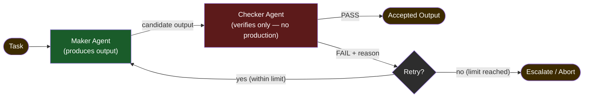

# Maker-Checker

## Intent

A maker agent produces an output; an independent checker agent verifies it — and the output is only accepted when the checker confirms it is correct.

## Motivation

LLM agents make mistakes: hallucinations, logic errors, off-by-one bugs, missed constraints. When the cost of an undetected error is high — a wrong database write, a dangerous action, a factually incorrect report — relying on the maker's self-assessment is insufficient. The maker-checker pattern introduces a structurally independent verification step before any output is committed. The checker's independence is the pattern's invariant: it must not share context, prompt, or model state with the maker.

## Structure

<details>
<summary><b>Solution Structure</b></summary>



</details>

## Participants

| Role | Responsibility |
|------|---------------|
| Maker | Produces a candidate output for the given task; has no role in verification |
| Checker | Independently verifies the candidate output against defined correctness criteria; returns a binary pass/fail verdict with a reason; does not produce content |
| Coordinator / Caller | Passes the candidate to the checker; routes based on the verdict; decides retry vs. escalation policy |

## How It Works

1. Coordinator passes the task to the maker.
2. Maker produces a candidate output.
3. Coordinator passes the candidate output (and the original task) to the checker.
4. Checker evaluates the candidate against defined correctness criteria.
5. If the checker returns PASS: the output is accepted and returned to the caller.
6. If the checker returns FAIL: the coordinator either retries the maker (with the failure reason as feedback) or escalates if the retry limit is reached.
7. No output is committed or returned to the user unless the checker has passed it.

## When to Use

- The cost of an undetected error is high (irreversible actions, safety-critical outputs, financial operations).
- The correctness criteria are well-defined and checkable by an LLM or automated verifier.
- You want a hard gate before an output is committed or exposed to downstream systems.
- The maker and checker can genuinely be independent (different prompts, ideally different models).
- Self-verification by the maker has proven insufficient.

## When NOT to Use

- The correctness criteria cannot be made precise — use [Specialist Reviewer](specialist-reviewer.md) for qualitative critique instead.
- The overhead of a second pass is not justified by the risk level.
- Maker and checker would use the same model and context — independence is illusory and the pattern provides no real guarantee.
- The task is low-stakes and the cost of occasional errors is acceptable.
- A simpler automated test (unit test, schema validation, regex) can do the checking — no LLM needed.

## Variants

**Binary Maker-Checker**: Checker returns only PASS or FAIL (no rationale). Fastest; used when failures are rare and the maker retries from scratch.

**Diagnostic Maker-Checker**: Checker returns FAIL with a specific reason. Maker uses the reason as feedback on retry. Faster convergence than binary.

**Multi-Checker**: Multiple independent checkers must all PASS before the output is accepted. Increases confidence at the cost of latency and token spend.

**Cascaded Checker**: First checker is fast and cheap (schema validation, rule-based); second checker is a full LLM verification only if the first passes. Reduces cost on common failures.

**Human-in-the-Loop Checker**: The checker is a human approval step. See [Family K — Human-in-the-Loop](../../K-human-control/README.md).

## Implementation Notes

- **Independence is mandatory**: The checker must not see the maker's reasoning or intermediate steps — only the candidate output and the task specification. Shared context destroys independence.
- **Checker prompt design**: The checker's system prompt must be scoped strictly to verification. It must not contain instructions that could cause it to generate alternative outputs.
- **Structured verdict**: Checker returns `{ verdict: "pass" | "fail", reason: string | null }`. Reason is required on fail.
- **Retry policy**: Pass the failure reason to the maker as feedback on retry. Blind retries (no feedback) converge slowly.
- **Retry limit**: Hard limit of 2–3 retries. If the maker cannot satisfy the checker after N attempts, escalate to a human or abort. Infinite retry loops are a production incident waiting to happen.
- **Checker ≠ Reviewer**: The checker produces a binary verdict on defined criteria. The [Specialist Reviewer](specialist-reviewer.md) provides qualitative critique on multiple dimensions. They serve different purposes.
- **Model diversity**: Where possible, use a different model for the checker than for the maker. Correlated failures in maker and checker reduce the pattern's effectiveness.

## Trade-offs

| Pro | Con |
|-----|-----|
| Hard gate prevents undetected errors from committing | Adds latency and cost of a second LLM call |
| Checker independence provides real (not self-referential) verification | Independence is degraded if maker and checker share model and context |
| Structured PASS/FAIL enables automated routing | Correctness criteria must be precise — vague criteria produce unreliable checks |
| Diagnostic failure reasons accelerate retry convergence | Retry loops can run to the limit if maker and checker are misaligned |
| Works well as a pre-commit gate in agentic pipelines | Does not replace domain expertise — checker must be equipped to verify the domain |

## Related Patterns

- [Specialist Reviewer](specialist-reviewer.md) — qualitative critique vs. binary verification; different purposes
- [Manager → Workers](manager-workers.md) — manager can invoke maker-checker as a sub-pattern for high-risk worker outputs
- [Synthesizer / Aggregator](synthesizer-aggregator.md) — synthesizer unifies many; checker verifies one
- [Family K — Human-in-the-Loop](../../K-human-control/README.md) — human as checker; escalation path when automated checker fails

## Example Sketch

```
MAX_RETRIES = 3

function maker_checker(task):
    feedback = null

    for attempt in range(MAX_RETRIES):
        // Maker produces candidate (optionally with prior failure feedback)
        candidate = maker.produce(task, prior_feedback = feedback)

        // Checker independently verifies — receives only candidate + task spec
        verdict = checker.verify(
            task_spec = task,
            candidate = candidate
            // Checker does NOT receive maker's reasoning or intermediate steps
        )

        if verdict.verdict == "pass":
            return candidate     // Accepted; commit or return to caller

        feedback = verdict.reason    // Feed failure reason back to maker

    raise MaxRetriesExceeded(last_failure = feedback)


// Maker — production only
function maker.produce(task, prior_feedback):
    prompt = build_prompt(task, hint = prior_feedback)
    return llm.generate(prompt)


// Checker — verification only
function checker.verify(task_spec, candidate):
    prompt = build_check_prompt(task_spec, candidate, CORRECTNESS_CRITERIA)
    raw = llm.generate(prompt)   // Different model preferred
    return parse_verdict(raw)    // { verdict: "pass"|"fail", reason: string }
```

## Sources

- **Anthropic Engineering** — AI safety company; authors of Claude. [Building Effective Agents](https://www.anthropic.com/engineering/building-effective-agents)
- **Google Cloud Architecture Center** — Google's cloud architecture team. [Choose a Design Pattern for Agentic AI](https://docs.cloud.google.com/architecture/choose-design-pattern-agentic-ai-system)
- **AWS Prescriptive Guidance** — Amazon Web Services architecture team. [Agentic AI Patterns](https://docs.aws.amazon.com/prescriptive-guidance/latest/agentic-ai-patterns/agent-patterns.html)
- **Stanford CS224G** — Stanford University course on LLM agents. [Agentic Design Patterns (lecture slides)](https://web.stanford.edu/class/cs224g/2025/lectures/Agentic_Design_Patterns.pdf)
