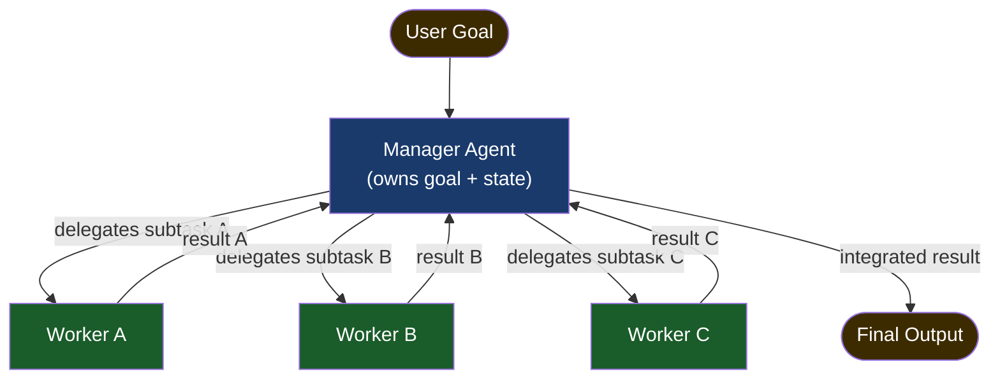

# Manager → Workers

## Intent

A single manager agent owns a goal end-to-end, delegates subtasks to worker agents, and integrates their results into a final output.

## Motivation

Without this pattern, a single agent must handle planning, execution, and integration simultaneously — overloading its context, increasing error surface, and making it hard to parallelize independent subtasks. The manager separates strategic responsibility (what needs to be done and in what order) from tactical execution (how each piece gets done).

## Structure

<details>
<summary><b>Solution Structure</b></summary>



</details>

## Participants

| Role | Responsibility |
|------|---------------|
| Manager | Holds the top-level goal, maintains task state, decides delegation order, integrates results, handles failures |
| Worker | Executes one assigned subtask; returns a result; has no knowledge of the larger goal |
| User / Caller | Provides the goal to the manager; receives the final integrated result |

## How It Works

1. User submits a goal to the manager.
2. Manager decomposes the goal into subtasks and determines dependencies.
3. Manager dispatches independent subtasks to workers (in parallel where possible).
4. Each worker executes its subtask and returns a result.
5. Manager collects results, checks for errors, and retries or reroutes on failure.
6. Manager integrates all results into a coherent final output.
7. Manager returns the final output to the user.

## When to Use

- The goal requires multiple distinct subtasks that a single agent cannot complete within its context window.
- Subtasks are independent enough to parallelize.
- You need a single point of accountability — one agent that can be held responsible for the outcome.
- The manager needs to adapt delegation dynamically based on intermediate results.
- Workers are interchangeable or reusable across different goals.

## When NOT to Use

- A single agent with a longer context window can complete the task sequentially — the coordination overhead is not worth it.
- Subtasks are tightly coupled and cannot be parallelized; sequential steps in one agent are simpler.
- The goal is simple enough that decomposition adds complexity without quality gain.
- You need domain expertise at the coordination level — consider Coordinator → Specialists instead.

## Variants

**Sequential Manager**: Manager dispatches workers one at a time, feeding each result into the next worker's context. Used when subtasks are dependent.

**Parallel Manager**: Manager dispatches all independent workers simultaneously and collects results. Used when subtasks are genuinely independent.

**Adaptive Manager**: Manager reviews intermediate results before deciding whether to dispatch more workers, retry failed ones, or terminate early. Used when the plan cannot be fully determined upfront.

**Hierarchical Manager**: Manager delegates to sub-managers rather than leaf workers. See [Hierarchical Coordinator](hierarchical-coordinator.md).

## Implementation Notes

- **State ownership**: The manager must carry all goal state. Workers are stateless; do not rely on workers remembering previous calls.
- **Context passing**: Pass only the context each worker needs for its subtask — not the full goal or all prior results. This prevents context bloat and leakage.
- **Failure handling**: The manager must detect worker failures explicitly. Workers should return structured results with a success/error field rather than raising exceptions silently.
- **Retry budget**: Set a maximum retry count per subtask. A failing worker should not block the manager indefinitely.
- **Token budget**: Track cumulative tokens across workers. The manager's integration step needs enough remaining context to synthesize all results.
- **Idempotency**: Design workers to be safe to retry. If a worker mutates external state, ensure idempotency or add deduplication.

## Trade-offs

| Pro | Con |
|-----|-----|
| Clear single point of accountability | Manager becomes a bottleneck if it must process all results sequentially |
| Workers are reusable and independently testable | Coordination overhead adds latency |
| Manager can adapt the plan based on intermediate results | Manager's context grows with each result; may hit limits on large tasks |
| Parallelism is explicit and controllable | Worker failures require manager-level retry logic |
| Simpler workers are cheaper and less error-prone | Manager must have enough intelligence to decompose and integrate well |

## Related Patterns

- [Orchestrator → Workers](orchestrator-workers.md) — similar structure, but the orchestrator routes without owning state
- [Coordinator → Specialists](coordinator-specialists.md) — coordinator has no domain knowledge; workers are domain experts
- [Hierarchical Coordinator](hierarchical-coordinator.md) — nested managers for deep decomposition
- [Synthesizer / Aggregator](synthesizer-aggregator.md) — specialized integration step after parallel fan-out
- [Maker-Checker](maker-checker.md) — add a verification layer after workers produce results
- [Family B — Task Decomposition](../B-task-decomposition/README.md) — patterns for how a manager breaks down the goal
- [Family K — Human-in-the-Loop](../K-human-in-the-loop/README.md) — where to insert human gates in the manager loop

## Example Sketch

```
function manager(goal):
    plan = decompose(goal)                    // Manager plans upfront
    results = {}

    parallel_tasks = [t for t in plan if no_dependencies(t)]
    for task in parallel_tasks:
        results[task.id] = dispatch(worker, task)   // Fire in parallel

    for remaining in plan.sequential_steps:
        input = build_input(remaining, results)
        results[remaining.id] = dispatch(worker, input)

    return integrate(results)                 // Manager owns integration


function worker(subtask):
    output = execute(subtask.instructions)
    return { success: true, result: output }
    // Worker knows nothing about the larger goal
```

## Sources

- **Anthropic Engineering** — AI safety company; authors of Claude. [Building Effective Agents](https://www.anthropic.com/engineering/building-effective-agents)
- **Google Cloud Architecture Center** — Google's cloud architecture team. [Choose a Design Pattern for Agentic AI](https://docs.cloud.google.com/architecture/choose-design-pattern-agentic-ai-system)
- **AWS Prescriptive Guidance** — Amazon Web Services architecture team. [Agentic AI Patterns](https://docs.aws.amazon.com/prescriptive-guidance/latest/agentic-ai-patterns/agent-patterns.html)
- **Microsoft Azure Architecture Center** — Microsoft's cloud architecture team. [AI Agent Design Patterns](https://learn.microsoft.com/en-us/azure/architecture/ai-ml/guide/ai-agent-design-patterns)
