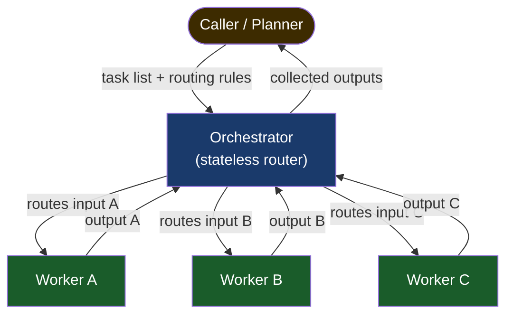

# Orchestrator → Workers

## Intent

A stateless orchestrator routes tasks to workers and collects their outputs without owning the goal state or making strategic decisions.

## Motivation

When a manager pattern is applied but the coordinating agent accumulates too much state and decision-making responsibility, it becomes a monolith. The orchestrator pattern separates routing logic from goal ownership: the orchestrator decides which worker handles which input and aggregates outputs mechanically, while goal state lives elsewhere (in the caller or a shared store). This makes the orchestrator replaceable, testable in isolation, and cheap to run.

## Structure

<details>
<summary><b>Solution Structure</b></summary>



</details>

## Participants

| Role | Responsibility |
|------|---------------|
| Caller / Planner | Owns the goal and task list; decides what needs doing; receives collected outputs |
| Orchestrator | Receives a task list; routes each task to the right worker; collects and returns outputs; carries no goal state |
| Worker | Executes one routed task; returns a structured output; stateless |

## How It Works

1. Caller decomposes a goal into a task list and routing rules, then passes both to the orchestrator.
2. Orchestrator inspects each task and selects the appropriate worker based on routing rules (e.g., task type, capability tag).
3. Orchestrator dispatches tasks to workers — in parallel where tasks are independent.
4. Each worker executes its task and returns a structured output.
5. Orchestrator collects all outputs and returns them to the caller as a batch.
6. Caller integrates results and decides next steps; the orchestrator is not involved in integration.

## When to Use

- The routing logic is well-defined and mechanical (match task type to worker type).
- Goal state and planning responsibility should remain with the caller, not the coordinator.
- Workers are heterogeneous: different task types need different workers.
- You want the coordinator to be stateless and easily testable.
- Fan-out across many workers is the primary concern, not adaptive replanning.

## When NOT to Use

- The coordinator needs to adapt the plan based on intermediate results — use [Manager → Workers](manager-workers.md) instead.
- All tasks go to identical workers with no routing decision — a simple parallel dispatch loop suffices.
- The routing rules are complex enough to require domain knowledge — use [Coordinator → Specialists](coordinator-specialists.md).
- A single agent can handle all tasks sequentially without context overflow.

## Variants

**Type-based Routing**: Orchestrator inspects a `task.type` field and dispatches to a registered worker for that type. Simple and predictable.

**Capability-based Routing**: Workers advertise capabilities; orchestrator matches task requirements to worker capabilities at runtime. More flexible but adds discovery overhead.

**Load-balanced Routing**: Multiple identical workers handle the same task type; orchestrator distributes load. Useful for high-throughput pipelines.

**Fan-out / Fan-in**: Orchestrator sends the same input to multiple workers and collects all outputs for comparison or voting (see also [Synthesizer / Aggregator](synthesizer-aggregator.md)).

## Implementation Notes

- **Statelessness is the invariant**: The orchestrator must not accumulate goal state between calls. If it needs to retry a failed worker, that decision should come from the caller or be encoded in the routing rules passed in.
- **Structured task format**: Define a task schema with at minimum: `id`, `type`, `input`. Workers return `{ task_id, success, output, error }`.
- **Error surfacing**: Orchestrator returns all outputs including failures to the caller. It does not decide whether a failure is fatal.
- **Parallel dispatch**: Use async dispatch for independent tasks. Track in-flight tasks by `task_id`.
- **Idempotency**: Workers should be idempotent. The caller (not the orchestrator) decides whether to retry.
- **Token budget**: The orchestrator's context stays small because it holds no goal state. Each worker call is a fresh, bounded context.

## Trade-offs

| Pro | Con |
|-----|-----|
| Orchestrator is simple, testable, and replaceable | Caller must own all goal state and integration logic |
| Statelessness makes the orchestrator cheap to run | No adaptive replanning at the orchestration layer |
| Routing logic is explicit and auditable | Routing rules must be fully specified upfront by the caller |
| Workers are isolated and independently testable | All error handling and retry decisions fall to the caller |
| Scales well for high fan-out scenarios | Adding routing flexibility adds complexity to the routing rules |

## Related Patterns

- [Manager → Workers](manager-workers.md) — manager owns goal state; orchestrator does not
- [Coordinator → Specialists](coordinator-specialists.md) — coordinator uses domain knowledge; orchestrator uses routing rules
- [Agent-as-Tool](agent-as-tool.md) — an individual worker can itself be an agent wrapped as a tool
- [Synthesizer / Aggregator](synthesizer-aggregator.md) — handles the fan-in step after orchestrator fan-out
- [Family A — Topology](../A-topology/README.md) — the orchestrator is a hub node in a hub-and-spoke topology

## Example Sketch

```
// Caller prepares the task list
tasks = [
    { id: "t1", type: "summarize", input: doc_a },
    { id: "t2", type: "translate", input: doc_b },
    { id: "t3", type: "summarize", input: doc_c },
]

outputs = orchestrate(tasks)

// Caller integrates
final = integrate(outputs)


// Orchestrator — stateless, no goal knowledge
function orchestrate(tasks):
    worker_map = { "summarize": summarizer, "translate": translator }
    results = parallel_map(tasks, task => worker_map[task.type](task.input))
    return results   // Return all outputs; do not interpret them
```

## Sources

- **Anthropic Engineering** — AI safety company; authors of Claude. [Building Effective Agents](https://www.anthropic.com/engineering/building-effective-agents)
- **OpenAI Engineering** — AI research company; authors of GPT and Codex. [A Practical Guide to Building AI Agents](https://openai.com/business/guides-and-resources/a-practical-guide-to-building-ai-agents/)
- **Google Cloud Architecture Center** — Google's cloud architecture team. [Choose a Design Pattern for Agentic AI](https://docs.cloud.google.com/architecture/choose-design-pattern-agentic-ai-system)
- **AWS Prescriptive Guidance** — Amazon Web Services architecture team. [Agentic AI Patterns](https://docs.aws.amazon.com/prescriptive-guidance/latest/agentic-ai-patterns/agent-patterns.html)
