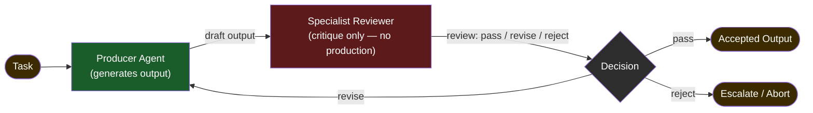

# Specialist Reviewer

## Intent

A separate agent whose sole responsibility is to critique, validate, or score the output of a producing agent — providing an independent evaluation without any production responsibility.

## Motivation

When the same agent that produces an output also evaluates it, it is subject to confirmation bias: it is more likely to approve its own work than to find flaws in it. A specialist reviewer is a structurally independent agent whose system prompt contains no production instructions — only evaluation criteria. This independence is the pattern's core invariant. The reviewer cannot rationalize away a flaw because it did not produce the output and has no stake in defending it.

## Structure

<details>
<summary><b>Solution Structure</b></summary>



</details>

## Participants

| Role | Responsibility |
|------|---------------|
| Producer Agent | Generates the output; has no knowledge of the reviewer's criteria; does not evaluate its own output |
| Specialist Reviewer | Evaluates the output against defined criteria; returns a structured verdict with rationale; does not produce content |
| Coordinator / Caller | Receives the verdict; decides whether to accept, send back for revision, or escalate |

## How It Works

1. Producer agent generates an output (draft, plan, code, analysis, etc.).
2. Output is passed to the specialist reviewer along with the evaluation criteria.
3. Reviewer evaluates the output against the criteria — checking correctness, completeness, safety, style, or any defined dimension.
4. Reviewer returns a structured verdict: pass / revise / reject, plus specific rationale for any issues found.
5. Coordinator routes based on the verdict: accept the output, send it back to the producer with the review comments, or escalate to a human or abort.
6. If revision is requested, the producer receives the review comments and regenerates. Steps 2–5 repeat up to a retry limit.

## When to Use

- Output quality is critical and the cost of an undetected error is high.
- The evaluation criteria are well-defined and can be encoded in the reviewer's prompt.
- You want to separate the "generate" and "evaluate" concerns so each can be optimized independently.
- The producer's output may contain domain errors that are easier to detect with a focused evaluator than to prevent in generation.
- You are implementing a revision loop and need a clean entry point for feedback.

## When NOT to Use

- The evaluation criteria are vague or require the same capabilities as production — a reviewer cannot provide independent value if it would produce identical output.
- The overhead of a second LLM call is not justified by the quality gain.
- The task is low-stakes and a producer self-check is sufficient.
- The reviewer and producer would use the same model with the same context — there is no real independence.
- Use [Maker-Checker](maker-checker.md) instead when the verification is binary (correct/incorrect) rather than qualitative critique.

## Variants

**Single-Pass Review**: Reviewer evaluates once; no revision loop. Used when the producer has one chance to get it right.

**Iterative Review**: Reviewer evaluates, producer revises, reviewer re-evaluates. Loops up to a maximum retry count.

**Multi-Dimension Reviewer**: Reviewer evaluates multiple named dimensions (accuracy, safety, style, completeness) and returns a score per dimension. Useful for structured quality gates.

**Panel Review**: Multiple independent reviewers evaluate the same output; a synthesizer aggregates their verdicts. Reduces individual reviewer bias.

## Implementation Notes

- **Reviewer prompt isolation**: The reviewer's system prompt must contain only evaluation instructions. Never include production instructions in the reviewer's prompt — this defeats the independence invariant.
- **Structured verdict**: The reviewer must return a machine-parseable verdict, not free-form text. Minimum schema: `{ verdict: "pass" | "revise" | "reject", issues: list[{ dimension, description, severity }] }`.
- **Criteria clarity**: Vague criteria produce vague reviews. Encode specific, checkable conditions (e.g., "all claims must be supported by a cited source" rather than "be accurate").
- **Retry limit**: Set a hard limit on revision cycles (e.g., 3). If the producer cannot satisfy the reviewer after N iterations, escalate rather than loop indefinitely.
- **Reviewer context**: Pass the producer's output and the original task specification to the reviewer. The reviewer should evaluate the output against the task, not in isolation.
- **Avoid reviewer-producer knowledge leakage**: If the producer can see the reviewer's criteria upfront, it may overfit to them. Consider keeping evaluation criteria in the reviewer's system prompt only.

## Trade-offs

| Pro | Con |
|-----|-----|
| Structural independence reduces confirmation bias | Adds latency and cost of a second LLM call |
| Evaluation criteria can be updated independently of the producer | Reviewer may have blind spots that neither agent detects |
| Clean separation enables independent testing of reviewer quality | Revision loops can run long if criteria are unclear |
| Catches errors before they propagate downstream | Producer and reviewer may use the same underlying model — true independence requires model diversity |
| Supports structured quality gates in automated pipelines | Vague criteria produce unhelpful reviews |

## Related Patterns

- [Maker-Checker](maker-checker.md) — binary verification variant; checker confirms correctness rather than providing critique
- [Manager → Workers](manager-workers.md) — manager can invoke a reviewer as one of its workers
- [Coordinator → Specialists](coordinator-specialists.md) — reviewer is a specialist in evaluation
- [Synthesizer / Aggregator](synthesizer-aggregator.md) — panel review variant aggregates multiple reviewer verdicts
- [Family K — Human-in-the-Loop](../../K-human-control/README.md) — human reviewer as an escalation path from the specialist reviewer

## Example Sketch

```
MAX_REVISIONS = 3

function review_loop(task):
    output = producer.generate(task)

    for attempt in range(MAX_REVISIONS):
        verdict = reviewer.evaluate(
            task_spec = task,
            output = output,
            criteria = REVIEW_CRITERIA    // Defined in reviewer's prompt only
        )

        if verdict.verdict == "pass":
            return output

        if verdict.verdict == "reject":
            raise ReviewRejection(verdict.issues)

        // verdict == "revise": give producer the feedback
        output = producer.generate(task, revision_feedback = verdict.issues)

    raise MaxRevisionsExceeded()


// Reviewer — evaluation only, no production
function reviewer.evaluate(task_spec, output, criteria):
    // Returns structured verdict; does not generate content
    return {
        verdict: "revise",
        issues: [
            { dimension: "accuracy", description: "Claim X lacks citation", severity: "high" }
        ]
    }
```

## Sources

- **Anthropic Engineering** — AI safety company; authors of Claude. [Building Effective Agents](https://www.anthropic.com/engineering/building-effective-agents)
- **Google Cloud Architecture Center** — Google's cloud architecture team. [Choose a Design Pattern for Agentic AI](https://docs.cloud.google.com/architecture/choose-design-pattern-agentic-ai-system)
- **AWS Prescriptive Guidance** — Amazon Web Services architecture team. [Agentic AI Patterns](https://docs.aws.amazon.com/prescriptive-guidance/latest/agentic-ai-patterns/agent-patterns.html)
- **Stanford CS224G** — Stanford University course on LLM agents. [Agentic Design Patterns (lecture slides)](https://web.stanford.edu/class/cs224g/2025/lectures/Agentic_Design_Patterns.pdf)
