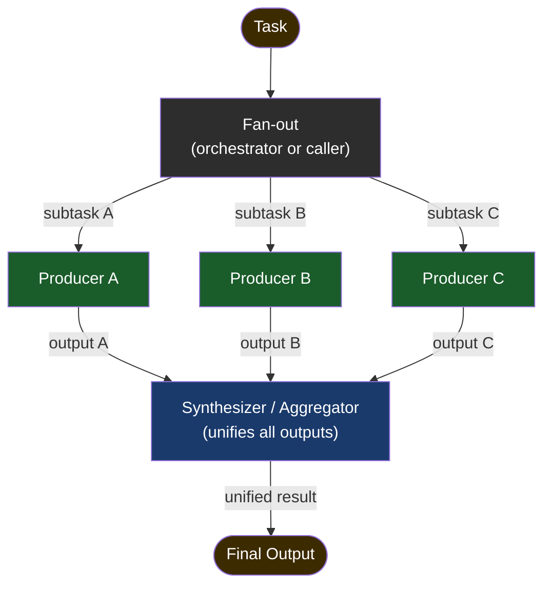

# Synthesizer / Aggregator

## Intent

A dedicated agent collects the outputs of multiple parallel producers and combines them into a single, coherent result — handling deduplication, conflict resolution, and unification.

## Motivation

When multiple agents produce outputs in parallel (fan-out), someone must integrate those outputs. If integration is left to the orchestrator or manager, it accumulates responsibility it may not be equipped for — especially when outputs conflict, overlap, or must be ranked. A dedicated synthesizer separates the convergence concern from the fan-out concern, allowing each to be optimized independently. The synthesizer is the natural counterpart to parallel fan-out.

## Structure

<details>
<summary><b>Solution Structure</b></summary>



</details>

## Participants

| Role | Responsibility |
|------|---------------|
| Fan-out Coordinator | Dispatches the task to multiple producers in parallel; collects all outputs; passes the full set to the synthesizer |
| Producer | Generates one output for its assigned subtask; has no knowledge of other producers |
| Synthesizer / Aggregator | Receives all producer outputs; deduplicates, resolves conflicts, ranks, and unifies them into one coherent result |

## How It Works

1. Fan-out coordinator dispatches the same (or related) task to N producers in parallel.
2. Producers run concurrently; each returns its output independently.
3. Coordinator collects all N outputs and passes them as a batch to the synthesizer.
4. Synthesizer processes all outputs: removes duplicates, resolves contradictions, fills gaps from one output with content from another, and produces a unified result.
5. Synthesizer returns the unified result to the caller.

## When to Use

- Multiple agents are producing parallel outputs that must be unified before use.
- Producer outputs may overlap, contradict, or be complementary — and a mechanical merge (simple concatenation) is insufficient.
- The synthesis step requires judgment that the fan-out coordinator should not own.
- You want to decouple the parallel generation concern from the convergence concern.
- You are implementing a map-reduce pattern at the agent level.

## When NOT to Use

- There is only one producer — no synthesis needed.
- Producer outputs are disjoint and can be concatenated without conflict — a simple join suffices.
- The synthesis logic is trivial (e.g., "take the first result") — an inline function is simpler than a dedicated agent.
- The synthesizer would need the same capabilities as the producers — there is no benefit to separation.

## Variants

**Summarizing Synthesizer**: Synthesizer summarizes all producer outputs into a single condensed result. Used when outputs are voluminous.

**Voting / Consensus Synthesizer**: Synthesizer identifies the majority position across producers and uses it as the result. Used when producers answer the same question independently (ensemble).

**Ranked Aggregator**: Synthesizer scores each producer output on defined criteria and returns the top-ranked result. Used in content generation or search scenarios.

**Conflict-Resolving Synthesizer**: Synthesizer explicitly identifies contradictions between producers and resolves them using a defined policy (e.g., most recent, highest confidence, human escalation).

**Hierarchical Synthesis**: Synthesizers at multiple levels combine outputs from sub-groups before a root synthesizer combines the sub-group results. Used with [Hierarchical Coordinator](hierarchical-coordinator.md).

## Implementation Notes

- **Pass structured outputs**: Producers must return structured outputs (not free-form text) to enable programmatic deduplication and conflict detection. Define a shared output schema before building producers.
- **Synthesizer context**: Pass all producer outputs in a single synthesizer call. Avoid calling the synthesizer incrementally — it needs the full picture to resolve conflicts correctly.
- **Conflict policy**: Define the conflict resolution policy before implementing the synthesizer. Common policies: highest-confidence wins, latest wins, human escalation, or generate a new output reconciling all views.
- **Token budget**: With N producers, the synthesizer's input context grows as O(N × output_size). Monitor total tokens; for large N, consider hierarchical synthesis.
- **Attribution**: The synthesizer should preserve attribution (which producer contributed which claim) in the output metadata, even if the final output is unified prose.
- **Null handling**: Define behavior when zero or one producer returns a valid output. The synthesizer must handle these edge cases gracefully.

## Trade-offs

| Pro | Con |
|-----|-----|
| Cleanly separates fan-out from fan-in | Synthesizer's context grows with number of producers |
| Producer outputs can be generated in parallel | Synthesis is non-trivial — vague instructions produce poor unification |
| Conflict resolution is explicit and auditable | Adding a dedicated agent increases latency and cost |
| Synthesizer can be tuned or replaced independently | Attribution of claims in the unified output can be lost |
| Natural fit for ensemble, map-reduce, and multi-perspective patterns | Synthesizer may introduce its own biases when resolving conflicts |

## Related Patterns

- [Orchestrator → Workers](orchestrator-workers.md) — the fan-out side that feeds the synthesizer
- [Manager → Workers](manager-workers.md) — manager can include a synthesis step as its final integration
- [Specialist Reviewer](specialist-reviewer.md) — reviewer evaluates; synthesizer unifies; different post-processing roles
- [Maker-Checker](maker-checker.md) — checker verifies one output; synthesizer unifies many
- [Hierarchical Coordinator](hierarchical-coordinator.md) — each coordinator level can include a synthesis step
- [Family B — Task Decomposition](../../B-task-decomposition/README.md) — fan-out decomposition strategies that precede synthesis

## Example Sketch

```
// Fan-out + synthesize
function run_with_synthesis(task):
    // Fan out to N producers in parallel
    producers = [researcher_A, researcher_B, researcher_C]
    outputs = parallel_map(producers, p => p.generate(task))

    // All outputs go to the synthesizer as a batch
    unified = synthesizer.synthesize(
        task = task,
        producer_outputs = outputs
    )
    return unified


// Synthesizer — unification only, no production
function synthesizer.synthesize(task, producer_outputs):
    // 1. Identify claims present in multiple outputs → deduplicate
    // 2. Identify contradictions → apply conflict policy
    // 3. Identify gaps in one output filled by another → merge
    // 4. Produce a single coherent result
    return {
        unified_result: ...,
        source_map: { claim_X: ["producer_A", "producer_C"] }   // attribution
    }
```

## Sources

- **Anthropic Engineering** — AI safety company; authors of Claude. [Building Effective Agents](https://www.anthropic.com/engineering/building-effective-agents)
- **OpenAI Engineering** — AI research company; authors of GPT and Codex. [A Practical Guide to Building AI Agents](https://openai.com/business/guides-and-resources/a-practical-guide-to-building-ai-agents/)
- **Google Cloud Architecture Center** — Google's cloud architecture team. [Choose a Design Pattern for Agentic AI](https://docs.cloud.google.com/architecture/choose-design-pattern-agentic-ai-system)
- **Stanford CS224G** — Stanford University course on LLM agents. [Agentic Design Patterns (lecture slides)](https://web.stanford.edu/class/cs224g/2025/lectures/Agentic_Design_Patterns.pdf)
