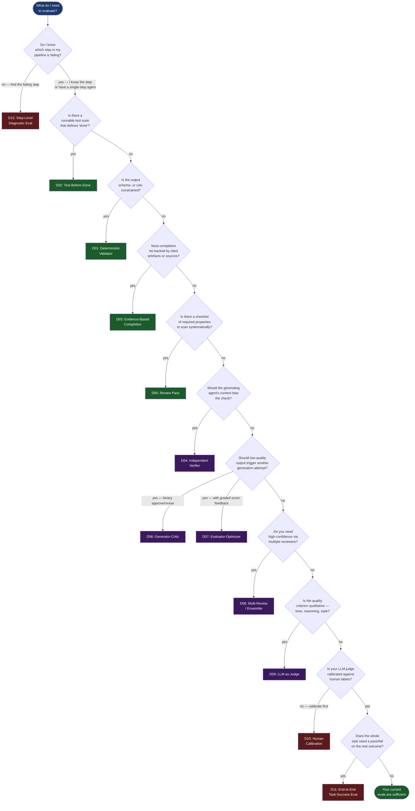

# Eval Type Selector

**Purpose:** Answer "what eval do I need?" with a structured decision process. Work through the questions in order; stop at the first pattern that fits.

---

## Decision Tree

<details>
<summary><b>Eval Type Selector — Full Decision Tree</b></summary>



</details>

---

## Quick-Reference Table

| Question | If yes → use | Pattern |
|----------|-------------|---------|
| Do I need to find which step failed? | Step-Level Diagnostic | [D12](../patterns/D12-step-level-diagnostic.md) |
| Does passing a test suite define "done"? | Test-Before-Done | [D02](../patterns/D02-test-before-done.md) |
| Is the output schema-valid or rule-compliant? | Deterministic Validator | [D01](../patterns/D01-deterministic-validator.md) |
| Must completion cite concrete evidence? | Evidence-Based Completion | [D03](../patterns/D03-evidence-based-completion.md) |
| Is there a checklist of required properties? | Review Pass | [D05](../patterns/D05-review-pass.md) |
| Would generator context bias the check? | Independent Verifier | [D04](../patterns/D04-independent-verifier.md) |
| Should failure trigger binary revision? | Generator-Critic | [D06](../patterns/D06-generator-critic.md) |
| Should failure trigger graded revision? | Evaluator-Optimizer | [D07](../patterns/D07-evaluator-optimizer.md) |
| Need high-confidence via N reviewers? | Multi-Review / Ensemble | [D08](../patterns/D08-multi-review-ensemble.md) |
| Is the criterion qualitative? | LLM-as-Judge | [D09](../patterns/D09-llm-as-judge.md) |
| Is the LLM judge uncalibrated? | Human Calibration | [D10](../patterns/D10-human-calibration.md) |
| Does the full task need a real-outcome check? | End-to-End Task-Success | [D11](../patterns/D11-end-to-end-task-success.md) |

---

## Stacking Rules

Multiple evals can and should be stacked. Common stacks:

**Structured output pipeline:**
```
D01 (schema) → D03 (evidence present) → D09 (quality) → D10 (calibration)
```

**Coding agent:**
```
D01 (syntax / lint) → D02 (tests pass) → D04 (independent logic review)
```

**Research / report agent:**
```
D03 (sources cited) → D05 (required sections present) → D09 (quality judge) → D10 (calibration)
```

**High-stakes pipeline (legal / medical / financial):**
```
D01 → D02 or D03 → D04 → D08 (ensemble) → D10 → D11 (E2E gate)
```

**Debugging a failing pipeline:**
```
D11 (confirm E2E failure) → D12 (find failing step) → targeted fix → D11 (regression check)
```

---

## The Hamel Husain Sequencing Rule

Before designing any eval:

1. **Collect real failing traces** from production or staging. Minimum 20 examples.
2. **Read every trace manually.** Do not skim; look for what actually went wrong.
3. **Build a failure taxonomy.** Label each failure. Count frequencies.
4. **Run D11 (E2E eval) first.** Confirm which tasks fail end-to-end.
5. **Apply D12 (step-level diagnostic)** to failing E2E cases to identify root-cause steps.
6. **Then design targeted evals** for the top failure categories. Use this selector to pick the right pattern per category.

Never design evals from first principles without inspecting real failures. Generic quality axes that were not observed in actual traces waste time and produce misleading metrics.

---

## Related Guides

- [verification-ladder.md](verification-ladder.md) — when to escalate check type (cost vs. capability table).

## Sources

- **Hamel Husain & Shreya Shankar** — independent ML practitioners; leading voices on LLM evaluation methodology. [Why Error Analysis Matters](https://hamel.dev/blog/posts/evals-faq/why-is-error-analysis-so-important-in-llm-evals-and-how-is-it-performed.html) | [How to Evaluate Agentic Workflows](https://hamel.dev/blog/posts/evals-faq/how-do-i-evaluate-agentic-workflows.html)
- **Anthropic Engineering** — AI safety company; authors of Claude. [Demystifying Evals](https://www.anthropic.com/engineering/demystifying-evals-for-ai-agents) | [Building Effective Agents](https://www.anthropic.com/engineering/building-effective-agents)
- **OpenAI Engineering** — AI research company; authors of GPT and Codex. [A Practical Guide to Building AI Agents](https://openai.com/business/guides-and-resources/a-practical-guide-to-building-ai-agents/)
