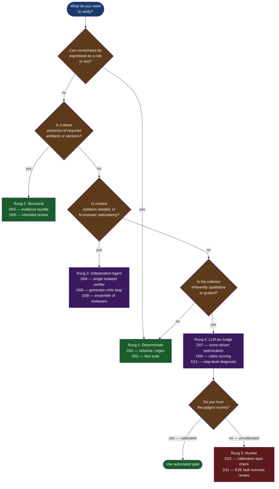

# Verification Ladder

**Purpose:** Match the check type to the question being asked. Use the cheapest check that can reliably catch the failure. Escalate only when a lower rung cannot cover the requirement.

---

## The Ladder

| Rung | Type | Patterns | Latency | Token Cost | What It Catches |
|------|------|----------|---------|------------|-----------------|
| 1 | **Deterministic** | D01, D02 | ~0 ms | 0 | Schema errors, test failures, constraint violations, exact matches |
| 2 | **Structural / Evidence** | D03, D05 | Low | Low | Missing required artefacts, unsupported claims, checklist gaps |
| 3 | **Independent Agent** | D04, D06, D08 | Med | Med | Logic errors, hallucinations, reasoning gaps a single agent misses |
| 4 | **LLM-as-Judge** | D07, D09, D12 | Med–High | High | Subjective quality, rubric conformance, step-level diagnosis |
| 5 | **Human** | D10, D11 | Hours | N/A | Ground truth, calibration, high-stakes correctness |

**Core rule (from Family H):** if a deterministic check can answer the question, use it. LLM-judge is only justified when the correctness criterion is inherently qualitative and cannot be expressed as a rule.

---

## Decision Flow

<details>
<summary><b>Verification Ladder — Escalation Decision Tree</b></summary>



</details>

---

## When to Escalate

**Rung 1 → Rung 2:** the schema is valid but required content sections or cited sources are absent.

**Rung 2 → Rung 3:** the artefact is structurally complete but logic errors or hallucinations are plausible — and the generating agent's context would bias a self-review.

**Rung 3 → Rung 4:** the review requires graded quality judgment, not binary presence/absence. Or: you need to know *which step* in a pipeline introduced an error, not just whether the final output is wrong.

**Rung 4 → Rung 5:** the LLM judge's scores have not been calibrated against human labels, or the decision is high-stakes and irreversible (publishing, legal, financial).

---

## Cost-Benefit Reference

```
Rung 1: cost ~$0 per check.  Use as the default first pass on every structured output.
Rung 2: cost ~$0.001 per check (deterministic + small prompt).  Use when Rung 1 passes but artefact completeness matters.
Rung 3: cost ~$0.01–0.05 per check (one agent invocation).  Use when hallucination risk is high.
Rung 4: cost ~$0.05–0.20 per check (judge LLM call).  Use only when qualitative judgment is necessary.
Rung 5: cost ~$5–50 per review (human time).  Use for calibration and irreversible decisions.
```

*Costs are approximate and model-dependent. They illustrate relative magnitude only.*

---

## Common Mistakes

| Mistake | Correct Approach |
|---------|-----------------|
| Jumping to LLM-as-Judge for format validation | Use D01 (schema check) first — it's free |
| Running Rung 4 before Rung 1 | Always run Rung 1 first; skip higher rungs if it passes |
| Using a single-rung eval and calling it sufficient | Stack rungs when failure modes span multiple types |
| Skipping D10 calibration and trusting judge scores directly | Calibrate before any automated gate goes to production |
| Building step-level evals before E2E eval | Run D11 first; use D12 only to diagnose D11 failures |

---

## Related Guides

- [eval-type-selector.md](eval-type-selector.md) — "what eval do I need?" decision tree for selecting among patterns.

## Sources

- **Hamel Husain & Shreya Shankar** — independent ML practitioners; leading voices on LLM evaluation methodology. [LLM Evals FAQ](https://hamel.dev/blog/posts/evals-faq/) | [Why Error Analysis Matters](https://hamel.dev/blog/posts/evals-faq/why-is-error-analysis-so-important-in-llm-evals-and-how-is-it-performed.html)
- **Anthropic Engineering** — AI safety company; authors of Claude. [Building Effective Agents](https://www.anthropic.com/engineering/building-effective-agents) | [Demystifying Evals](https://www.anthropic.com/engineering/demystifying-evals-for-ai-agents)
- **Google Cloud Architecture Center** — Google's cloud architecture team. [Choose a Design Pattern for Agentic AI](https://docs.cloud.google.com/architecture/choose-design-pattern-agentic-ai-system)
