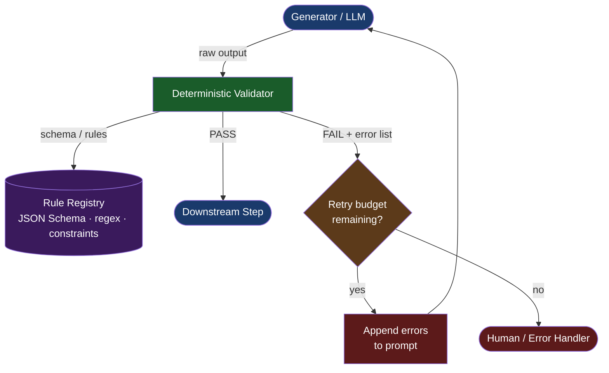

# D01: Deterministic Validator

**Intent** — Run rule-based checks (schema, regex, constraint) against generated output before accepting it, at zero LLM cost.  
**Also known as** — Schema Validation, Rule-Based Guard, Constraint Check, Structural Assertion.

## Problem

LLMs produce plausible-looking output that silently violates format contracts: a JSON field is missing, a date is in the wrong locale, a required enum value is misspelled, or a numeric range is exceeded. Catching these failures with another LLM call wastes tokens and introduces non-determinism. The check itself should be infallible.

## Solution

After every generation step that produces structured output, pass the result through a deterministic validator before the pipeline proceeds. The validator applies a fixed ruleset — JSON Schema, regex, type assertions, range checks, referential integrity — and returns a pass/fail verdict with a machine-readable error list. On failure the pipeline either retries the generation with the error message appended to the prompt, or surfaces the error to a human. No LLM is involved in the check itself.

## Structure

<details>
<summary><b>Deterministic Validator — Component Diagram</b></summary>



</details>

## When to Use

- The output has a well-defined schema (JSON, XML, CSV, a typed data class).
- Downstream code will parse or execute the output — malformed output causes crashes or silent data corruption.
- High throughput: token cost of an LLM check is not acceptable.
- The validity criterion is fully expressible as a rule (no subjective judgment required).

## When NOT to Use

- The correctness criterion is inherently qualitative (tone, reasoning quality, completeness) — use D09 LLM-as-Judge instead.
- The schema is so loose that schema-validity provides no real signal.
- You need to verify logical coherence, not just structural shape — combine with D04 or D06.

## Implementation Notes

**Schema approach (JSON):**

```
function validate_output(raw_text):
    parsed = parse_json(raw_text)               // catch parse errors
    errors = json_schema_validate(parsed, SCHEMA)
    if errors is empty:
        return PASS
    return FAIL(errors)

function generation_loop(prompt, max_retries=3):
    for attempt in 1..max_retries:
        output = llm_generate(prompt)
        result = validate_output(output)
        if result == PASS:
            return output
        prompt = prompt + "\n\nPrevious attempt failed validation:\n" + result.errors
    raise ValidationExhausted(result.errors)
```

**Rule registry design:**
- Store schemas and regex patterns outside code (YAML/JSON config) so rules can be updated without redeployment.
- Tag each rule with a severity: `error` (hard fail), `warning` (log only).
- Emit structured error objects: `{field, rule, actual_value, message}` — machine-readable for prompt injection.

**Retry prompt injection pattern:**
```
SYSTEM: Your previous response failed validation with these errors:
- field "due_date": expected ISO-8601, got "next week"
- field "priority": must be one of [low, medium, high], got "urgent"
Regenerate the JSON fixing only these fields.
```

## Cost Profile

| Dimension           | Rating   |
|---------------------|----------|
| Latency added       | Low      |
| Token cost          | Low      |
| Implementation      | Low      |
| False-positive risk | Low      |

## Related Patterns

- [D02: Test-Before-Done](D02-test-before-done.md) — deterministic check at the task level rather than the output level.
- [D05: Review Pass](D05-review-pass.md) — structured checklist; use D01 for machine-checkable items, D05 for qualitative items.
- [D07: Evaluator-Optimizer](D07-evaluator-optimizer.md) — when the validator score drives iterative improvement.
- [Family H](../../H-deterministic-control/README.md) — prefer deterministic checks over LLM checks wherever possible.

## Anti-Patterns Addressed

- **Self-Certified Completion** — the generator cannot pass its own output unchecked; an independent deterministic gate must clear it first.
- **Generic Evals Before Error Analysis** — D01 is the cheapest first rung; run it before escalating to LLM-based checks.

## Sources

- **Anthropic Engineering** — AI safety company; authors of Claude. [Building Effective Agents](https://www.anthropic.com/engineering/building-effective-agents)
- **Google Cloud Architecture Center** — Google's cloud architecture team. [Choose a Design Pattern for Agentic AI](https://docs.cloud.google.com/architecture/choose-design-pattern-agentic-ai-system)
- **AWS Prescriptive Guidance** — Amazon Web Services architecture team. [Agentic AI Patterns](https://docs.aws.amazon.com/prescriptive-guidance/latest/agentic-ai-patterns/agent-patterns.html)
