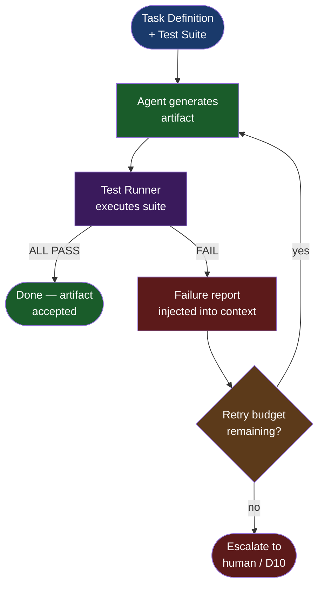

# D02: Test-Before-Done

**Intent** — Gate task completion on passing a pre-defined test suite; the agent is not done until the tests pass.  
**Also known as** — Test-Driven Completion, Pass-Before-Proceed, Exit-Criteria Gate, TDD Loop.

## Problem

Agents self-report completion based on their own assessment of their output. This leads to premature closure: the agent believes it has finished a coding task, data transformation, or configuration change while the actual artifact is broken, incomplete, or non-functional. Without an external verification step that the agent cannot override, "done" is a guess, not a fact.

## Solution

Define the acceptance criteria as a runnable test suite before generation begins. After each generation attempt, the agent executes the tests. Passing all tests is the only legal exit condition. If tests fail, the agent reads the failure output, revises its work, and re-runs. The loop continues until pass or until a retry budget is exhausted. The test suite is authored independently of the agent and cannot be modified by it during the loop.

## Structure

<details>
<summary><b>Test-Before-Done — Loop Diagram</b></summary>



</details>

## When to Use

- The task has an executable definition of correctness: unit tests, integration tests, assertion scripts, linters, or property-based checks.
- Coding agents, data-pipeline agents, configuration agents — anywhere "does it work?" is answerable by running code.
- The test suite is stable and authored before or independently of the generation step.
- The agent has tool access to a sandbox where tests can be executed safely.

## When NOT to Use

- No runnable test suite exists and writing one would cost more than the task itself.
- The correctness criterion cannot be encoded as executable tests (e.g., prose quality, reasoning depth) — use D09 or D10 instead.
- The agent can modify the test suite during the loop — this undermines the pattern entirely; tests must be locked.
- Tests are flaky: intermittent failures will cause infinite retry loops.

## Implementation Notes

**Core loop pseudocode:**

```
function agent_task_loop(task, test_suite, max_retries=5):
    context = [task.description]
    for attempt in 1..max_retries:
        artifact = agent_generate(context)
        result = test_runner.execute(test_suite, artifact)
        if result.all_passed:
            return artifact
        failure_summary = format_failures(result.failures)
        context.append(
            "Attempt {attempt} failed {result.fail_count}/{result.total} tests:\n"
            + failure_summary
            + "\nRevise the artifact to fix these failures."
        )
    raise RetryBudgetExhausted(result)

function format_failures(failures):
    // Include: test name, expected, actual, diff
    // Omit: passing tests (reduce context noise)
    return failures.map(f => "FAIL {f.name}: expected {f.expected}, got {f.actual}")
```

**Sandbox safety:** always execute tests in an isolated environment (container, subprocess with resource limits). Never let the agent run arbitrary code in the host process.

**Test suite locking:** store the test suite in a read-only location the agent cannot write to. Log any attempt to modify it as a security event.

**Failure injection format:** inject only failing tests with their diffs, not the full test output. Passing test noise inflates context and may distract the agent from the actual failures.

**Budget tuning:** 3–5 retries covers most coding tasks. Beyond 5, the agent is usually stuck in a local minimum — escalate to human or switch strategy.

## Cost Profile

| Dimension           | Rating   |
|---------------------|----------|
| Latency added       | Med      |
| Token cost          | Med      |
| Implementation      | Med      |
| False-positive risk | Low      |

## Related Patterns

- [D01: Deterministic Validator](D01-deterministic-validator.md) — validates output shape; D02 validates functional correctness.
- [D03: Evidence-Based Completion](D03-evidence-based-completion.md) — evidence that work was done; D02 proves the work passes.
- [D07: Evaluator-Optimizer](D07-evaluator-optimizer.md) — score-driven loop; D02 is binary pass/fail rather than graded.
- [D04: Independent Verifier](D04-independent-verifier.md) — use after D02 when the test suite itself may have gaps.

## Anti-Patterns Addressed

- **Self-Certified Completion** — the agent cannot declare done; only a passing test suite can.

## Sources

- **Anthropic Engineering** — AI safety company; authors of Claude. [Building Effective Agents](https://www.anthropic.com/engineering/building-effective-agents)
- **OpenAI Engineering** — AI research company; authors of GPT and Codex. [A Practical Guide to Building AI Agents](https://openai.com/business/guides-and-resources/a-practical-guide-to-building-ai-agents/)
- **Hamel Husain & Shreya Shankar** — independent ML practitioners; leading voices on LLM evaluation methodology. [Evals Skills for Coding Agents](https://hamel.dev/blog/posts/evals-skills/)
