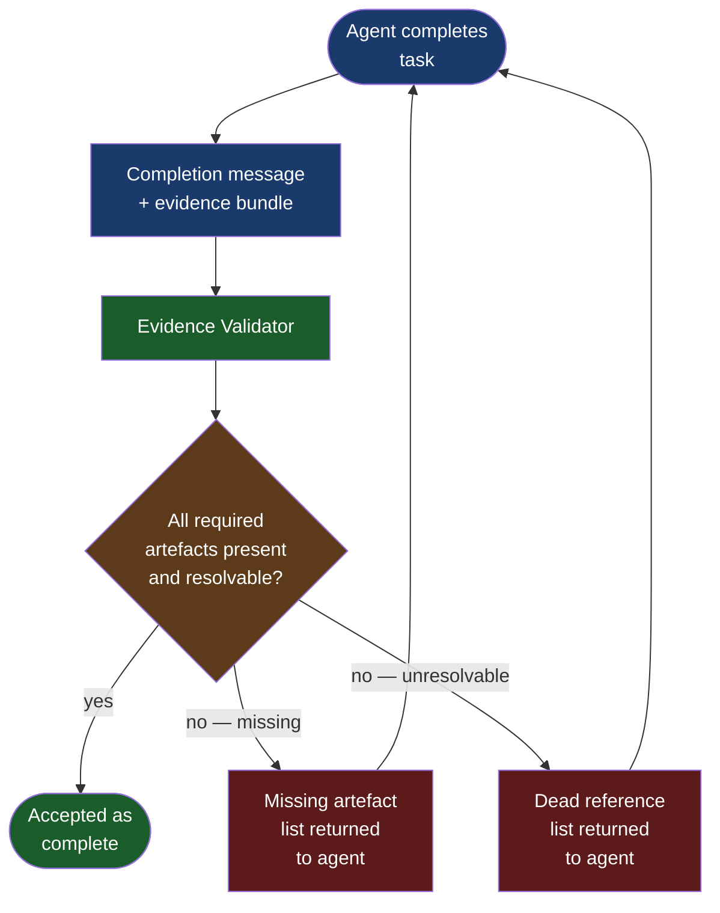

# D03: Evidence-Based Completion

**Intent** — Require the agent to cite concrete, verifiable evidence before a task is accepted as complete.  
**Also known as** — Grounded Completion, Citation-Gated Done, Artifact-Backed Closure.

## Problem

Agents declare tasks complete based on their internal belief that the work is done, not on observable proof. A research agent says "I found the answer" without producing a source. A coding agent says "the bug is fixed" without showing test output. A data agent says "the report is ready" without attaching the file. These completions are unverifiable and frequently wrong.

## Solution

Define, for each task type, a required evidence bundle that must accompany any completion claim. The evidence bundle is a set of concrete artefacts — file paths, URLs, log excerpts, test results, citations — that a downstream validator or human can inspect independently. The agent's completion message is rejected if the required artefacts are absent, malformed, or unresolvable. The check is structural: does the bundle exist and resolve? Not whether the evidence is correct (that is D04 or D10).

## Structure

<details>
<summary><b>Evidence-Based Completion — Validation Flow</b></summary>



</details>

## When to Use

- Research, summarization, or fact-finding tasks where hallucination risk is high.
- Any task whose output references external sources (URLs, files, database records).
- Coding tasks where the fix should be demonstrable (test output, diff, build log).
- Multi-agent pipelines where downstream agents must be able to independently verify the upstream agent's work.

## When NOT to Use

- Purely creative tasks where no external ground truth exists.
- Real-time tasks where waiting for artefact collection adds unacceptable latency.
- When the evidence requirement is so easy to fake (e.g., any URL satisfies it) that it provides no real check — tighten the artefact specification or add D04.

## Implementation Notes

**Evidence bundle schema (pseudocode):**

```
struct EvidenceBundle:
    task_id: string
    completion_claim: string           // agent's prose summary
    artefacts: list[Artefact]

struct Artefact:
    type: enum [FILE, URL, LOG_EXCERPT, TEST_RESULT, CODE_DIFF, DB_RECORD]
    reference: string                  // path, URL, or ID
    role: string                       // "source for claim X", "proof of fix", etc.
    content_hash: optional string      // for files: SHA-256 of content

function validate_bundle(bundle, required_types):
    missing = required_types - {a.type for a in bundle.artefacts}
    if missing is not empty:
        return FAIL("Missing artefact types: " + missing)
    for artefact in bundle.artefacts:
        if not resolves(artefact):     // file exists, URL returns 200, etc.
            return FAIL("Unresolvable: " + artefact.reference)
    return PASS
```

**Task-type evidence requirements (example config):**

```
research_task:
  required: [URL, LOG_EXCERPT]
  min_sources: 2

bug_fix_task:
  required: [CODE_DIFF, TEST_RESULT]

data_report_task:
  required: [FILE]
  file_extensions: [.csv, .json, .xlsx]
```

**Prompt instruction pattern:**
```
Before declaring this task complete, you MUST provide:
1. A code diff showing the exact change you made.
2. The test output proving the fix passes.
Format your completion message as JSON matching the EvidenceBundle schema.
```

## Cost Profile

| Dimension           | Rating   |
|---------------------|----------|
| Latency added       | Low      |
| Token cost          | Low      |
| Implementation      | Low–Med  |
| False-positive risk | Med      |

## Related Patterns

- [D02: Test-Before-Done](D02-test-before-done.md) — proves functional correctness; D03 proves the artefact exists and is cited.
- [D04: Independent Verifier](D04-independent-verifier.md) — checks whether the evidence is actually correct, not just present.
- [D05: Review Pass](D05-review-pass.md) — checklist-based; D03 artefact requirements can be one checklist section.
- [D09: LLM-as-Judge](D09-llm-as-judge.md) — judges quality of the evidence, not just its presence.

## Anti-Patterns Addressed

- **Self-Certified Completion** — the agent cannot simply assert done; it must produce inspectable artefacts that external parties can verify.

## Sources

- **Anthropic Engineering** — AI safety company; authors of Claude. [Building Effective Agents](https://www.anthropic.com/engineering/building-effective-agents)
- **Hamel Husain & Shreya Shankar** — independent ML practitioners; leading voices on LLM evaluation methodology. [How to Evaluate Agentic Workflows](https://hamel.dev/blog/posts/evals-faq/how-do-i-evaluate-agentic-workflows.html)
- **Microsoft Azure Architecture Center** — Microsoft's cloud architecture team. [AI Agent Design Patterns](https://learn.microsoft.com/en-us/azure/architecture/ai-ml/guide/ai-agent-design-patterns)
