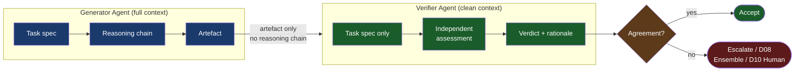

# D04: Independent Verifier

**Intent** — Route completed work to a separate agent that re-checks it without sharing the generator's context, eliminating confirmation bias.  
**Also known as** — Context-Isolated Reviewer, Blind Verifier, Second-Opinion Agent, Clean-Room Check.

## Problem

An agent that generated an answer and an agent that reviews that same answer share a problem: they share context. The reviewing agent has seen the generating agent's reasoning, its partial drafts, and its framing of the problem. This causes confirmation bias — the reviewer is primed to find the answer correct because it absorbed the generator's perspective. Errors that the generator made consistently throughout its reasoning chain are invisible to a reviewer who read that same chain.

## Solution

Spawn a separate agent instance with a clean context window. Provide it only with the task specification and the completed artefact — never the generator's reasoning trace, intermediate steps, or prior conversation. The verifier independently assesses whether the artefact satisfies the task, without knowing how it was produced. Discrepancies between generator and verifier surface errors that shared-context review would miss.

## Structure

<details>
<summary><b>Independent Verifier — Context Isolation Diagram</b></summary>



</details>

## When to Use

- High-stakes outputs: medical, legal, financial, or safety-critical content.
- Long generation chains where errors can compound undetected across steps.
- When the generator and reviewer would otherwise share conversation history.
- When the task is complex enough that a single agent's self-review is unreliable.
- As a complement to D02 (tests pass but logic is subtly wrong).

## When NOT to Use

- Low-stakes, high-throughput tasks where the extra agent invocation cost is not justified.
- When the task specification itself is ambiguous — the verifier will reach a different conclusion not because the artefact is wrong but because the spec allows multiple valid interpretations. Clarify the spec first.
- When D01 (deterministic validator) is sufficient — use the cheaper check.

## Implementation Notes

**Context stripping protocol (pseudocode):**

```
function run_with_independent_verifier(task_spec, generator_fn, verifier_fn):
    // Generator runs with full context
    artefact = generator_fn(task_spec)

    // Verifier receives ONLY task spec + artefact
    // No generator reasoning, no intermediate steps, no prior messages
    verifier_context = build_clean_context(
        task_spec=task_spec,
        artefact=artefact,
        instruction="Assess whether this artefact fully satisfies the task. "
                    "Do not assume it is correct. List any issues found."
    )
    verdict = verifier_fn(verifier_context)
    return artefact, verdict

function build_clean_context(task_spec, artefact, instruction):
    // Explicitly exclude: generator conversation history, tool call logs,
    // intermediate drafts, the generator's self-assessment.
    return [
        SystemMessage(instruction),
        UserMessage("Task: " + task_spec),
        UserMessage("Artefact to verify:\n" + artefact)
    ]
```

**Verifier prompt shape:**
```
You are an independent reviewer. You have NOT seen how this artefact was produced.
Task specification: {task_spec}
Artefact: {artefact}

Assess:
1. Does the artefact fully satisfy the task?
2. Are there any errors, omissions, or unsupported claims?
3. Verdict: PASS / FAIL / UNCERTAIN — with reasoning.
```

**Handling disagreement:** if the verifier returns FAIL or UNCERTAIN, do not automatically retry. Surface both the artefact and the verifier's rationale to a human (D10) or to an ensemble (D08). Auto-retry on verifier failure creates a loop where the generator is optimising to satisfy the verifier's specific framing rather than the task.

## Cost Profile

| Dimension           | Rating   |
|---------------------|----------|
| Latency added       | Med      |
| Token cost          | Med      |
| Implementation      | Low–Med  |
| False-positive risk | Med      |

## Related Patterns

- [D08: Multi-Review / Ensemble](D08-multi-review-ensemble.md) — multiple independent verifiers; use when a single verifier's verdict is insufficient.
- [D06: Generator-Critic](D06-generator-critic.md) — critic shares context; D04 explicitly isolates context.
- [D10: Human Calibration](D10-human-calibration.md) — escalation target when verifier disagrees.
- [D03: Evidence-Based Completion](D03-evidence-based-completion.md) — the verifier checks whether the evidence is actually valid, not just present.

## Anti-Patterns Addressed

- **Self-Certified Completion** — the generator cannot review its own work; a context-isolated agent checks independently.

## Sources

- **Anthropic Engineering** — AI safety company; authors of Claude. [Building Effective Agents](https://www.anthropic.com/engineering/building-effective-agents)
- **Google Cloud Architecture Center** — Google's cloud architecture team. [Choose a Design Pattern for Agentic AI](https://docs.cloud.google.com/architecture/choose-design-pattern-agentic-ai-system)
- **Microsoft Azure Architecture Center** — Microsoft's cloud architecture team. [AI Agent Design Patterns](https://learn.microsoft.com/en-us/azure/architecture/ai-ml/guide/ai-agent-design-patterns)
