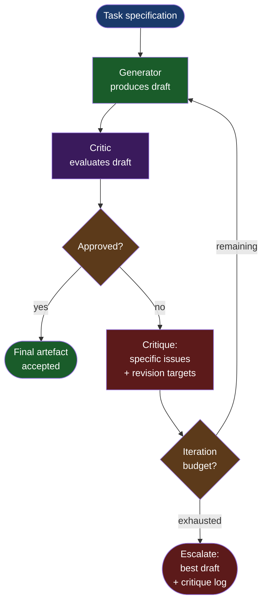

# D06: Generator-Critic

**Intent** — Pair a generator agent with a critic agent in a loop: the critic evaluates each draft and the generator revises until the critic is satisfied.  
**Also known as** — Generate-Then-Critique, Critique Loop, Writer-Reviewer Loop, Actor-Critic.

## Problem

A single agent tasked with both producing and evaluating its own output is structurally biased toward accepting what it just wrote. Self-critique is possible but shallow — the agent re-reads its own draft with the same prior beliefs and misses the same errors. Quality plateaus quickly without an external force pushing the generator toward genuine improvement.

## Solution

Split generation and critique into two distinct roles, each with its own system prompt and objective. The generator produces a draft. The critic receives the draft and the original task specification, then returns a structured critique: what is wrong, what is missing, and what should change. The generator revises based on the critique. The loop continues until the critic issues an approval or a maximum iteration count is reached. The critic's approval condition is defined in advance, not negotiated during the loop.

## Structure

<details>
<summary><b>Generator-Critic — Loop Diagram</b></summary>



</details>

## When to Use

- Long-form content (reports, plans, code modules) where quality is iteratively improvable.
- Tasks with qualitative correctness criteria that a deterministic validator cannot check.
- When the generator is known to produce acceptable-but-not-excellent first drafts.
- Pipelines where the cost of a few extra LLM calls is small compared to the cost of a poor output.

## When NOT to Use

- When the critic can be satisfied by a trivially compliant but actually poor response — the generator will learn to game the critic rather than improve the work. Define concrete, hard-to-game approval criteria.
- High-latency-sensitive paths: the loop adds at minimum one extra round-trip per iteration.
- When D04 (Independent Verifier) is required — the critic in D06 shares the conversation context with the generator and is therefore not context-isolated. Use D04 when context isolation matters.
- When the task has a binary correct/incorrect answer — use D01 or D02 instead.

## Implementation Notes

**Role separation pseudocode:**

```
GENERATOR_SYSTEM = """
You are a generator. Produce the best draft you can for the given task.
When you receive a critique, revise your draft to address every point.
Do not argue with the critique — improve the work.
"""

CRITIC_SYSTEM = """
You are a critic. Your job is to find genuine flaws in the draft.
Be specific: cite the exact location and nature of each issue.
Approve only when ALL of the following are satisfied: {approval_criteria}
Your response format:
  verdict: APPROVE | REVISE
  issues: list of {location, problem, suggested_fix}
"""

function generator_critic_loop(task, approval_criteria, max_iterations=4):
    generator = Agent(GENERATOR_SYSTEM)
    critic = Agent(CRITIC_SYSTEM.format(approval_criteria=approval_criteria))

    draft = generator.generate(task)
    for i in 1..max_iterations:
        critique = critic.evaluate(task, draft)
        if critique.verdict == APPROVE:
            return draft
        draft = generator.revise(draft, critique.issues)

    return best_draft(draft, critique)  // escalate with artefacts
```

**Approval criteria examples:**
- "All claims are supported by a cited source."
- "No step in the plan references a tool that does not exist in the tool registry."
- "The code compiles and all variable names match the schema."

**Loop termination discipline:** cap iterations at 3–5. Beyond that, the critic and generator are likely in a cycle (critic flags A, generator fixes A but breaks B, critic flags B, etc.). Log all iterations for D12 step-level diagnosis.

**Critic prompt discipline:** require the critic to output structured issues, not prose. Prose critiques are harder for the generator to act on and harder to evaluate for completeness.

## Cost Profile

| Dimension           | Rating   |
|---------------------|----------|
| Latency added       | Med–High |
| Token cost          | Med–High |
| Implementation      | Med      |
| False-positive risk | Med      |

## Related Patterns

- [D04: Independent Verifier](D04-independent-verifier.md) — context-isolated check; D06 critic shares conversation context.
- [D07: Evaluator-Optimizer](D07-evaluator-optimizer.md) — score-driven variant of this loop; the critic emits a score rather than structured issues.
- [D08: Multi-Review / Ensemble](D08-multi-review-ensemble.md) — multiple critics to reduce single-critic bias.
- [Family A](../A-topology/README.md) — Generator-Critic is also a network topology pattern.

## Anti-Patterns Addressed

- **Self-Certified Completion** — the generator cannot approve its own output; only the critic can issue an approval.

## Sources

- **Anthropic Engineering** — AI safety company; authors of Claude. [Building Effective Agents](https://www.anthropic.com/engineering/building-effective-agents)
- **Google Cloud Architecture Center** — Google's cloud architecture team. [Choose a Design Pattern for Agentic AI](https://docs.cloud.google.com/architecture/choose-design-pattern-agentic-ai-system)
- **Microsoft Azure Architecture Center** — Microsoft's cloud architecture team. [AI Agent Design Patterns](https://learn.microsoft.com/en-us/azure/architecture/ai-ml/guide/ai-agent-design-patterns)
