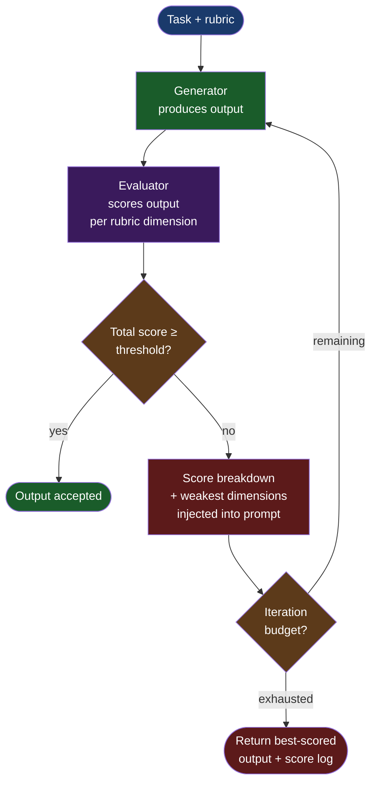

# D07: Evaluator-Optimizer

**Intent** — Use a scored evaluation to drive iterative generation: the generator keeps revising until the evaluator's score meets a defined threshold.  
**Also known as** — Score-Driven Loop, Eval-Then-Generate, Quality Score Loop, Reflect-and-Refine.

## Problem

Binary pass/fail feedback (as in D06 Generator-Critic) does not tell the generator how close it is to the target or which dimension to improve first. When an output is failing on multiple dimensions simultaneously, the generator must guess which to address. Without a graded signal that distinguishes "slightly off" from "completely wrong," optimization is inefficient and the loop converges slowly.

## Solution

Define a multi-dimensional scoring rubric. An evaluator (LLM or deterministic) scores the output on each dimension, producing a vector of scores and a total. The generator uses the score breakdown to focus its next revision on the lowest-scoring dimensions. The loop terminates when the total score meets a threshold or when a maximum iteration count is reached. The evaluator is stable across iterations — its rubric does not change in response to generator output.

## Structure

<details>
<summary><b>Evaluator-Optimizer — Score-Driven Loop</b></summary>



</details>

## When to Use

- Outputs with multiple quality dimensions that can be scored independently (accuracy, clarity, conciseness, tone, completeness).
- When you need to communicate to the generator not just "fix it" but "fix dimension X most urgently."
- When you are tracking quality trends across many runs — scores are more informative than binary verdicts.
- Coupled with D09 (LLM-as-Judge) as the evaluator for qualitative dimensions.

## When NOT to Use

- When a binary pass/fail suffices and the scoring overhead is not justified — use D02 or D06 instead.
- When dimensions interact and fixing one reliably breaks another — the loop oscillates. Redesign the rubric to capture the interaction or use D08 Ensemble to get diverse perspectives.
- When the evaluator's scores are noisy (high variance on identical inputs) — the loop optimizes noise rather than quality. Run D10 Human Calibration first to validate the evaluator.

## Implementation Notes

**Rubric definition structure:**

```
struct RubricDimension:
    name: string
    weight: float            // relative importance; weights sum to 1.0
    scoring_guide: string    // 1-sentence description per score level
    min_score: int           // typically 1
    max_score: int           // typically 5

RUBRIC = [
    RubricDimension("accuracy",    weight=0.4, max_score=5),
    RubricDimension("completeness",weight=0.3, max_score=5),
    RubricDimension("clarity",     weight=0.2, max_score=5),
    RubricDimension("conciseness", weight=0.1, max_score=5),
]
PASS_THRESHOLD = 0.8   // fraction of max weighted score
```

**Eval-optimize loop pseudocode:**

```
function evaluator_optimizer(task, rubric, threshold, max_iterations=4):
    output = generator.generate(task)
    best = (output, score=0)

    for i in 1..max_iterations:
        scores = evaluator.score(output, rubric)       // returns per-dimension scores
        total = weighted_sum(scores, rubric)
        if total >= threshold:
            return output
        if total > best.score:
            best = (output, total)

        weak_dims = sorted(scores, by=deficit)[:2]     // focus on worst 2 dimensions
        feedback = format_score_feedback(scores, weak_dims)
        output = generator.revise(output, feedback)

    return best.output   // return best seen, not last

function format_score_feedback(scores, weak_dims):
    lines = ["Your output scored {total:.0%} of the target. Focus on:"]
    for dim in weak_dims:
        lines.append("  [{dim.name}] scored {dim.score}/{dim.max} — {dim.scoring_guide}")
    return "\n".join(lines)
```

**Score injection pattern:**
```
Your previous output scored 62% (target: 80%).
Weakest dimensions:
  [accuracy] 2/5 — claims are not supported by cited sources
  [completeness] 3/5 — section "Risk Mitigation" is missing
Revise to address these dimensions first.
```

**Evaluator stability:** freeze the rubric for the entire loop. Changing rubric weights mid-loop invalidates score comparisons and causes non-convergence.

## Cost Profile

| Dimension           | Rating   |
|---------------------|----------|
| Latency added       | Med–High |
| Token cost          | High     |
| Implementation      | Med      |
| False-positive risk | Med      |

## Related Patterns

- [D06: Generator-Critic](D06-generator-critic.md) — binary approve/revise variant; use D07 when graded feedback is needed.
- [D09: LLM-as-Judge](D09-llm-as-judge.md) — the evaluator in D07 is typically an LLM-as-Judge invocation.
- [D10: Human Calibration](D10-human-calibration.md) — validate that the evaluator's scores align with human judgment before relying on them.
- [D01: Deterministic Validator](D01-deterministic-validator.md) — run D01 first; only invoke D07 for dimensions that D01 cannot cover.

## Anti-Patterns Addressed

- **Generic Evals Before Error Analysis** — the rubric should be built from observed failure modes (D12), not generic quality axes.

## Sources

- **Anthropic Engineering** — AI safety company; authors of Claude. [Building Effective Agents](https://www.anthropic.com/engineering/building-effective-agents) | [Demystifying Evals](https://www.anthropic.com/engineering/demystifying-evals-for-ai-agents)
- **Hamel Husain & Shreya Shankar** — independent ML practitioners; leading voices on LLM evaluation methodology. [LLM Evals FAQ](https://hamel.dev/blog/posts/evals-faq/)
- **Google Cloud Architecture Center** — Google's cloud architecture team. [Choose a Design Pattern for Agentic AI](https://docs.cloud.google.com/architecture/choose-design-pattern-agentic-ai-system)
