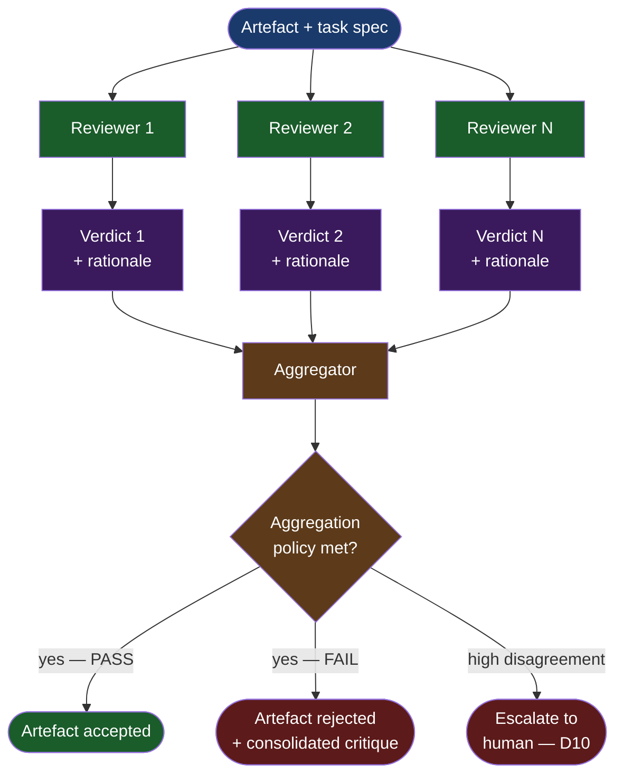

# D08: Multi-Review / Ensemble

**Intent** — Run N independent reviewers on the same artefact and aggregate their verdicts to produce a high-confidence final judgment.  
**Also known as** — Ensemble Review, Jury-of-Agents, Diverse-Reviewer Panel, Multi-Judge Aggregation.

## Problem

A single reviewer — whether LLM or human — has idiosyncratic blind spots, temperature-induced variance, and limited perspective. A single "PASS" from one reviewer gives false confidence; a single "FAIL" from one reviewer may be a false positive. High-stakes decisions require a verdict that is robust to individual reviewer error, not dependent on any single agent's judgment call.

## Solution

Spawn N reviewer agents independently, each with a clean context. Each reviewer evaluates the artefact and returns a structured verdict. An aggregator combines the verdicts using a pre-defined policy (majority vote, weighted vote, unanimous-required, or confidence-weighted). The aggregated verdict, not any individual verdict, determines acceptance. Disagreement among reviewers is itself a signal — captured and surfaced rather than hidden by averaging.

## Structure

<details>
<summary><b>Multi-Review / Ensemble — Parallel Review Aggregation</b></summary>



</details>

## When to Use

- High-stakes decisions: publishing, legal review, safety-critical code, financial outputs.
- When a single reviewer's variance is unacceptably high (demonstrated by D10 calibration).
- When the failure mode of a false positive is severe and irreversible.
- Replacing a single expensive human review with N cheaper LLM reviews (calibrated against human judgment via D10).

## When NOT to Use

- Low-stakes, high-throughput pipelines — the N× token cost is rarely justified.
- When all reviewers share the same model and system prompt — this creates correlated errors, not independent ones. Ensemble value comes from reviewer diversity: different models, different system prompts, different review angles (style, correctness, completeness).
- When the task has an objective correct answer that D01 or D02 can verify — ensemble review adds cost without adding signal.

## Implementation Notes

**Reviewer diversity strategies:**
```
// Vary at least one of: model, system prompt, review angle
REVIEWER_CONFIGS = [
    {model: "model-A", angle: "factual accuracy and sourcing"},
    {model: "model-B", angle: "logical coherence and reasoning gaps"},
    {model: "model-A", angle: "completeness against task requirements"},
]
```

**Aggregation policies:**

```
struct Verdict:
    reviewer_id: string
    decision: enum [PASS, FAIL, UNCERTAIN]
    confidence: float     // 0.0–1.0
    issues: list[string]

function aggregate(verdicts, policy):
    pass_count = count(v for v in verdicts if v.decision == PASS)
    fail_count = count(v for v in verdicts if v.decision == FAIL)
    total = len(verdicts)

    if policy == MAJORITY:
        return PASS if pass_count > total / 2 else FAIL

    if policy == UNANIMOUS:
        return PASS if pass_count == total else FAIL

    if policy == CONFIDENCE_WEIGHTED:
        pass_weight = sum(v.confidence for v in verdicts if v.decision == PASS)
        fail_weight = sum(v.confidence for v in verdicts if v.decision == FAIL)
        if abs(pass_weight - fail_weight) < DISAGREEMENT_THRESHOLD:
            return ESCALATE   // too close to call
        return PASS if pass_weight > fail_weight else FAIL
```

**Disagreement surfacing:**
```
function consolidate_critique(verdicts):
    all_issues = flatten(v.issues for v in verdicts if v.decision == FAIL)
    // De-duplicate by semantic similarity (or exact match)
    // Issues raised by multiple reviewers get higher priority weight
    return deduplicated_ranked_issues(all_issues)
```

**Cost control:** run reviewers in parallel. N=3 with parallel execution adds one round-trip of latency, not N round-trips.

## Cost Profile

| Dimension           | Rating   |
|---------------------|----------|
| Latency added       | Med      |
| Token cost          | High     |
| Implementation      | Med      |
| False-positive risk | Low      |

## Related Patterns

- [D04: Independent Verifier](D04-independent-verifier.md) — single independent reviewer; D08 is the N-reviewer generalization.
- [D06: Generator-Critic](D06-generator-critic.md) — single critic in a loop; D08 uses parallel independent reviewers for a one-shot verdict.
- [D09: LLM-as-Judge](D09-llm-as-judge.md) — each reviewer in D08 is an LLM-as-Judge invocation.
- [D10: Human Calibration](D10-human-calibration.md) — calibrate individual reviewers before deploying them in an ensemble.

## Anti-Patterns Addressed

- **Self-Certified Completion** — N independent agents must agree before acceptance; no single agent's self-assessment is sufficient.

## Sources

- **Anthropic Engineering** — AI safety company; authors of Claude. [Building Effective Agents](https://www.anthropic.com/engineering/building-effective-agents)
- **Google Cloud Architecture Center** — Google's cloud architecture team. [Choose a Design Pattern for Agentic AI](https://docs.cloud.google.com/architecture/choose-design-pattern-agentic-ai-system)
- **Hamel Husain & Shreya Shankar** — independent ML practitioners; leading voices on LLM evaluation methodology. [How to Evaluate Agentic Workflows](https://hamel.dev/blog/posts/evals-faq/how-do-i-evaluate-agentic-workflows.html)
