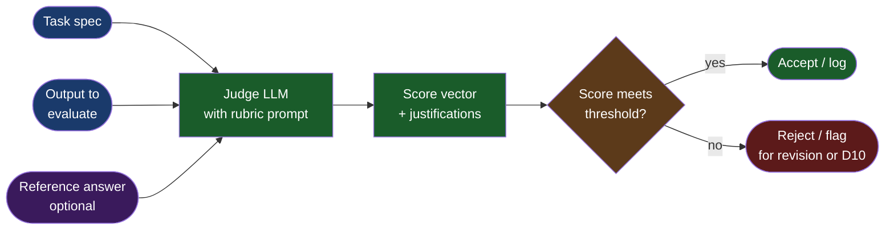

# D09: LLM-as-Judge

**Intent** — Use a separate LLM invocation with a scoring rubric to evaluate output quality on dimensions that are inherently qualitative and cannot be checked deterministically.  
**Also known as** — Model-Graded Eval, Auto-Evaluator, LLM Evaluator, Judge Model.

## Problem

Many important quality dimensions — reasoning soundness, tone appropriateness, explanation clarity, instruction-following fidelity — cannot be expressed as deterministic rules. Human evaluation is accurate but expensive and slow. Without an automated qualitative evaluator, either quality checks are skipped or a human bottleneck is introduced into every evaluation path.

## Solution

Invoke a separate LLM (the judge) with a stable, explicit rubric. The judge receives the task specification, the output under evaluation, and optionally a reference answer. It returns a score per rubric dimension plus a brief justification. The judge model, its prompt, and the rubric are fixed; they are not influenced by the output being evaluated. The judge's scores are used as automated quality signals for gating, ranking, or regression detection. Judge outputs are calibrated against human labels (D10) before being trusted for production decisions.

## Structure

<details>
<summary><b>LLM-as-Judge — Evaluation Pipeline</b></summary>



</details>

## When to Use

- Quality dimensions are qualitative: reasoning quality, explanation clarity, instruction-following, tone, coherence.
- Scale requires automation: too many outputs for human review on every run.
- Regression detection: compare scores across model versions or prompt changes.
- As the evaluator within D07 (Evaluator-Optimizer) or as each reviewer in D08 (Ensemble).

## When NOT to Use

- A deterministic check can answer the question — use D01 instead (Family H rule: cheapest check first).
- The rubric is vague or the judge cannot be calibrated (D10) against human labels — uncalibrated LLM-as-Judge introduces systematic bias silently.
- The judge model is the same model as the generator with the same system prompt — this produces correlated errors. Use a different model, a different system prompt, or a different temperature.
- Evaluating factual correctness against a knowable ground truth — use a reference-based metric or a retrieval check instead.

## Implementation Notes

**Judge prompt structure:**

```
JUDGE_SYSTEM = """
You are an evaluator. Score the following output strictly according to the rubric.
Do not consider factors outside the rubric. Do not be lenient.
Return your response as JSON: {"scores": {"dim1": int, ...}, "justifications": {"dim1": str, ...}}
"""

RUBRIC = """
Score each dimension 1–5:
  accuracy (1=multiple errors, 5=fully correct):
    Does every factual claim match the reference or a verifiable source?
  completeness (1=major gaps, 5=covers all required points):
    Does the output address every requirement in the task spec?
  clarity (1=confusing, 5=immediately clear):
    Is the output easy to understand for the intended audience?
"""

function judge(task_spec, output, reference=None):
    messages = [
        SystemMessage(JUDGE_SYSTEM),
        UserMessage("Task: " + task_spec),
        UserMessage("Output to evaluate:\n" + output),
    ]
    if reference:
        messages.append(UserMessage("Reference answer:\n" + reference))
    messages.append(UserMessage("Rubric:\n" + RUBRIC + "\nReturn JSON scores."))
    response = llm_call(messages, temperature=0)   // deterministic judge
    return parse_json(response)
```

**Calibration check (before production use):**
```
// Compare judge scores to human labels on a held-out set
human_labels = load_human_eval_set()   // min 50–100 labelled examples
for example in human_labels:
    judge_score = judge(example.task, example.output)
    compare(judge_score, example.human_score)
// Acceptable: Spearman ρ > 0.7 per dimension
// If not: revise rubric, add examples, or switch judge model
```

**Prompt injection attack surface:** the output being judged is untrusted content. Isolate it clearly in the prompt (e.g., XML tags or explicit delimiters) to prevent prompt injection from the evaluated content influencing the judge's scoring.

**Temperature:** set to 0 for reproducible scores. Non-zero temperature introduces score variance that is indistinguishable from real quality signal.

## Cost Profile

| Dimension           | Rating   |
|---------------------|----------|
| Latency added       | Med      |
| Token cost          | Med–High |
| Implementation      | Med      |
| False-positive risk | Med–High |

## Related Patterns

- [D01: Deterministic Validator](D01-deterministic-validator.md) — use before D09; only invoke D09 for dimensions D01 cannot cover.
- [D07: Evaluator-Optimizer](D07-evaluator-optimizer.md) — D09 is the evaluator component within the D07 loop.
- [D08: Multi-Review / Ensemble](D08-multi-review-ensemble.md) — each reviewer in D08 is typically a D09 invocation.
- [D10: Human Calibration](D10-human-calibration.md) — required before trusting D09 scores for production decisions.
- [D12: Step-Level Diagnostic Eval](D12-step-level-diagnostic.md) — apply D09 per-step to isolate which step degraded quality.

## Anti-Patterns Addressed

- **Generic Evals Before Error Analysis** — rubric dimensions must be derived from observed failure modes (D12), not invented from generic quality axes.

## Sources

- **Anthropic Engineering** — AI safety company; authors of Claude. [Demystifying Evals](https://www.anthropic.com/engineering/demystifying-evals-for-ai-agents)
- **Hamel Husain & Shreya Shankar** — independent ML practitioners; leading voices on LLM evaluation methodology. [LLM Evals FAQ](https://hamel.dev/blog/posts/evals-faq/) | [Why Error Analysis Matters](https://hamel.dev/blog/posts/evals-faq/why-is-error-analysis-so-important-in-llm-evals-and-how-is-it-performed.html)
- **OpenAI Engineering** — AI research company; authors of GPT and Codex. [A Practical Guide to Building AI Agents](https://openai.com/business/guides-and-resources/a-practical-guide-to-building-ai-agents/)
