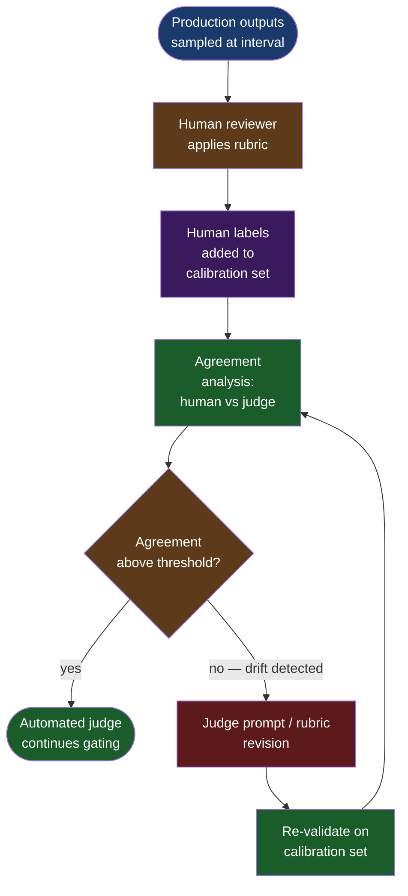

# D10: Human Calibration

**Intent** — Anchor automated evaluator scores to human judgment through periodic spot-checks, preventing LLM-judge drift from actual quality standards.  
**Also known as** — Human-in-the-Loop Calibration, Ground-Truth Anchoring, Eval Alignment, Human Spot-Check.

## Problem

LLM-based evaluators (D09) drift silently. Their scores may correlate with human judgment on the day they are set up, then gradually diverge as the generator model, prompt, or output distribution changes — or simply because LLM judge outputs are inconsistent across temperature runs. Without periodic human anchoring, automated evals produce numbers that feel authoritative but no longer measure what they claim to measure.

## Solution

Maintain a small, growing set of human-labelled examples (the calibration set). At defined intervals — or when score distributions shift — sample recent outputs and have domain experts label them using the same rubric as the automated judge. Compare human labels to judge scores. When agreement falls below a threshold (e.g., Spearman ρ < 0.7 on any dimension), halt automated gating, revise the judge prompt or rubric, and re-establish agreement before resuming. The calibration set is also used to onboard new human reviewers so their labels are consistent.

## Structure

<details>
<summary><b>Human Calibration — Calibration Loop</b></summary>



</details>

## When to Use

- Any production system using D09 (LLM-as-Judge) for quality gating — calibration is a prerequisite, not an option.
- After a generator model upgrade or system prompt change — re-run calibration before trusting judge scores.
- When score distributions shift noticeably (mean or variance moves beyond one standard deviation from baseline).
- When onboarding new human reviewers — use the calibration set to align their labels with the established standard.
- High-stakes domains (medical, legal, financial) where automated quality gates directly affect outcomes.

## When NOT to Use

- Throwaway experiments where the cost of human labelling exceeds the value of the eval.
- When all evaluation is already deterministic (D01, D02) — human calibration applies to qualitative LLM judges, not to schema validators.

## Implementation Notes

**Calibration set management:**

```
struct CalibrationExample:
    id: string
    task_spec: string
    output: string
    human_scores: dict[dimension, int]   // from domain expert
    human_label_date: date
    judge_scores: dict[dimension, int]   // from D09 at same date
    agreement: dict[dimension, float]    // |human - judge| / max_score

function calibration_check(judge, calibration_set, min_spearman=0.7):
    for dimension in rubric.dimensions:
        human_vals = [e.human_scores[dimension] for e in calibration_set]
        judge_vals  = [e.judge_scores[dimension]  for e in calibration_set]
        rho = spearman_correlation(human_vals, judge_vals)
        if rho < min_spearman:
            return DRIFT_DETECTED(dimension=dimension, rho=rho)
    return ALIGNED
```

**Sampling strategy:** stratified sampling across score ranges — do not sample only high-scoring outputs. Calibration sets that lack failing examples cannot detect false positives.

**Calibration set size:** start with 50 examples; grow by adding ~10 new examples per calibration cycle. Cap at 300–500 to keep labelling time manageable; retire old examples when the task distribution shifts significantly.

**Inter-rater reliability:** before using human labels, measure inter-rater agreement (Cohen's κ or Krippendorff's α) across at least two human reviewers. Labels with κ < 0.6 indicate the rubric is ambiguous — fix the rubric before using the labels.

**Drift response protocol:**
```
1. Halt automated gating (route to human review temporarily).
2. Sample 20 recent outputs; collect fresh human labels.
3. Identify drifting dimension(s) from agreement analysis.
4. Revise judge prompt: add examples, tighten dimension wording.
5. Re-run calibration check. Resume automated gating only when aligned.
```

**Hamel Husain's key insight:** inspect real production traces first. Calibration is not about abstract quality — it is about whether your judge correctly identifies the specific failure modes you have already observed in real outputs (D12).

## Cost Profile

| Dimension           | Rating   |
|---------------------|----------|
| Latency added       | High     |
| Token cost          | Low      |
| Implementation      | Med      |
| False-positive risk | Low      |

## Related Patterns

- [D09: LLM-as-Judge](D09-llm-as-judge.md) — D10 is the calibration mechanism that keeps D09 trustworthy.
- [D11: End-to-End Task-Success Eval](D11-end-to-end-task-success.md) — human calibration of end-to-end success metrics is the highest-trust form of this pattern.
- [D12: Step-Level Diagnostic Eval](D12-step-level-diagnostic.md) — error analysis (D12) surfaces the failure modes that calibration examples should cover.
- [D08: Multi-Review / Ensemble](D08-multi-review-ensemble.md) — calibrate each individual reviewer before deploying in an ensemble.

## Anti-Patterns Addressed

- **Generic Evals Before Error Analysis** — calibration examples must cover real observed failure modes, not generic quality axes chosen without inspecting production traces.

## Sources

- **Hamel Husain & Shreya Shankar** — independent ML practitioners; leading voices on LLM evaluation methodology. [LLM Evals FAQ](https://hamel.dev/blog/posts/evals-faq/) | [Why Error Analysis Matters](https://hamel.dev/blog/posts/evals-faq/why-is-error-analysis-so-important-in-llm-evals-and-how-is-it-performed.html)
- **Anthropic Engineering** — AI safety company; authors of Claude. [Demystifying Evals](https://www.anthropic.com/engineering/demystifying-evals-for-ai-agents)
- **OpenAI Engineering** — AI research company; authors of GPT and Codex. [A Practical Guide to Building AI Agents](https://openai.com/business/guides-and-resources/a-practical-guide-to-building-ai-agents/)
