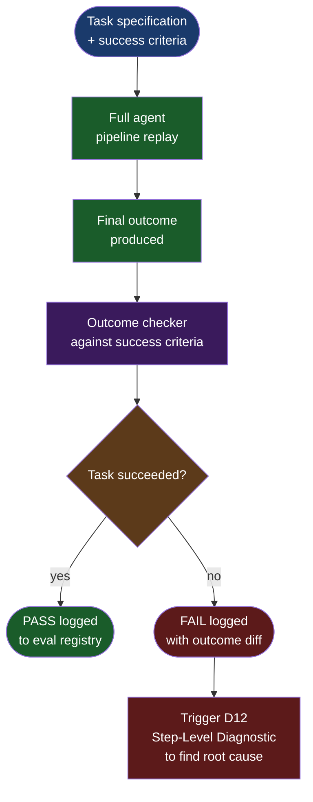

# D11: End-to-End Task-Success Eval

**Intent** — Measure whether the agent's full output achieves the real task objective by replaying the complete task and checking the final outcome, not intermediate steps.  
**Also known as** — Full-Task Eval, Outcome-Based Eval, Task Completion Eval, E2E Success Metric.

## Problem

Component-level evals — validating individual steps, checking intermediate outputs — can all pass while the overall task fails. An agent that writes syntactically correct code, produces a well-formed API response, and passes every intermediate check may still fail to answer the user's question or complete the intended workflow. Optimizing for component metrics without measuring end-to-end success is a form of Goodhart's Law: the metric is fine, the goal is missed.

## Solution

Define success criteria at the task level: what observable outcome proves the task was accomplished? Replay the complete task in a controlled environment and check only whether the final outcome matches the success criterion. Intermediate steps are not scored in E2E eval — their failures only matter if they cause the final outcome to fail. E2E eval is run first; when it fails, step-level diagnostics (D12) are applied to find which step caused the failure.

## Structure

<details>
<summary><b>End-to-End Task-Success Eval — Full Replay Pipeline</b></summary>



</details>

## When to Use

- Any agent system before deploying to production — E2E eval is the primary quality gate.
- After every significant change to the agent, its tools, or its prompt.
- When component evals are all passing but user-reported quality is declining — E2E eval catches the gap.
- For regression testing: maintain a suite of E2E test cases and run on every release.
- As the primary metric when reporting agent quality; step-level metrics are secondary diagnostics.

## When NOT to Use

- As a substitute for D12 when you need to understand *why* the task failed — E2E eval tells you that it failed, not which step caused it.
- When the task is non-deterministic in ways that make a fixed success criterion impossible to define (open-ended creative tasks). In those cases, use D09 with a rubric calibrated by D10.
- When replay is prohibitively expensive (e.g., tasks requiring hours of real-world tool execution) — use a cheaper proxy task for regression testing and reserve full E2E for release gates.

## Implementation Notes

**Success criteria taxonomy:**

```
// Binary outcome examples (cheapest, most reliable)
//   Did the agent book the flight? → check booking confirmation ID
//   Did the code fix the failing test? → run test suite
//   Did the agent answer the question correctly? → exact match or semantic match to reference

// Soft outcome examples (require D09 or human D10)
//   Is the report useful to the intended audience?
//   Does the plan cover all required risk scenarios?

struct E2ETestCase:
    id: string
    task_spec: string
    expected_outcome: string           // what success looks like
    outcome_check_fn: function         // deterministic if possible
    baseline_pass_rate: float          // track over time
```

**E2E eval loop pseudocode:**

```
function run_e2e_suite(test_cases, agent, n_runs=1):
    results = []
    for case in test_cases:
        for run in 1..n_runs:
            // Full pipeline replay: fresh context, no cached intermediate state
            outcome = agent.run_full_task(case.task_spec)
            passed = case.outcome_check_fn(outcome, case.expected_outcome)
            results.append(E2EResult(case_id=case.id, run=run, passed=passed, outcome=outcome))

    pass_rate = count(r for r in results if r.passed) / len(results)
    failures = [r for r in results if not r.passed]
    return E2ESuiteResult(pass_rate=pass_rate, failures=failures)
```

**Hamel Husain's sequencing rule:** run E2E eval first. When the pass rate is below target, apply D12 step-level diagnostics to the failing cases to identify which steps are responsible. Do not invest in step-level evals for steps that are not causing E2E failures — that is wasted effort.

**Test case design:** cover the full input distribution, not just easy cases. Include edge cases identified from real production traces (D12). A test suite that only covers easy inputs will show a high pass rate while missing the failure modes users actually encounter.

**Pass rate tracking:** log pass rates per release. A regression is a statistically significant drop in pass rate — not a single new failure. Use a control chart to detect trends rather than reacting to individual failures.

## Cost Profile

| Dimension           | Rating   |
|---------------------|----------|
| Latency added       | High     |
| Token cost          | High     |
| Implementation      | Med–High |
| False-positive risk | Low      |

## Related Patterns

- [D12: Step-Level Diagnostic Eval](D12-step-level-diagnostic.md) — applied when D11 reports a failure to identify the root cause step.
- [D10: Human Calibration](D10-human-calibration.md) — for tasks where the success criterion is qualitative, human labels anchor the outcome check.
- [D02: Test-Before-Done](D02-test-before-done.md) — D02 gates completion during generation; D11 measures success after the full pipeline runs.
- [D01: Deterministic Validator](D01-deterministic-validator.md) — when the success criterion is binary and machine-checkable, the outcome checker is a D01 call.

## Anti-Patterns Addressed

- **Generic Evals Before Error Analysis** — E2E eval is the starting point; it identifies which tasks fail before any step-level analysis is done.
- **Self-Certified Completion** — the agent's internal assessment of completion is irrelevant; only the E2E outcome check matters.

## Sources

- **Hamel Husain & Shreya Shankar** — independent ML practitioners; leading voices on LLM evaluation methodology. [How to Evaluate Agentic Workflows](https://hamel.dev/blog/posts/evals-faq/how-do-i-evaluate-agentic-workflows.html) | [Evals Skills for Coding Agents](https://hamel.dev/blog/posts/evals-skills/)
- **Anthropic Engineering** — AI safety company; authors of Claude. [Demystifying Evals](https://www.anthropic.com/engineering/demystifying-evals-for-ai-agents)
- **OpenAI Engineering** — AI research company; authors of GPT and Codex. [A Practical Guide to Building AI Agents](https://openai.com/business/guides-and-resources/a-practical-guide-to-building-ai-agents/)
