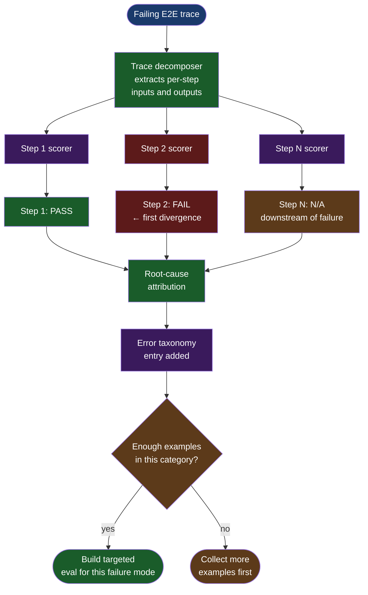

# D12: Step-Level Diagnostic Eval

**Intent** — Score each step in a multi-step pipeline individually to isolate which step caused an end-to-end failure, enabling targeted fixes rather than shotgun prompt rewrites.  
**Also known as** — Trace-Level Eval, Per-Step Scoring, Failure Attribution, Root-Cause Eval, Pipeline Autopsy.

## Problem

When an end-to-end task fails (D11), the failure could originate at any step in the pipeline. Without step-level visibility, engineers rewrite the entire agent prompt or change the model, hoping to fix the failure. This is expensive, slow, and often makes things worse — the problem step is fixed by accident while regressions are introduced elsewhere. Worse, without understanding which step failed and why, teams repeat the same class of mistake in future pipelines.

## Solution

After an E2E failure is detected, replay the failing trace and score each step independently. Each step has its own success criterion (which may be different from the E2E criterion). The step that first diverges from its expected output is the root-cause step. Error analysis across many failing traces reveals a failure taxonomy — a categorized list of what actually goes wrong, in what proportion, and at which step. This taxonomy drives targeted eval design and fix prioritization, not generic quality intuitions.

## Structure

<details>
<summary><b>Step-Level Diagnostic Eval — Trace Decomposition</b></summary>



</details>

## When to Use

- After D11 (E2E eval) reports failures — D12 is the diagnostic tool, not the primary gate.
- When the pipeline has 3 or more distinct steps and you cannot tell from the E2E result which step is at fault.
- Before designing new evals: error analysis on real failing traces tells you which failure modes to build evals for.
- When a fix to one step causes a regression — step scores isolate whether the regression is in the fixed step or a downstream effect.
- For building a failure taxonomy that drives long-term eval investment priorities.

## When NOT to Use

- As a substitute for D11 — step-level scores can all pass while the E2E goal fails (component evals can be blind to emergent failure modes). Always anchor on E2E first.
- For simple single-step agents — step-level diagnostics add overhead with no diagnostic value when there is only one step.
- Before you have real production traces to analyze. Building step-level evals from hypothetical failure modes wastes effort.

## Implementation Notes

**Trace decomposition structure:**

```
struct StepTrace:
    step_id: string
    step_name: string
    input: any                    // full input to this step
    output: any                   // actual output produced
    expected_output_spec: string  // what a correct output looks like
    scorer: function              // deterministic or LLM-based

struct PipelineTrace:
    task_id: string
    e2e_result: bool              // from D11
    steps: list[StepTrace]
```

**Step scoring loop pseudocode:**

```
function diagnose_trace(trace):
    first_failure = None
    for step in trace.steps:
        score = step.scorer(step.input, step.output, step.expected_output_spec)
        step.score = score
        if score == FAIL and first_failure is None:
            first_failure = step

    return DiagnosticReport(
        root_cause_step=first_failure,
        all_step_scores=trace.steps,
        attribution="First failure at step '{first_failure.step_name}'"
    )
```

**Error taxonomy construction (Hamel Husain's method):**

```
// Step 1: collect failing traces from production (minimum 20–30)
// Step 2: for each trace, manually read the full trace — don't skim
// Step 3: label each failure with a short category name
//         e.g., "tool_call_hallucination", "context_window_truncation",
//               "ambiguous_instruction_interpretation", "schema_mismatch"
// Step 4: count category frequencies
// Step 5: build targeted evals for the top 3 categories by frequency
// Step 6: fix the highest-frequency root-cause step first

struct FailureTaxonomyEntry:
    category: string
    count: int
    example_trace_ids: list[string]
    root_cause_step: string
    recommended_fix: string        // prompt change, tool fix, schema fix, etc.
```

**Step scorer design guidance:**
- Prefer deterministic scorers for steps with structured outputs (D01).
- Use LLM-as-Judge (D09) only for steps with qualitative outputs; calibrate via D10.
- Each step scorer should be independently testable with known inputs and outputs.
- A step scorer that is harder to build than the step itself indicates the step is too complex — decompose it.

**Prioritization rule:** fix the step with the highest failure frequency first, not the step that appears most interesting. Impact = frequency × severity.

## Cost Profile

| Dimension           | Rating   |
|---------------------|----------|
| Latency added       | Med      |
| Token cost          | Med      |
| Implementation      | Med–High |
| False-positive risk | Low      |

## Related Patterns

- [D11: End-to-End Task-Success Eval](D11-end-to-end-task-success.md) — always run D11 first; D12 is triggered by D11 failures.
- [D09: LLM-as-Judge](D09-llm-as-judge.md) — step scorers for qualitative steps use D09.
- [D07: Evaluator-Optimizer](D07-evaluator-optimizer.md) — step scores from D12 can feed D07's optimization loop for a specific step.
- [D10: Human Calibration](D10-human-calibration.md) — calibrate LLM-based step scorers before using them to build the taxonomy.

## Anti-Patterns Addressed

- **Generic Evals Before Error Analysis** — D12 is the embodiment of the correct approach: inspect real traces, discover actual failure modes, build a failure taxonomy, THEN define targeted evals. Never design evals from first principles without inspecting real failures.

## Sources

- **Hamel Husain & Shreya Shankar** — independent ML practitioners; leading voices on LLM evaluation methodology. [Why Error Analysis Matters](https://hamel.dev/blog/posts/evals-faq/why-is-error-analysis-so-important-in-llm-evals-and-how-is-it-performed.html) | [How to Evaluate Agentic Workflows](https://hamel.dev/blog/posts/evals-faq/how-do-i-evaluate-agentic-workflows.html) | [LLM Evals FAQ](https://hamel.dev/blog/posts/evals-faq/)
- **Anthropic Engineering** — AI safety company; authors of Claude. [Demystifying Evals](https://www.anthropic.com/engineering/demystifying-evals-for-ai-agents)
- **Google Cloud Architecture Center** — Google's cloud architecture team. [Choose a Design Pattern for Agentic AI](https://docs.cloud.google.com/architecture/choose-design-pattern-agentic-ai-system)
