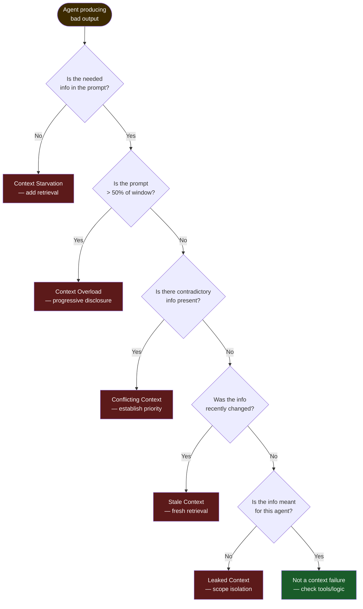

# Guide: Context Failure Modes

## Purpose

Use this guide to diagnose why an agent is performing poorly when the prompt and model seem adequate. Most agent failures that are not tool or logic bugs are context failures — the right information is not reaching the model at the right time in the right form.

---

## The Five Context Failure Modes

### 1. Context Overload (Too Much)

**What happens:** The model receives so much context that it cannot identify what matters. Critical instructions are buried in walls of documentation. The model ignores, contradicts, or partially follows instructions.

**Observable signs:**
- Agent ignores rules that are clearly present in the prompt
- Performance degrades as the instruction file grows
- Selective amnesia — follows some rules but not others
- Works perfectly on simple tasks but fails on complex ones (lost in the noise)

**Root cause:** Treating the context window as a database dump rather than a curated input. Every piece of information competes for attention, and past a threshold, more context reduces quality.

**Fix direction:** Progressive disclosure, map-not-manual, just-in-time retrieval. Load only what the current step needs.

---

### 2. Context Starvation (Too Little)

**What happens:** The model lacks information it needs to make a correct decision. It hallucinates, guesses, or asks questions it should already know the answer to.

**Observable signs:**
- Agent asks questions whose answers are in the codebase
- Agent hallucinates file paths, function names, or API endpoints
- Agent makes decisions inconsistent with project conventions
- Works on greenfield tasks but fails on tasks requiring project knowledge

**Root cause:** Assuming the model "knows" things about your specific project, or failing to provide retrieval paths to relevant context.

**Fix direction:** Repository-as-system-of-record, structured instructions, retrieval-augmented context.

---

### 3. Stale Context

**What happens:** The model operates on outdated information. It references files that have been renamed, uses deprecated APIs, or follows rules that have been superseded.

**Observable signs:**
- Agent uses old naming conventions that were recently changed
- Agent references files or functions that no longer exist
- Agent produces output that was correct last week but is wrong today
- Multi-turn conversations diverge from actual repository state

**Root cause:** Context loaded at session start is never refreshed. Long-running sessions accumulate staleness. Cached summaries or static instructions fall behind the evolving codebase.

**Fix direction:** Fresh retrieval at each decision point, context compaction with re-anchoring, short session lifecycles.

---

### 4. Conflicting Context

**What happens:** The model receives contradictory instructions and must silently choose one. The choice is unpredictable and varies between turns.

**Observable signs:**
- Agent behavior flips between runs with no prompt change
- Different parts of the output follow different style conventions
- Agent explicitly mentions being "unsure which approach" or silently picks one
- Global instructions conflict with project-specific instructions

**Root cause:** Multiple sources of truth loaded simultaneously without priority ordering. System prompt says one thing; retrieved documentation says another; inline comments say a third.

**Fix direction:** Explicit priority hierarchy, context isolation per scope, single source of truth per topic.

---

### 5. Leaked Context (Wrong Audience)

**What happens:** Information intended for one agent, role, or scope leaks into another. A specialized agent receives irrelevant context that confuses its task. Private or sensitive information appears where it should not.

**Observable signs:**
- Specialist agent references tools or knowledge it should not have
- Multi-agent handoffs carry over unrelated context from previous steps
- Agent mentions internal details in user-facing output
- Context from one tenant or user leaks into another's responses

**Root cause:** Shared context buses without access control. Passing full conversation history rather than filtered, role-appropriate summaries. No isolation between agent scopes.

**Fix direction:** Role-scoped context, minimal-context handoff, context isolation between agents.

---

## Diagnosis Flowchart

<b>Context Failure Diagnosis</b>

---

## Related Patterns

- [Map-Not-Manual](../patterns/map-not-manual.md) — fixes Context Overload
- [Progressive Disclosure](../patterns/progressive-disclosure.md) — fixes Context Overload
- [Just-in-Time Retrieval](../patterns/just-in-time-retrieval.md) — fixes Context Starvation and Stale Context
- [Context Isolation](../patterns/context-isolation.md) — fixes Leaked Context and Conflicting Context
- [Context Compaction](../patterns/context-compaction.md) — fixes Stale Context
- [Role-Scoped Context](../patterns/role-scoped-context.md) — fixes Leaked Context
- [Minimal-Context Handoff](../patterns/minimal-context-handoff.md) — fixes Leaked Context

---

## Sources

- Anthropic — [Effective Context Engineering for AI Agents](https://www.anthropic.com/engineering/effective-context-engineering-for-ai-agents)
- OpenAI — [Harness Engineering](https://openai.com/index/harness-engineering/)
- Microsoft — [AI Agent Orchestration Patterns](https://learn.microsoft.com/en-us/azure/architecture/ai-ml/guide/ai-agent-design-patterns)
