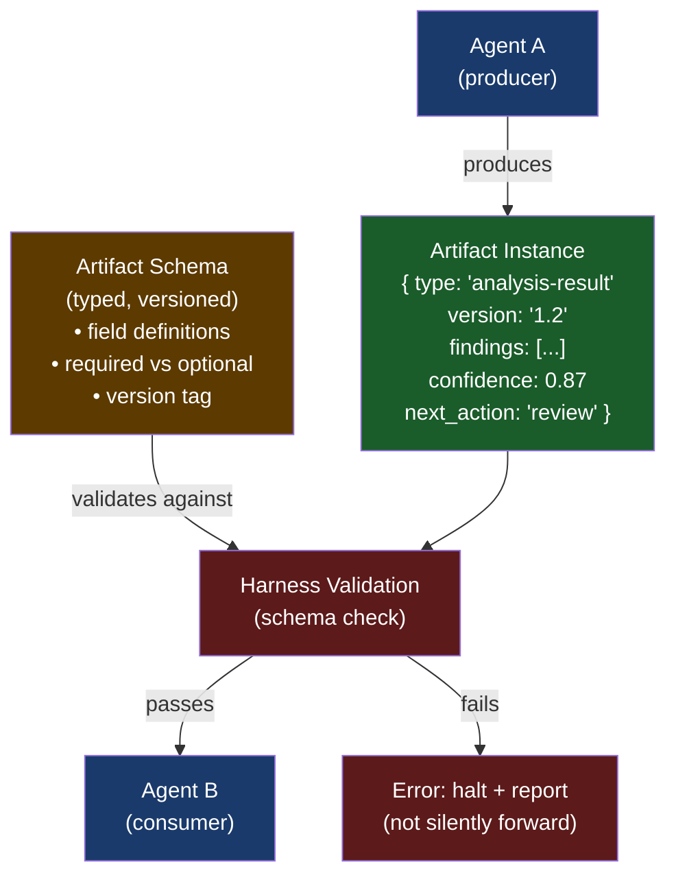

# Artifact-Based Handoff

**Family:** E — Context Engineering

## Problem

When agents pass results to each other as unstructured prose or raw conversation history, the receiving agent must parse, interpret, and validate what it receives before it can use it. Ambiguous outputs cause the next agent to make wrong assumptions. Structural mismatches — a field the next agent expects that wasn't produced, or a field it doesn't know how to handle — cause silent errors that propagate through the pipeline. The further downstream the failure, the harder it is to trace back to the handoff that introduced it.

## Solution

Define a typed, versioned artifact schema for each inter-agent boundary. When an agent completes its work, it serializes its output into the schema. The receiving agent deserializes the artifact and operates on well-defined fields. The harness validates the artifact against the schema before passing it. The schema is the contract between agents; it is independent of how either agent works internally.

## Structure

<b>Solution Structure</b>

1. For each agent-to-agent boundary, define an artifact schema: field names, types, required/optional status, and a version tag.
2. Include in the producing agent's prompt the schema it must output (JSON, structured markdown, or a typed object).
3. The harness validates the output against the schema before forwarding. On validation failure, halt and surface the error — do not silently forward malformed output.
4. The consuming agent's prompt references the schema and the field names it will operate on.
5. When the schema changes, increment the version. Maintain backward compatibility or force a migration step.

## When to Use

- A pipeline has multiple agents that pass structured results to each other.
- The correctness of downstream agents depends on the exact structure of upstream outputs.
- The pipeline runs autonomously and silent failures would be hard to detect.
- Multiple consuming agents receive the same artifact (fan-out).

## When NOT to Use

- The result is inherently unstructured (a free-form essay, a generated image) — schema validation does not apply.
- There is only one agent; no handoff occurs.
- The pipeline is exploratory and the output format is not yet stable — defer schema definition until the format stabilizes.

## Tradeoffs

| Benefit | Cost |
|---------|------|
| Explicit contract between agents; failures are caught early | Schema design is upfront work; wrong schemas cause the same problems as no schema |
| Validation step surfaces errors at the boundary, not downstream | Schema maintenance overhead as requirements evolve |
| Producing agent has a clear, testable output target | Agents must be prompted to produce structured output, which can conflict with natural language reasoning |
| Enables independent development and testing of each agent | Version management complexity in long-lived pipelines |

## Related Patterns

- [Minimal-Context Handoff](minimal-context-handoff.md) — governs how much content crosses the boundary; artifact schema governs the structure of what crosses.
- [Context Isolation](context-isolation.md) — isolation creates the boundary; artifact-based handoff defines the interface at that boundary.
- [Repository-as-System-of-Record](repository-as-system-of-record.md) — artifact schemas can be versioned and stored in the repository.
- [Progressive Disclosure](progressive-disclosure.md) — an artifact can be the structured output of one phase, disclosed to the next phase.

## Anti-Patterns Addressed

- **Shared Context Everywhere** — passing raw history is the opposite of a structured artifact; this pattern replaces uncontrolled context forwarding with a defined interface.

## Example

A research pipeline: Agent A (searcher) finds and scores web sources. Agent B (synthesizer) writes a report from those sources. Without a schema, Agent A might output a bulleted list, a numbered list, or prose — and Agent B must guess the format. With a schema: Agent A produces `{ sources: [{ url, title, relevance_score, key_quote }], query_used, result_count }`. Agent B receives this artifact, iterates `sources`, and writes a grounded report. The harness validates that `sources` is a non-empty list and each item has a `url` before forwarding. A missing `key_quote` is caught at the boundary, not buried in the report.

## Sources

- **Anthropic Engineering** — AI safety company; authors of Claude. Recommends structured outputs and defined interfaces at agent boundaries as a reliability practice in multi-agent pipelines. [Building Effective Agents](https://www.anthropic.com/engineering/building-effective-agents)
- **Microsoft Azure Architecture Center** — Microsoft's cloud architecture team. Documents typed inter-agent message passing as a core pattern for reliable agentic orchestration. [AI Agent Design Patterns](https://learn.microsoft.com/en-us/azure/architecture/ai-ml/guide/ai-agent-design-patterns)
- **Google Cloud Architecture Center** — Google's cloud architecture team. Identifies structured agent outputs as essential for composable multi-agent system design. [Choose a Design Pattern for Agentic AI](https://docs.cloud.google.com/architecture/choose-design-pattern-agentic-ai-system)
