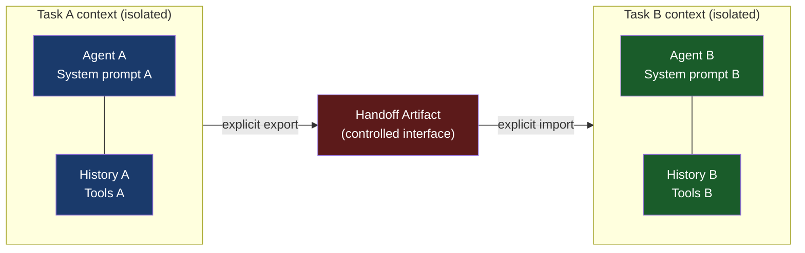

# Context Isolation

**Family:** E — Context Engineering

## Problem

When multiple tasks, users, or agents share a context window — or when one task's history bleeds into the next — the model's behavior is contaminated by information it should not have. A customer-A detail surfaces in a customer-B response. A sensitive intermediate reasoning step from task 1 influences task 2. An agent that handled a security-sensitive sub-task carries that data into a downstream task that should not have access to it. Context leakage is a correctness failure, a security failure, and an unpredictability failure simultaneously.

## Solution

Enforce explicit context boundaries between tasks, users, roles, and agents. Each unit of work gets its own isolated context that is constructed fresh and torn down when the unit completes. No context crosses a boundary unless it is explicitly serialized into a handoff artifact and passed through a controlled interface.

## Structure

<b>Solution Structure</b>

1. Assign each task or agent a dedicated context object — system prompt, tool list, and conversation history — that is not shared with any other task or agent.
2. When a task completes and its result is needed downstream, serialize only the result into a defined artifact format; do not forward raw history.
3. Tear down (or clear) the context when the task ends; do not persist it in a shared variable.
4. In multi-tenant systems, enforce isolation at the harness level, not the prompt level — a prompt instruction to "ignore other users" is not isolation.

## When to Use

- Multiple users or tenants share the same agent infrastructure.
- A workflow has parallel branches that must not influence each other.
- A sub-task handles sensitive data (credentials, PII, confidential documents) that must not leak to downstream agents.
- Agents are assigned different roles with different permission scopes.

## When NOT to Use

- A single agent runs a single-user sequential task where there is no other context to contaminate.
- Tasks are so tightly coupled that they functionally need shared history — in this case, use [Role-Scoped Context](role-scoped-context.md) to filter rather than isolate.

## Tradeoffs

| Benefit | Cost |
|---------|------|
| Prevents cross-task contamination and data leakage | Harness must manage context lifecycle (create, populate, destroy) |
| Enables multi-tenant safety without prompt-level hacks | Information cannot flow freely; every cross-boundary transfer must be explicit |
| Makes agent behavior deterministic relative to its own context | More infrastructure complexity than a simple shared conversation |
| Supports auditing — each task's context is bounded and inspectable | Debugging requires reconstructing what was in each isolated context |

## Related Patterns

- [Role-Scoped Context](role-scoped-context.md) — a softer form: one agent sees filtered views of shared context rather than fully isolated contexts.
- [Minimal-Context Handoff](minimal-context-handoff.md) — the pattern for what crosses a context boundary after isolation is enforced.
- [Artifact-Based Handoff](artifact-based-handoff.md) — the mechanism for transferring results across isolated contexts.
- [Progressive Disclosure](progressive-disclosure.md) addresses the temporal boundary; Context Isolation addresses the structural boundary.

## Anti-Patterns Addressed

- **Shared Context Everywhere** — the direct inverse of this pattern; every agent seeing full history is the canonical failure mode Context Isolation prevents.

## Example

A legal document processing system runs two agents in sequence: a clause-extraction agent that sees the full confidential contract, and a redaction-summary agent that produces a public-safe summary. The harness gives agent 1 its own isolated context with the contract. Agent 1 produces a structured list of clauses — no confidential text. That list is passed as a handoff artifact to agent 2, which has no access to the original contract. Even if agent 2 is compromised or misconfigured, it cannot leak the contract because it was never in its context.

## Sources

- **Anthropic Engineering** — AI safety company; authors of Claude. Identifies context leakage between tasks as a primary failure mode in multi-agent systems and recommends explicit isolation boundaries. [Effective Context Engineering for AI Agents](https://www.anthropic.com/engineering/effective-context-engineering-for-ai-agents)
- **AWS Prescriptive Guidance** — Amazon Web Services architecture team. Describes context isolation as a foundational security and correctness requirement for multi-agent agentic systems. [Agentic AI Patterns](https://docs.aws.amazon.com/prescriptive-guidance/latest/agentic-ai-patterns/agent-patterns.html)
