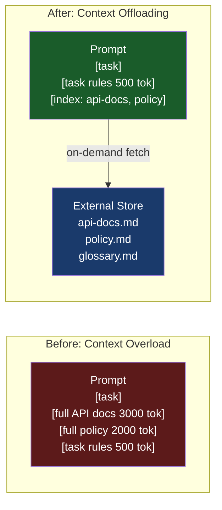

# Context Offloading

**Family:** E — Context Engineering

## Problem

Stable reference material — API documentation, domain glossaries, configuration schemas, company policies — is loaded into every prompt even though it rarely changes and the model only needs a fraction of it per call. This reference material consumes a fixed token budget on every call, crowds out task-specific content, and creates maintenance overhead when the material changes (every prompt must be updated). The content is in the context not because it is needed now, but because the alternative — losing it — seems worse.

## Solution

Move stable, rarely-changing reference material out of the prompt entirely and into an external store (repository files, a vector database, a documentation site, or a configuration service). The prompt contains only a pointer or index entry. Content is retrieved only when a step explicitly needs it, and only the relevant portion is loaded — not the full document.

## Structure

<b>Solution Structure</b>

1. Audit the current system prompt for content that is: (a) stable across calls, (b) not always needed, and (c) large relative to total prompt size.
2. Move each such block into a named external file or store entry.
3. Add a one-line index entry in the system prompt: the name and a description of when to load it.
4. When a step needs the offloaded content, the agent reads the file or queries the store.
5. Update the external file when the reference material changes — the prompt index entry does not need to change.

## When to Use

- The system prompt contains blocks of reference material that are consulted rarely or conditionally.
- Reference material changes at a different cadence from the task logic (docs update monthly; task logic changes daily).
- Multiple agents or workflows need access to the same reference material.
- The reference material's total size is large relative to the window budget.

## When NOT to Use

- The reference material is small (under 200 tokens) and always needed — keep it inline.
- The agent has no file-reading or retrieval capability.
- Latency from the retrieval call is unacceptable for the use case.

## Tradeoffs

| Benefit | Cost |
|---------|------|
| Reduces fixed per-call token cost | Requires retrieval infrastructure or file access |
| Reference material is versioned and updated in one place | Agent must be prompted to fetch, not assume; missed fetches cause errors |
| Prompt stays small and focused | Read latency per step that fetches offloaded content |
| Multiple agents share the same external source | Content that should always be present must not be offloaded |

## Related Patterns

- [Map-Not-Manual](map-not-manual.md) — the map is itself the offloading mechanism for knowledge documents.
- [Just-in-Time Retrieval](just-in-time-retrieval.md) — the fetch mechanism used to load offloaded content on demand.
- [Context Compaction](context-compaction.md) — compaction handles dynamic accumulation; offloading handles static pre-load.
- [Repository-as-System-of-Record](repository-as-system-of-record.md) — the repository is the canonical store for offloaded reference material.

## Anti-Patterns Addressed

- **Giant Instruction Manual** — offloading is the structural solution to the anti-pattern of embedding all reference material in the prompt.

## Example

A developer-tools agent has a 4000-token system prompt: 500 tokens of task rules and 3500 tokens of language reference (syntax tables, standard library signatures). The agent consults the language reference on about 30% of calls. After offloading: the system prompt contains 500 tokens of task rules and a one-line pointer to `references/language-spec.md`. On calls that need syntax details, the agent reads the relevant section (~300 tokens). Per-call token cost drops from 4000 to 500–800. The language spec is updated by the documentation team without touching the agent prompt.

## Sources

- **Anthropic Engineering** — AI safety company; authors of Claude. Recommends keeping the system prompt minimal and referencing external docs rather than inlining them; identifies reference bloat as a primary context overload cause. [Effective Context Engineering for AI Agents](https://www.anthropic.com/engineering/effective-context-engineering-for-ai-agents)
- **OpenAI Engineering** — AI research company; authors of GPT and Codex. The AGENTS.md / harness pattern centers on offloading deep knowledge to structured repository files rather than embedding it in the harness prompt. [Harness Engineering](https://openai.com/index/harness-engineering/) | [Unlocking the Codex Harness](https://openai.com/index/unlocking-the-codex-harness/)
