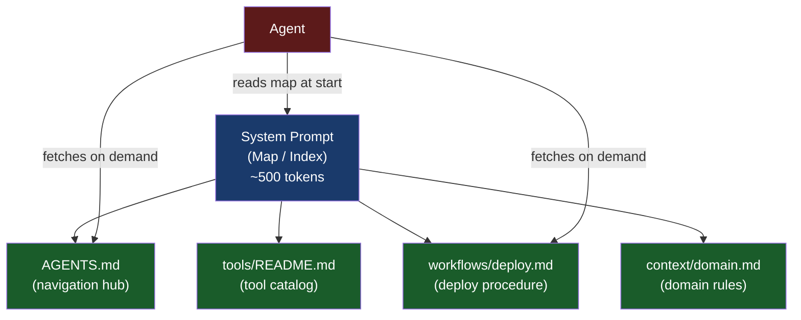

# Map-Not-Manual

**Family:** E — Context Engineering

## Problem

When all rules, procedures, background knowledge, and reference material are packed into a single large system prompt, the model's attention dilutes across thousands of tokens of unrelated content. A rule buried at token 6000 competes with a rule at token 200 — and the model frequently ignores the buried one. The agent cannot find what it needs because nothing is organized to help it navigate: it either reads everything (expensive, noisy) or misses the relevant section entirely.

## Solution

Replace the monolithic instruction document with a concise index — a map — that tells the agent what documents exist, what each covers, and how to load them. The system prompt stays small. Deeper knowledge lives in structured repository-local files that the agent fetches only when the current step requires it.

## Structure

<b>Solution Structure</b>

1. Write a short index document (AGENTS.md or equivalent) that lists every reference file, its topic, and the conditions under which an agent should load it.
2. Keep the system prompt or initial context to the index plus the immediate task description — nothing else.
3. When a step requires domain knowledge, the agent reads the relevant file from the repository at that moment.
4. Never inline content that is already in a referenced file.

## When to Use

- The system prompt has grown beyond ~1000 tokens of rules and reference material.
- Different steps of a workflow need different background knowledge.
- Multiple agents share a knowledge base but each needs only a subset.
- The repository already contains structured documentation that duplicates what is in the prompt.

## When NOT to Use

- The task is a single-shot call with no multi-step reasoning; a compact inline prompt is fine.
- The agent has no file-reading tool and cannot fetch documents on demand.
- All rules are universally relevant to every step (e.g., safety constraints must always be present).

## Tradeoffs

| Benefit | Cost |
|---------|------|
| Keeps system prompt small; improves instruction-following | Requires an extra read per knowledge domain accessed |
| Knowledge is versioned alongside code in the repo | Agent must be prompted to consult the map rather than assume it knows |
| Multiple agents can share the same knowledge base | Index must be maintained as docs evolve |
| Reduces token cost per call when only some docs are needed | Latency added if the agent fetches multiple files in sequence |

## Related Patterns

- [Progressive Disclosure](progressive-disclosure.md) — Map-Not-Manual decides *what* to load; Progressive Disclosure decides *when* to load it.
- [Context Offloading](context-offloading.md) — both move content out of the prompt; offloading targets stable reference data, this pattern targets structured navigable knowledge.
- [Repository-as-System-of-Record](repository-as-system-of-record.md) — the repo provides the files the map points to.
- [Just-in-Time Retrieval](just-in-time-retrieval.md) — the mechanism used to fetch the content the map describes.

## Anti-Patterns Addressed

- **Giant Instruction Manual** — directly replaces the practice of embedding all knowledge in a single large prompt.

## Example

An agent that manages cloud deployments across three providers has an AGENTS.md with ten lines: each line names a file (e.g., `cloud/aws-deploy.md`, `cloud/gcp-deploy.md`) and a one-sentence description. The system prompt includes only AGENTS.md verbatim. When the agent receives a task targeting AWS, it reads `cloud/aws-deploy.md`. The GCP and Azure docs are never loaded. Token cost for the AWS task: ~800 tokens instead of ~6000.

## Sources

- **Anthropic Engineering** — AI safety company; authors of Claude. Describes AGENTS.md as a map rather than a manual: keep the index short and let agents fetch deeper docs on demand. [Effective Context Engineering for AI Agents](https://www.anthropic.com/engineering/effective-context-engineering-for-ai-agents)
- **OpenAI Engineering** — AI research company; authors of GPT and Codex. Introduces the AGENTS.md convention and recommends keeping it as a navigable index pointing to structured repo-local docs. [Harness Engineering](https://openai.com/index/harness-engineering/)
