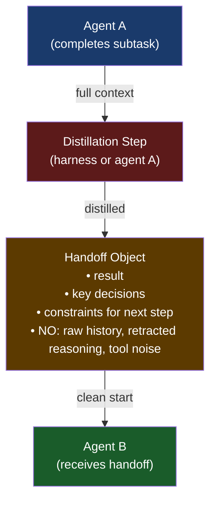

# Minimal-Context Handoff

**Family:** E — Context Engineering

## Problem

When one agent passes its entire conversation history to the next agent, the receiving agent inherits noise, intermediate reasoning, retracted attempts, and irrelevant tool outputs. The signal — the actual result the next agent needs — is buried. The receiving agent's context window is partly consumed before it has done any work. Worse, discarded intermediate reasoning can mislead the next agent into treating exploratory steps as decisions.

## Solution

Before handing off to the next agent, distill the current agent's output to the minimum information the next agent needs to continue. Pass the result, not the journey. The handoff object is constructed deliberately: it contains the task output, relevant decisions made, and any constraints the next step must respect — nothing else.

## Structure

<b>Solution Structure</b>

1. Define a handoff schema before the workflow starts: what fields the next agent requires.
2. At completion, the current agent (or harness) fills only those fields — discarding tool call logs, intermediate attempts, and scratchpad reasoning.
3. The receiving agent's system prompt references the handoff schema, not free-form history.
4. If the next agent needs to explain or audit the prior step, include a `rationale` field in the schema — but still keep it brief and structured.

## When to Use

- A workflow chains multiple specialized agents in sequence.
- The preceding agent's conversation history is long or contains noisy tool calls.
- The next agent's task is well-defined and needs results, not process.
- Context window budget is a constraint.

## When NOT to Use

- The next agent must understand the reasoning process, not just the result (pass a `rationale` field instead of full history).
- The task is exploratory and the next agent needs to see the full trajectory to continue (consider [Context Compaction](context-compaction.md) over truncation).
- Only one agent is involved — no handoff needed.

## Tradeoffs

| Benefit | Cost |
|---------|------|
| Next agent starts with a clean, high-signal context | Distillation step adds latency and complexity |
| Reduces token cost for all downstream agents | Information loss if the distillation schema is wrong or incomplete |
| Decouples agents — each has a defined interface | Schema maintenance overhead as the workflow evolves |
| Prevents intermediate reasoning from anchoring next agent | Debugging is harder — the journey is not preserved by default |

## Related Patterns

- [Artifact-Based Handoff](artifact-based-handoff.md) — a stronger form: the handoff object is a typed, versioned artifact with a formal schema.
- [Context Isolation](context-isolation.md) — isolation enforces the boundary; this pattern governs what crosses it.
- [Progressive Disclosure](progressive-disclosure.md) — disclosure governs what enters context at each step; handoff governs what exits.
- [Context Compaction](context-compaction.md) — an alternative when history must be preserved but compressed rather than discarded.

## Anti-Patterns Addressed

- **Shared Context Everywhere** — passing full history to every downstream agent is the specific failure this pattern prevents.

## Example

Agent A searches a codebase for usages of a deprecated API and produces a list of 47 file paths with line numbers. Its conversation history includes 12 tool calls, several retracted searches, and 3000 tokens of intermediate analysis. The handoff object passed to Agent B (which will make the replacements) contains: the 47 file paths, the deprecated API signature, the replacement API signature, and one sentence of rationale. Agent B's context starts at ~400 tokens instead of ~4000.

## Sources

- **Anthropic Engineering** — AI safety company; authors of Claude. Recommends passing only necessary context between subagents and avoiding full history forwarding in multi-agent pipelines. [Effective Context Engineering for AI Agents](https://www.anthropic.com/engineering/effective-context-engineering-for-ai-agents) | [Building Effective Agents](https://www.anthropic.com/engineering/building-effective-agents)
- **Google Cloud Architecture Center** — Google's cloud architecture team. Describes inter-agent handoff as a structured interface concern, not a raw context-copy operation. [Choose a Design Pattern for Agentic AI](https://docs.cloud.google.com/architecture/choose-design-pattern-agentic-ai-system)
