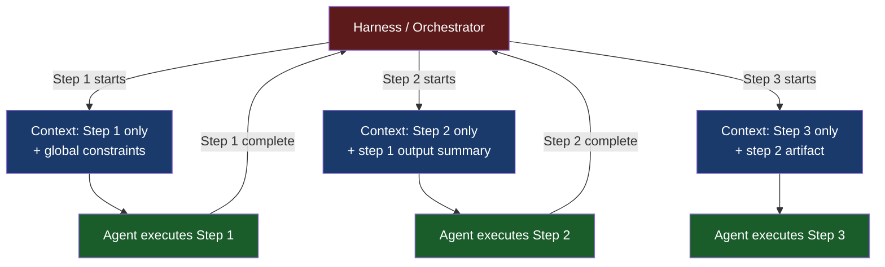

# Progressive Disclosure

**Family:** E — Context Engineering

## Problem

When all information needed for a multi-step workflow is loaded upfront, the model's context window fills with content that is irrelevant to the current step. A step-3 procedure loaded at step 1 adds noise that competes with step-1 instructions. The model attends to content proportional to its position and salience — early irrelevant content can anchor wrong behavior before the relevant step begins.

## Solution

Reveal information to the agent incrementally, injecting each piece of context only when the step that requires it begins. The system prompt contains only what is needed for the first step. As the workflow advances, the harness appends or replaces context relevant to the current step. Information about future steps is withheld until those steps are reached.

## Structure

<b>Solution Structure</b>

1. Divide the workflow into discrete steps with clear entry and exit conditions.
2. For each step, define the minimum context needed: task description, relevant rules, and outputs from prior steps (summarized, not raw).
3. The harness builds a fresh context object at the start of each step rather than accumulating turn history.
4. Prior step outputs are passed forward as compact artifacts, not as full conversation transcripts.

## When to Use

- The workflow has clearly separable phases where each phase needs different reference material.
- The total information needed across all steps would overflow or significantly dilute a single context window.
- Steps are executed sequentially with the harness controlling transitions.
- Different steps require different tool sets or permissions.

## When NOT to Use

- The model needs to see the full history of all steps to reason about the current one (use [Context Compaction](context-compaction.md) instead).
- Steps are parallelized — there is no sequential disclosure order.
- The workflow has fewer than three steps with low total token cost.

## Tradeoffs

| Benefit | Cost |
|---------|------|
| Each step gets maximum attention on its own relevant content | Harness must manage step transitions and context construction |
| Reduces mid-workflow context overload | Information from step N is unavailable at step N+1 unless explicitly forwarded |
| Enables longer workflows within a fixed window size | Step boundaries must be designed carefully — wrong cuts lose continuity |
| Cheaper per-call token cost | More calls overall if steps are fine-grained |

## Related Patterns

- [Map-Not-Manual](map-not-manual.md) — the map tells the agent what docs exist; Progressive Disclosure determines when each is loaded.
- [Minimal-Context Handoff](minimal-context-handoff.md) — the mechanism for passing only what is needed from one step to the next.
- [Just-in-Time Retrieval](just-in-time-retrieval.md) — retrieval can serve as a per-step disclosure mechanism when content is in a store rather than a file.
- [Context Compaction](context-compaction.md) — an alternative when history must accumulate but must also be compressed.

## Anti-Patterns Addressed

- **Giant Instruction Manual** — loading all step-specific instructions at once is the manifest form of this anti-pattern in multi-step workflows.

## Example

A code-review pipeline has three steps: (1) static analysis, (2) security scan, (3) summary report. At step 1, the context contains only the diff and static-analysis rules. At step 2, the context contains the diff, the step-1 findings (as a short list), and security-scan rules. Step-1 rules are not present. At step 3, the context contains the two findings lists and the report template — no rules at all. Each step's model call is under 2000 tokens; the full upfront load would have been 7000.

## Sources

- **Anthropic Engineering** — AI safety company; authors of Claude. Frames context engineering as controlling what information is present at each step, not just at task start. [Effective Context Engineering for AI Agents](https://www.anthropic.com/engineering/effective-context-engineering-for-ai-agents)
- **Microsoft Azure Architecture Center** — Microsoft's cloud architecture team. Recommends step-scoped context injection as a core pattern for multi-step agentic workflows. [AI Agent Design Patterns](https://learn.microsoft.com/en-us/azure/architecture/ai-ml/guide/ai-agent-design-patterns)
