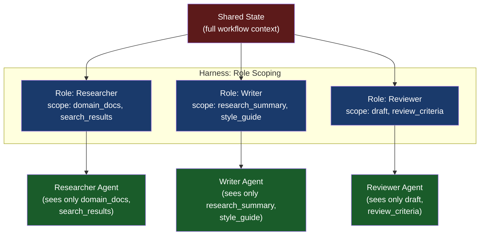

# Role-Scoped Context

**Family:** E — Context Engineering

## Problem

In multi-agent or multi-role systems, giving every participant the same context creates two compounding failures. First, agents receive information irrelevant to their role, consuming tokens and introducing noise that degrades precision. Second, agents receive information they should not have access to — a summarization agent seeing raw credentials, a public-facing agent seeing internal pricing logic, a junior agent seeing senior-level deliberations. Neither failure is addressed by a prompt instruction like "ignore irrelevant parts" — the tokens are already in the window.

## Solution

Construct each agent's context from the intersection of (a) what the agent's role requires and (b) what the agent's role is permitted to see. Role definitions are explicit: each role has a declared context scope — a set of information categories it receives. The harness filters shared information through each role's scope before building the prompt. Agents never see unfiltered shared state.

## Structure

<b>Solution Structure</b>

1. Define roles for each agent in the workflow; for each role, enumerate the context categories it needs and the categories it must not receive.
2. Maintain shared state as a structured object with labeled categories (e.g., `credentials`, `user_data`, `draft`, `research`).
3. When building a prompt for a role, the harness selects only the categories in that role's permitted scope.
4. Roles are defined in configuration, not in the prompt — the agent does not decide what it sees.

## When to Use

- Multiple agents with different responsibilities share a workflow but need different information.
- Some information is sensitive and must be kept from agents that do not need it.
- Agents are specialized and benefit from focused, noise-free context.
- The same underlying data model is shared across roles (e.g., a shared document being reviewed by different specialists).

## When NOT to Use

- All agents genuinely need the same information — scoping adds complexity without benefit.
- The workflow is sequential with full context isolation at each step (use [Context Isolation](context-isolation.md) instead).
- There are only two roles and the difference is minimal — a simpler filtered prompt is enough.

## Tradeoffs

| Benefit | Cost |
|---------|------|
| Each agent gets a high-signal, low-noise context | Scope definitions must be maintained as roles evolve |
| Sensitive information is structurally excluded from unauthorized roles | Harness complexity: context must be built from a structured state object |
| Agents are more predictable — behavior is bounded by their scope | Debugging: must reconstruct what each role saw to trace an error |
| Enables fine-grained least-privilege for information access | Role definitions may conflict; requires reconciliation |

## Related Patterns

- [Context Isolation](context-isolation.md) — isolation separates contexts completely; role-scoped context filters a shared state into per-role views.
- [Minimal-Context Handoff](minimal-context-handoff.md) — when a role's output is passed to the next role, handoff governs what crosses the boundary.
- [Just-in-Time Retrieval](just-in-time-retrieval.md) — retrieval can be scoped per role to enforce information access at the retrieval layer.
- [Progressive Disclosure](progressive-disclosure.md) — disclosure can be applied within a role's scope to stage information across steps.

## Anti-Patterns Addressed

- **Shared Context Everywhere** — role scoping is the direct structural counter to all agents receiving full undifferentiated context.

## Example

A content moderation pipeline has three roles: Classifier (sees only the raw submission and a taxonomy), Policy-Checker (sees only the classifier's label and the moderation policy), and Auditor (sees the submission, the label, the policy decision, and the appeals criteria). Credentials, internal metrics, and moderator identities are in the shared state but in no role's scope. The Classifier never sees the policy; the Policy-Checker never sees the raw submission. Each agent's context is ~600 tokens; the full shared state is 4000 tokens.

## Sources

- **Anthropic Engineering** — AI safety company; authors of Claude. Describes role-specific context as a tool for improving precision and enforcing least-privilege information access in multi-agent pipelines. [Effective Context Engineering for AI Agents](https://www.anthropic.com/engineering/effective-context-engineering-for-ai-agents)
- **Microsoft Azure Architecture Center** — Microsoft's cloud architecture team. Documents role-based context partitioning as a pattern for multi-agent orchestration architectures. [AI Agent Design Patterns](https://learn.microsoft.com/en-us/azure/architecture/ai-ml/guide/ai-agent-design-patterns)
- **AWS Prescriptive Guidance** — Amazon Web Services architecture team. Recommends scoping agent context to role requirements as a security and correctness practice in agentic systems. [Agentic AI Patterns](https://docs.aws.amazon.com/prescriptive-guidance/latest/agentic-ai-patterns/agent-patterns.html)
