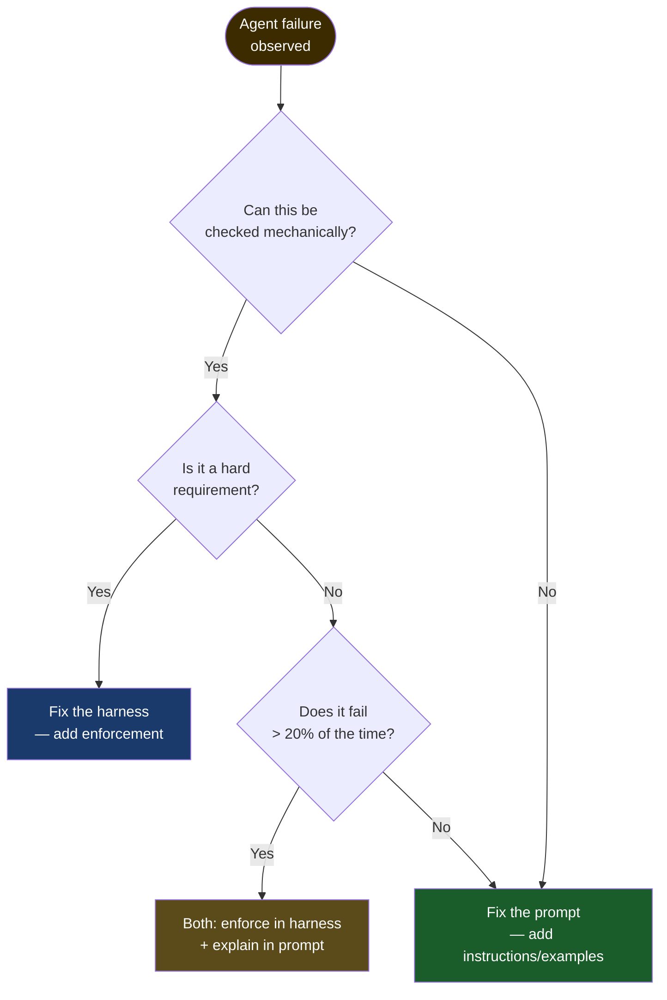

# Guide: Harness vs. Prompt Decision Guide

## Purpose

Use this guide when an agent is failing at a task and you need to decide: should I fix the harness (tools, environment, constraints, feedback loops) or fix the prompt (instructions, examples, context)? Getting this wrong leads to either prompt bloat (trying to fix harness problems with words) or over-engineering (building infrastructure for what a better prompt would solve).

---

## The Core Principle

> If a behavior can be enforced or verified mechanically, enforce it in the harness. If a behavior requires judgment, reasoning, or creativity, address it in the prompt.

The harness handles **what must be true**. The prompt handles **how to think about it**.

---

## Decision Matrix

For each agent failure, classify it using this matrix.

| Failure Type | Fix the Harness | Fix the Prompt |
|---|---|---|
| Agent produces syntactically invalid output | Add schema validation / output parser | — |
| Agent uses the wrong coding style | Add formatter (auto-fix) or linter (error) | — |
| Agent skips a required step | Add programmatic gate that blocks progression | — |
| Agent calls a dangerous API | Remove tool from available tools, or add permission gate | — |
| Agent's reasoning is wrong | — | Add examples, constraints, or retrieval |
| Agent doesn't understand the task | — | Clarify instructions, add context |
| Agent chooses a poor approach among valid options | — | Add decision criteria or heuristics |
| Agent's tone or style is wrong | — | Add style examples or constraints |
| Agent ignores a rule sometimes | Add mechanical enforcement AND keep the rule in prompt | Both |
| Agent produces correct but verbose output | Add output length constraint in harness if critical; prompt if soft preference | Depends |

---

## Diagnostic Flowchart

<b>Harness vs. Prompt Decision Flow</b>

---

## Harness Fixes (by category)

### Output Quality

| Problem | Harness Fix |
|---|---|
| Invalid JSON/YAML | Output schema validator + retry on parse failure |
| Wrong file format | File extension check + template |
| Missing required fields | Schema validation with required fields |
| Output too long/short | Token/character limit enforcement |

### Process Compliance

| Problem | Harness Fix |
|---|---|
| Skipped steps | Programmatic gate between steps (state machine) |
| Wrong ordering | State machine that only allows valid transitions |
| Missing tests | Pre-commit hook that checks test existence |
| Unsafe operations | Permission system / tool gating |

### Code Quality

| Problem | Harness Fix |
|---|---|
| Style violations | Auto-formatter on save/commit |
| Import violations | Linter rule (architectural boundaries) |
| Type errors | Type checker in feedback loop |
| Security issues | SAST scanner in CI + pre-commit |

---

## Prompt Fixes (by category)

### Reasoning Quality

| Problem | Prompt Fix |
|---|---|
| Wrong approach to problem | Add decision criteria, examples of good approaches |
| Incomplete analysis | Add "consider X, Y, Z" structure |
| Over-confident on uncertain tasks | Add "state confidence" instruction |
| Missing edge cases | Add "check for: [edge case list]" |

### Task Understanding

| Problem | Prompt Fix |
|---|---|
| Misinterprets the request | Rephrase task description, add examples |
| Works on wrong scope | Add explicit boundaries ("in scope / out of scope") |
| Uses wrong conventions | Add project-specific examples |
| Ignores constraints | Move constraints to prominent position, add emphasis |

---

## Red Flags: You're Fixing the Wrong Thing

### Signs you're prompt-fixing a harness problem

- You keep adding "IMPORTANT: Never..." rules to the prompt
- The same failure recurs despite prompt fixes
- The fix works for a week then stops working (attention decay)
- You're writing instructions for something a linter could catch
- The rule is binary (right/wrong) with no judgment involved

### Signs you're harness-fixing a prompt problem

- You're building complex infrastructure to constrain something the model rarely gets wrong
- The "fix" adds more latency than the occasional failure costs
- You're writing validators for subjective quality (tone, approach)
- The enforcement system is more complex than the task itself

---

## Related Patterns

- [F03 — Executable Feedback Loop](./patterns/F03-executable-feedback-loop.md) — harness-side verification
- [F04 — Mechanical Architecture Constraints](./patterns/F04-mechanical-architecture-constraints.md) — harness-side enforcement
- [F11 — Capability Gap Feedback](./patterns/F11-capability-gap-feedback.md) — when failures reveal missing harness capabilities

---

## Sources

- OpenAI — [Harness Engineering](https://openai.com/index/harness-engineering/)
- OpenAI — [Unrolling the Codex Agent Loop](https://openai.com/index/unrolling-the-codex-agent-loop/)
- OpenAI — [Unlocking the Codex Harness](https://openai.com/index/unlocking-the-codex-harness/)
- AWS — [System Design and Security Recommendations](https://docs.aws.amazon.com/prescriptive-guidance/latest/agentic-ai-security/best-practices-system-design.html)
