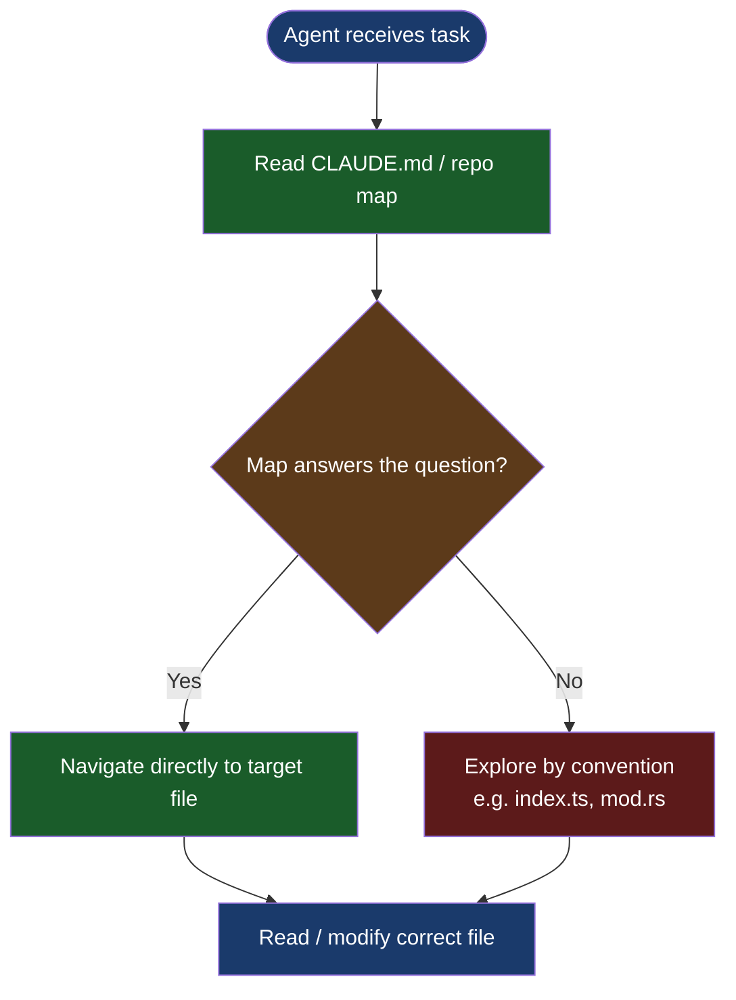

# F01 — Agent-Legible Repository

## Problem

When a repository is organized for human convention rather than machine navigation, agents waste significant context budget locating files, misidentify the purpose of directories, and make incorrect assumptions about where new code belongs. Without a predictable structure and an explicit map, agents explore by trial and error — reading wrong files, missing relevant ones, and building a flawed mental model of the codebase. Errors compound across multi-step tasks because each wrong assumption propagates to subsequent steps.

## Solution

Organize the repository so an agent can navigate it correctly on first contact: consistent naming conventions, self-describing directory names, explicit entry points, and a machine-readable map (e.g., CLAUDE.md) that states what lives where. The goal is that an agent — given only the map and a task — can locate the correct files without exploratory reads.

## Structure

<details>
<summary><b>Agent-Legible Repository Structure</b></summary>



</details>

**Key components:**

- **Repo map file** (CLAUDE.md or equivalent) — declares folder purposes, build targets, and naming conventions
- **Self-describing directories** — names that make purpose inferrable without reading contents (e.g., `service/`, `shared/`, `src/components/`)
- **Consistent entry points** — every module has a predictable entry file (`index.ts`, `mod.rs`, `__init__.py`)
- **Build/tag table** — maps directories to build commands so agents know what to run after editing

## Implementation

1. Audit directory names: rename any folder whose purpose is not obvious from its name alone (e.g., `misc/` → `scripts/`, `stuff/` → `fixtures/`).
2. Create or update a root-level `CLAUDE.md` (or `AGENTS.md`) with a table mapping each top-level directory to: its purpose, its primary language/framework, and which build/test command covers it.
3. Standardize entry point filenames per language across all modules (pick one: `index.ts` or `mod.ts`, not both).
4. Add a "What to Find Where" section to the repo map listing common task types (e.g., "to add a new API endpoint → `service/routes/`").
5. Remove or rename ambiguous files at the root level that agents commonly misidentify as entry points.
6. Validate by running a blind navigation test: give an agent only the map and ask it to locate 5 specific symbols without exploration — measure first-try accuracy.

## Signals (how to know it's working)

- Agent locates target files on the first read attempt (no exploratory misses logged)
- Agent places new files in the correct directory without being told
- Context usage for navigation drops compared to baseline (fewer reads before the first relevant file)
- New agents onboard to tasks without "where does X live?" queries

## Anti-Patterns

- **Map-less repo:** No CLAUDE.md or equivalent — agent falls back to `ls` loops and wastes context on irrelevant files.
- **Human-convention names:** Directories named after teams or history (`old-backend/`, `johns-stuff/`) rather than function — agent cannot infer purpose.
- **Inconsistent entry points:** Some modules use `index.ts`, others `main.ts`, others the module name — agent reads the wrong file first.
- **Stale map:** CLAUDE.md describes the old structure; actual layout diverged — agent trusts the map and navigates incorrectly.
- **Over-flat layout:** Everything at root level with no subdirectory grouping — agent has no structural signal to prioritize reads.

## Related Patterns

- [F02 — Repository-Local System of Record](F02-repository-local-system-of-record.md) — the map is also where the system of record lives
- [F06 — Structured Repository Instructions](F06-structured-repository-instructions.md) — the CLAUDE.md doubles as the instruction file
- [F05 — Agent-Accessible Tools](F05-agent-accessible-tools.md) — tools must be locatable the same way files are

## Examples

**CLAUDE.md directory table (representative):**

```
## Repo Structure

| Folder         | Purpose                          | Build command  |
|----------------|----------------------------------|----------------|
| service/       | Backend Node.js / Express        | /sl-build backend |
| shared/        | Shared types (frontend + backend)| /sl-build shared  |
| src/components/| SAPUI5 frontend production code  | /sl-build ui      |
| service/tests/ | Backend unit/integration tests   | /sl-build mocha   |
| cypress/       | E2E tests                        | cypress run       |
```

**Self-describing directory layout:**

```
my-service/
├── CLAUDE.md          ← machine-readable map
├── service/           ← backend (not "api/" or "server/")
│   ├── routes/        ← HTTP route handlers
│   ├── services/      ← business logic
│   ├── repositories/  ← data access
│   └── tests/         ← co-located tests
├── shared/            ← types shared across layers
└── src/               ← frontend
    └── components/    ← UI components
```

## Sources

- **OpenAI Engineering** — AI research company; authors of GPT and Codex; coined "harness engineering." [Harness Engineering: Leveraging Codex in an Agent-First World](https://openai.com/index/harness-engineering/)
- **OpenAI Engineering** — AI research company; authors of GPT and Codex; coined "harness engineering." [Unrolling the Codex Agent Loop](https://openai.com/index/unrolling-the-codex-agent-loop/)
- **Anthropic Engineering** — AI safety company; authors of Claude. [Building Effective Agents](https://www.anthropic.com/engineering/building-effective-agents)
