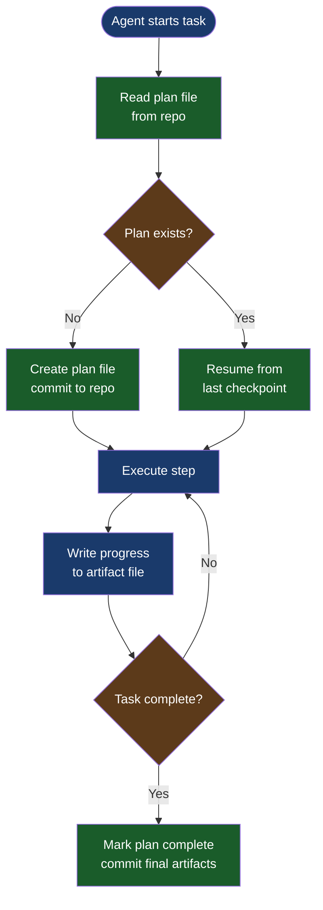

# F02 — Repository-Local System of Record

## Problem

When task state lives only in the agent's context window or in a chat transcript, it is lost the moment the session ends. A new session starts with no knowledge of what was decided, what was attempted, what succeeded, or where the task was interrupted. Agents repeat completed work, contradict prior decisions, and cannot resume mid-task without a full re-briefing that may itself be lossy or incomplete. Long-horizon tasks — spanning multiple sessions or multiple agents — become unreliable because there is no durable shared truth.

## Solution

Persist all task state as committed files inside the repository: plans, decisions, intermediate outputs, and progress markers. The repository itself becomes the system of record. Any agent — fresh or continuing — can reconstruct the full task state by reading these files, without relying on conversation memory. The rule is: if it matters beyond the current session, it must be in a file.

## Structure

<details>
<summary><b>Repository-Local System of Record</b></summary>



</details>

**Key components:**

- **Plan file** — structured document describing the task, phases, steps, and current status; committed to the repo
- **Decision log** — records why choices were made, not just what was done; prevents re-litigating settled questions
- **Progress markers** — checkboxes or status fields in the plan file that an agent updates as steps complete
- **Artifact directory** — a designated path (e.g., `~/claude-data/plans/`) where outputs accumulate across sessions
- **Session handoff note** — written at session end; tells the next session exactly where to resume

## Implementation

1. Designate a directory for task artifacts that is outside the protected config folder but inside version control or a known stable path (e.g., `~/claude-data/plans/<task-slug>/`).
2. Define a plan file template: context section, actors, phases with steps, checklist gates, and a "current status" field.
3. Require agents to write the plan file before executing any multi-step task; the plan must be committed before execution begins.
4. At each phase boundary, require the agent to update the plan file's status field and commit it.
5. Define a session-end protocol: agent writes a handoff note (last completed step, next step, open blockers) as the final action of every session.
6. Create a README at the artifact directory root that describes the naming convention and what each subdirectory contains.
7. Periodically archive or clean stale plan files (completed tasks older than N days) to prevent confusion from outdated artifacts.

## Signals (how to know it's working)

- A new agent session can identify exactly where a task left off by reading one file, with no re-briefing from the human
- Completed tasks leave a readable trail of decisions and outputs in the artifact directory
- Agents do not repeat steps already marked complete in the plan file
- When a task is interrupted (crash, timeout, context limit), recovery time is under 2 minutes

## Anti-Patterns

- **Context-only state:** Plan lives only in the system prompt or chat history — lost on session end, inaccessible to other agents.
- **Implicit progress:** Agent tracks progress mentally ("I just finished step 3") without writing it anywhere — next session has no signal.
- **Uncommitted artifacts:** Plan file is created but never committed — disappears if the working directory is reset or the worktree is removed.
- **Monolithic plan file:** Single massive document updated in place with no history — hard to diff, hard to audit, easy to corrupt.
- **Over-granular artifacts:** Every intermediate thought written to disk — artifact directory becomes noisy, navigation cost exceeds the benefit.

## Related Patterns

- [F01 — Agent-Legible Repository](F01-agent-legible-repository.md) — the artifact directory needs to be findable via the repo map
- [F09 — Persistent Task Artifacts](F09-persistent-task-artifacts.md) — artifacts from F02 are a subset of the broader persistence pattern
- [F06 — Structured Repository Instructions](F06-structured-repository-instructions.md) — instructions should tell agents where the system of record lives

## Examples

**Plan file structure (pseudocode template):**

```
# Task: <slug>
Context: <why this task exists>
Status: IN PROGRESS | BLOCKED | COMPLETE
Last updated: <date>

## Actors
- Sharon: approves gates
- Agent: executes steps

## Phase 1: <name>
- [x] Step 1.1: <done>
- [x] Step 1.2: <done>
- [ ] Step 1.3: <next>

[checklist-gate: Phase 1 → Phase 2]
- [x] Build passes
- [ ] Tests pass  ← BLOCKED: test infra down

## Open Blockers
- Test infrastructure unavailable; resume when fixed
```

**Artifact directory layout:**

```
~/claude-data/plans/
├── README.md                        ← naming convention, structure
├── feature-x/
│   ├── plan.md                      ← the system of record
│   ├── decisions.md                 ← why choices were made
│   └── outputs/                     ← intermediate artifacts
└── bug-fix-y/
    └── plan.md
```

## Sources

- **OpenAI Engineering** — AI research company; authors of GPT and Codex; coined "harness engineering." [Harness Engineering: Leveraging Codex in an Agent-First World](https://openai.com/index/harness-engineering/)
- **OpenAI Engineering** — AI research company; authors of GPT and Codex; coined "harness engineering." [Unrolling the Codex Agent Loop](https://openai.com/index/unrolling-the-codex-agent-loop/)
- **Anthropic Engineering** — AI safety company; authors of Claude. [Building Effective Agents](https://www.anthropic.com/engineering/building-effective-agents)
